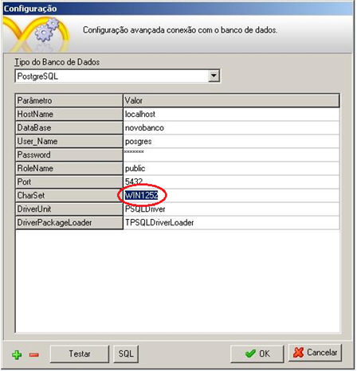
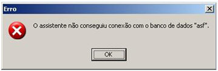

A versão 8.3 do PostgreSQL está em fase de homologação, porém, fazendo os procedimentos abaixo, é possível utilizá-lo para o desenvolvimento de aplicações utilizando o Maker.

A versão 8.3 do Postgres não utiliza mais o CharSet Latin1, devido esta mudança, não é possível criar banco de dados utilizando o assistente de criação de projetos. Para isso, é necessário que o banco seja criado previamente em um utilitário (PgAdmin). E no Maker, no momento de criação de projetos, ir até Configurações Avançadas e modificar o parâmetro CharSet de Latin1 para Win1252, como demonstram as figuras abaixo:

Erro  "o assistente não conseguiu criar o novo banco de dados"  ocorre porque o Charset Latin1 não está disponível nesta versão do Postgres.

      Erro: O assistente não conseguiu criar o novo banco de dados.

Erro "operator does not exist: integer = character varying". Este erro é apresentado, porque a partir da versão 8.3 do PostgreSQL, o cast de tipos de dados não-caracteres não são mais convertidos automaticamente para TEXT, dessa forma o banco tenta igualar tipos de dados incompatíveis. Para resolver o problema, o valor do parâmetro deve vir acompanhado do tipo de dados que se deseja igualar. Ex. campo=55@long;

Erro: operator does not exist: integer = character varying.
