Neste tutorial iremos descrever a criação e funcionalidade de uma trigger criada no Maker, mas antes disso, temos que ter em mente a ideia do que é uma trigger e seus usos.

**O que é?**

Uma Trigger é um bloco de comandos SQL que é automaticamente executado quando um comando INSERT, DELETE ou UPDATE é executado em uma tabela do banco de dados.

**Por que são utilizadas?**

As triggers são usadas para impor e manter a integridade referencial de baixo nível, o objetivo da mesma não é retornar resultados de consultas. A principal vantagem é que com a trigger podemos possuir lógica de processamento complexa.

As triggers podem ser utilizadas para atualizações e exclusões em cascata através de tabelas relacionadas em um banco de dados, definir mensagens de erro personalizadas, manter dados desnormalizados e fazer comparações de transações no banco de dados.

**Partindo para a ideia e criando a trigger**

Agora que já sabemos o que é uma trigger e onde utilizá-las, pensaremos no seguinte caso. Ao inserir ou excluir dados de uma determinada tabela, a trigger guardará em uma tabela de log as informações destas ações. Pronto, com a ideia em mente, partiremos para a parte prática, mão a obra!

**Criando a trigger no Maker**

Com base nas informações acima, nosso fluxo ficará da seguinte forma:

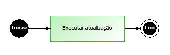

Adicione um objeto Processamento e no montador de expressão selecione a função Executar Atualização:

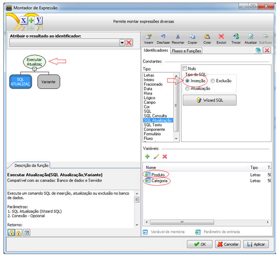

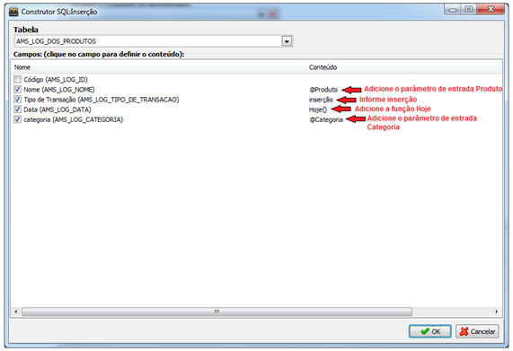

Salve o fluxo na camada Banco de dados.

Selecione o formulário, onde será adicionado a trigger, neste caso o formulário de cadastro de produtos e clique em definições.

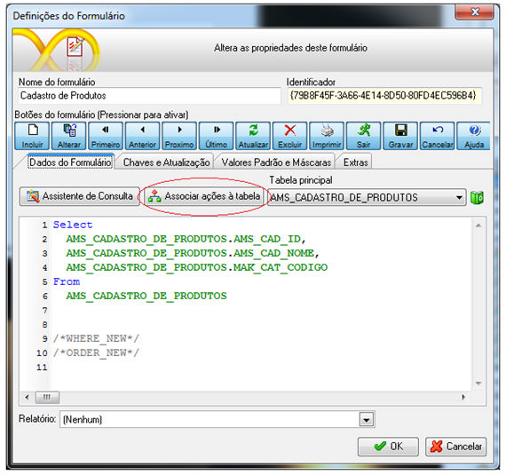

Clique sobre o botão Associar ações à tabela, abrirá uma tela onde serão exibidos todos os fluxos da camada banco de dados.

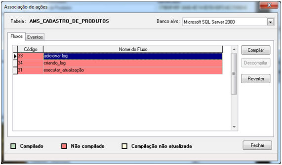

Clique sobre o fluxo que será utilizado, neste exemplo o "adicionar log" e clique sobre o botão compilar. Será gerado o script no banco de dados:

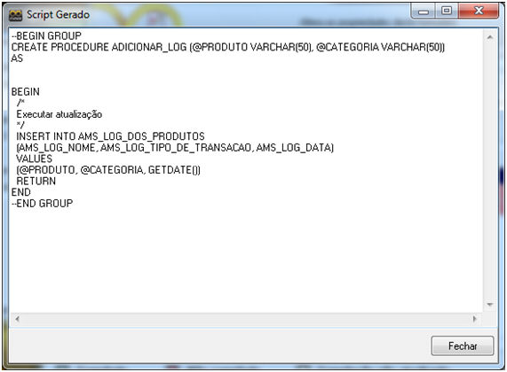

Em seguida, feche a tela e clique sobre a aba Eventos, localize o evento que disparará a trigger.

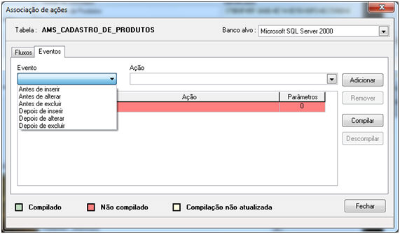

Como queremos criar um log para produtos inseridos, seleiconaremos o evento Depois de Inserir.

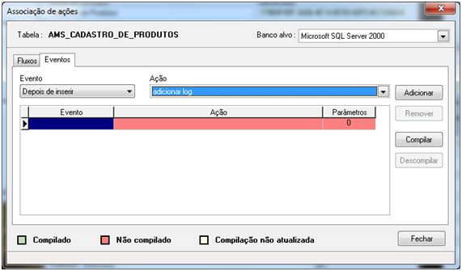

Informe a regra utilizada e clique sobre o botão Adicionar.

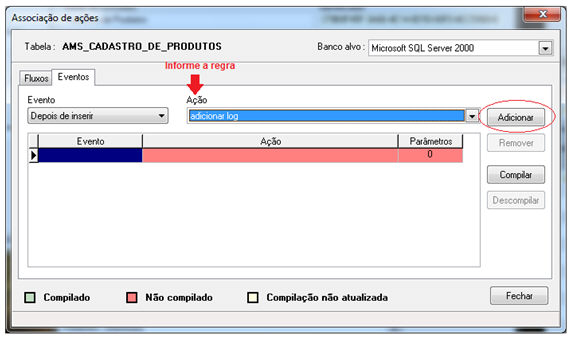

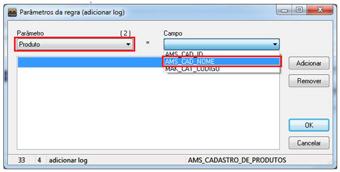

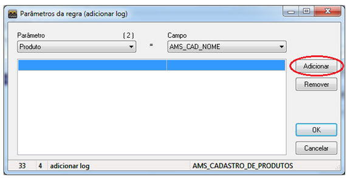

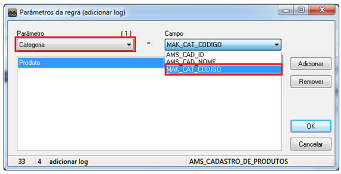

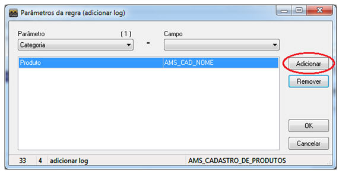

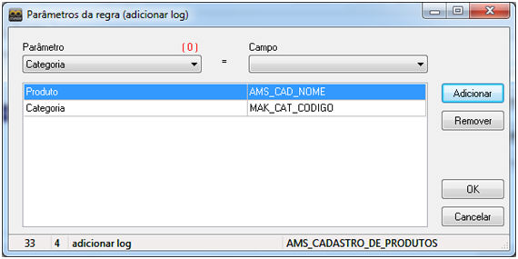

Associado os parâmetros aos campos, clique sobre o botão OK e em seguida  sobre o botão compilar.

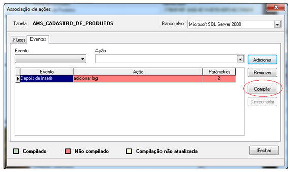

Observe que a trigger foi criada.

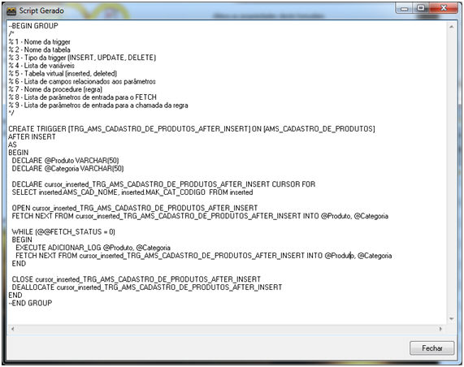

Fecha a tela de Associação de ações, salve o formulário , execute-o no Webrun, insira um novo registro e observe que a trigger foi disparada criando um log do evento na tabela.

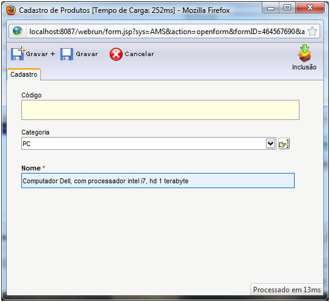

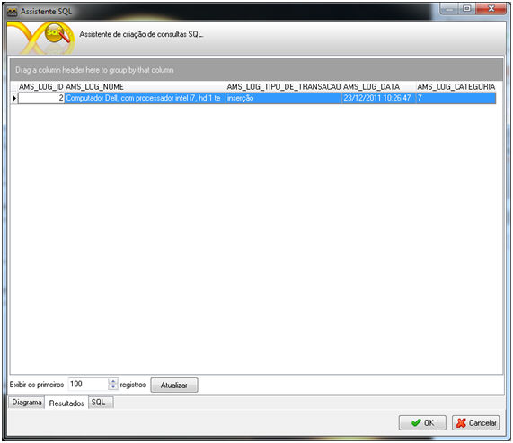
