O exemplo a seguir, demonstrará de forma prática ocomo criar uma árvore a partir de um diretório.

Primeiramente, será criado um formulário com as seguintes características.

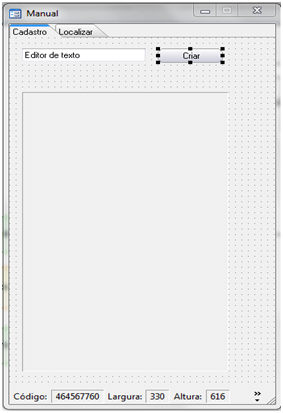

O formulário não possui fonte de dados e a propriedade Navegação está  definida como Não. Criado o formulário, partimemos para o fluxo associado ao botão Criar, que ficará da seguinte forma:

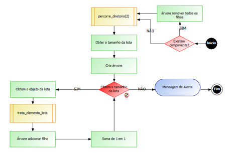

1. Informe o seguinte parâmetro de entrada:

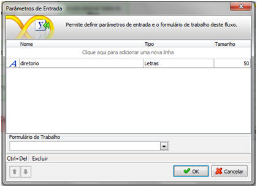

2. Informe os seguintes Identificadores (variáveis):

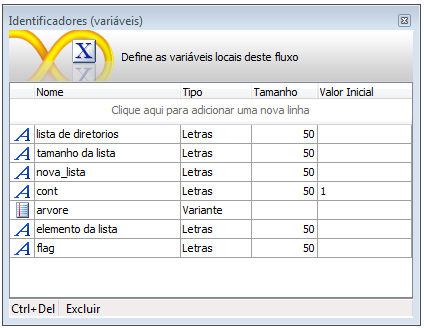

3. Selecione um objeto Decisão e no Montador de Expressão  selecione a função Existe componente?

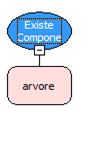

4. Selecione um objeto Processamento ligada a opção SIM da Decisão e no Montador de Expressão  selecione a função Árvore-Remover Filhos, utilizando como primeiro parâmetro a função Obter componente passando o nome do componente árvore e no segundo parâmetro da função principal – Árvore – Obter raiz da Árvore, que tem o parâmetro a função Obter componente com o nome da árvore.

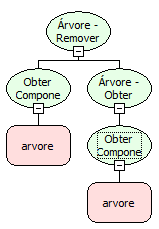

4. Crie um novo fluxo para ser usado como SubFluxo, que ficará da seguinte maneira:

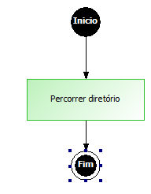

1. Informe o seguinte parâmetro de entrada:

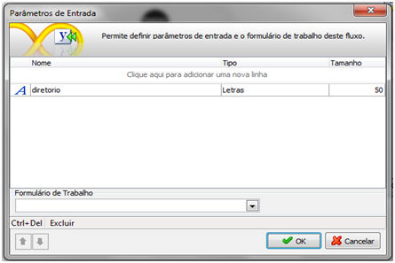

2.Informe o seguinte Identificador (variável):

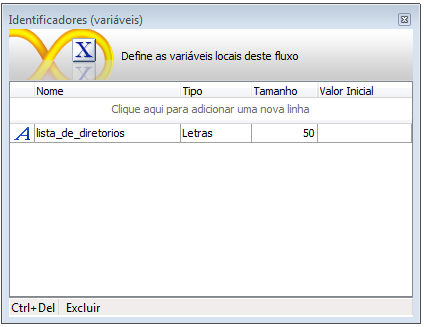

3. Selecione um objeto Processamento e no Montador de Expressão  selecione a função Percorrer diretório e atribua o resultado da função ao identificador lista_de_diretorios.

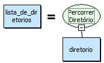

4. Atribua  a variável lista_de_diretorios ao valor de retorno , como mostra a figura e salve o fluxo.

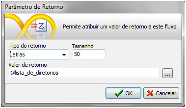

5.Voltando ao fluxo principal insira um objeto Subfluxo, selecione o fluxo que acabou de criar e selecione as variáveis como mostra a figura:

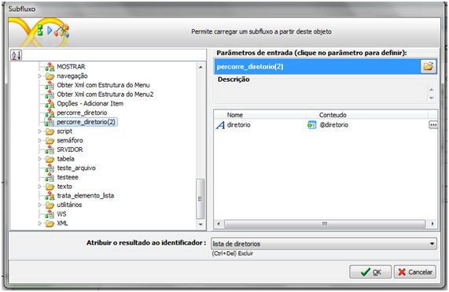

Esse fluxo terá duas entradas, o processamento que criamos com a função Árvore – Remover filhos e a opção NÃO do objeto Decisão.

5. Selecione um objeto Processamento e no Montador de Expressão  selecione a função Tamanho da Lista , passando como parâmetro a variável retorno do subfluxo  e atribua o resultado ao identificador tamanho da lista.

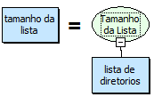

6. Selecione um objeto Processamento e no Montador de Expressão selecione a função Árvore – Criar Árvore, passando os  parâmetros que mostram na figura e atribuindo o resultado no identificador arvore.

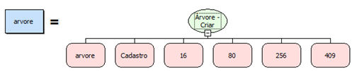

7. Selecione um obtejo Decisão e no Montador de Expressão utilize a função  Menor ou Igual, passando como parâmetros a variável cont e tamanho da lista .

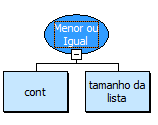

8. Selecione um objeto Interação, ligada a opção NÃO da Decisão criada anteriormente. Selecione a função Mensagem de Alerta , de acordo com a figura e depois ligue ao objeto Fim.

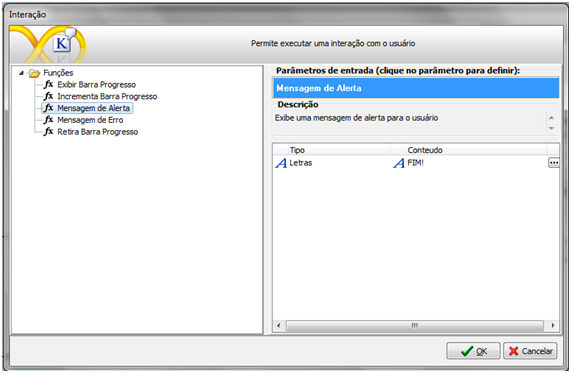

9. Selecione um objeto Processamento, ligada a opção SIM da Decisão criada anteriormente. Selecione a fução Obter Objeto da Lista e como parâmetros da mesma, utilize a variavel lista de diretorios e cont e atribua o resultado a variável elemento da lista, como mostra na figura:

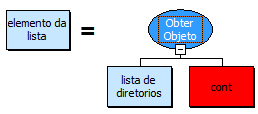

10. Crie um novo fluxo para ser usado como SubFluxo, que ficará da seguinte maneira:

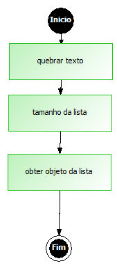

1. Informe o seguinte parâmetro de entrada:

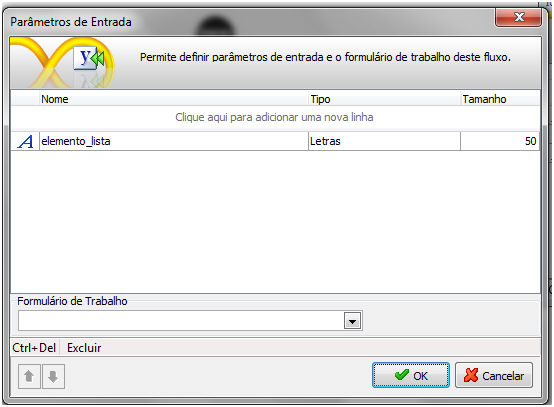

2. Informe o seguinte Identificador (variável):

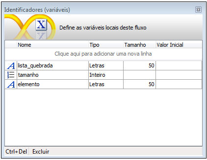

3. Selecione um objeto Processamento e no Montador de Expressão e selecione a função Quebrar Texto, passando como parâmetros a variável elemento_lista  e '\' e atribua o resultado da função ao identificador lista_quebrada.

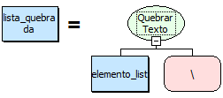

4. Selecione um objeto Processamento e no Montador de Expressão  selecione a função Tamanho da Lista, passando como parâmetro a variável lista_quebrada  e atribua o resultado da função ao identificador tamanho.

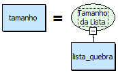

5. Selecione um objeto Processamento e no Montador de Expressão  selecione a função Obter objeto da lista, passando como parâmetros as variáveis lista_quebrada  e tamanho e atribua o resultado da função ao identificador elemento.

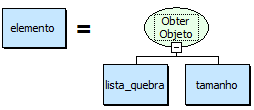

6.  Atribua  a variável elemento  ao valor de retorno , como mostra a figura e salve o fluxo.

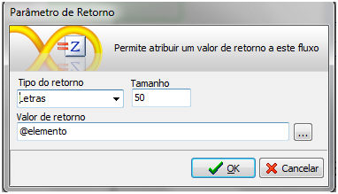

7. Voltando ao fluxo principal insira um objeto Subfluxo, selecione o fluxo que acabou de criar e selecione as variáveis como mostra a figura:

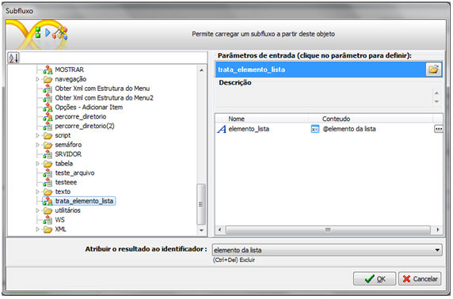

11. Selecione um objeto Processamento e no Montador de Expressão  selecione a função Árvore – Adicionar Filho, passando como parâmetros: 1- Função Obter Componente, com o nome do componente Árvore; 2- Função Árvore – Obter Raiz da Árvore, com a função Obter componente com o nome do componente Árvore; 3- variável elemento da lista.

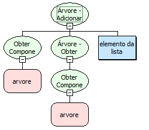

12. Selecione um objeto Processamento e no Montador de Expressão selecione a função Soma, com os parâmetros, variável cont e 1. Atribuindo o resultado da expressão na variável cont e fazendo ligação ao último objeto  Decisão criado, assim fechando o laço.

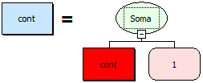

Salve o fluxo na camada Cliente e associe-o ao componente Botão do formulário.

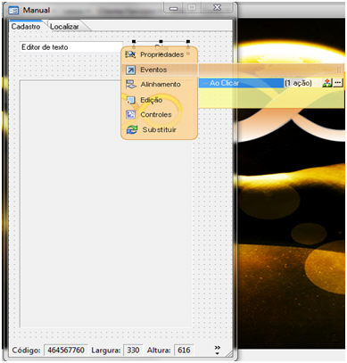

Salve o formulário e execute-o no Webrun .

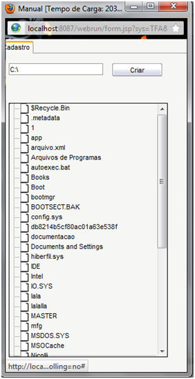
