Um determinado fluxo de ações executará um processamento no sistema que poderá alterar dados, apenas exibir dados, ou mesmo executar uma tarefa com objetos de formulários ou relatórios.

A execução da ação que o fluxo irá processar sempre será atribuída a um objeto.

Para criar um fluxo siga os passos:

1. Na tela do Maker, clique no botão 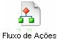;
2. A seguinte tela será exibida;

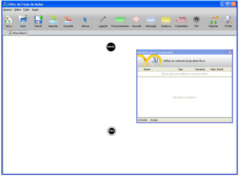

Figura 1 - Tela de Trabalho do Fluxo de Ações

- Antes de desenvolver um Fluxo de Ações, responda a uma pergunta: você já está familiarizado com os [Objetos da Tela do Fluxo de Ações](../../maker_2/fluxos_e_acoes/os_objetos_da_tela_do_fluxo_de_acoes) e com a tela Identificadores (variáveis)? Caso "Sim", então siga os passos;
- Um Fluxograma desenhará todo o processamento por meio de figuras geométricos interligados, em que cada uma possuirá uma função predefinida por características e propriedades particulares. Cada objeto do fluxo representará uma etapa no processamento da regra projetada. Observe na Figura 1 que um fluxo inicialmente possui os elementos:
- - Início, obrigatório em todas as regras iniciando o fluxo. Neste objeto podemos definir os Parâmetros de Entrada e definir o Formulário de Entrada;
  - Fim, obrigatório em todas as regras, finalizando o fluxo. Neste objeto podemos definir os Parâmetros de Saída;
  - Identificadores (variáveis), permite criar variáveis que serão utilizadas no decorrer do fluxo em uso;
  - Barra de Ferramentas - esta barra é composta por ferramentas que serão utilizadas na montagem do Fluxo. Verifique no item [Os objetos da tela do Fluxo de Ações](../../maker_2/fluxos_e_acoes/os_objetos_da_tela_do_fluxo_de_acoes) detalhamentos sobre cada elemento.

Observe, no exemplo abaixo, a criação de um fluxo, que irá criar um código para um campo do formulário da tela:

1. Em primeiro lugar analise a situação:
2. Numa determinada base de dados foi criada a seguinte tabela:

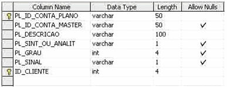

Figura 2 - TABELA PLANO DE CONTAS

- A grade abaixo mostra uma sequência de registros compostos por contas e subcontas. Seguindo a hierarquia das contas, temos o grau que aumenta à medida que cria uma subconta:

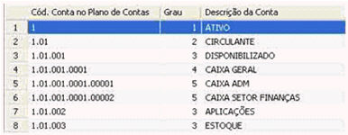

- O exemplo proposto irá gerar o GRAU da conta automaticamente, após informar qual será a conta superior. Observe, na imagem abaixo, que a conta DISPONIBILIZADO possui GRAU Três, pois é uma conta inferior à conta CIRCULANTE.

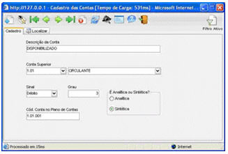

Figura 4 - Tela Cadastro das Contas

- No Editor de Fluxo de Ações, crie os Identificadores (variáveis) para armazenar temporariamente informações que serão utilizadas no decorrer da regra. Neste caso serão utilizadas quatro variáveis, que possuirão as mesmas características dos campos do banco de dados:

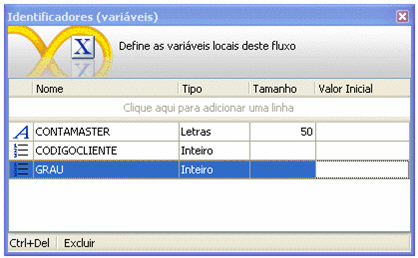

Figura 5 - Criando as Variáveis que serão utilizadas no Fluxo de Ações

- No objeto Início, execute um clique duplo para que seja apresentada a janela Parâmetros de Entrada, pois, nesta, iremos criar a regra associada a um formulário. Quando você associa a um formulário, os descritivos dos campos correspondentes se apresentarão disponíveis. Caso deseje mais informações sobre a tela, acesse Parâmetros de Entrada.

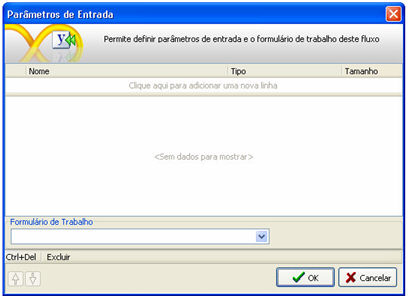

Figura 6 - Configurando o objeto Início, Parâmetro de Entrada.

- Agora insira um objeto Processamento na área de criação do fluxo. Ao inserir o objeto [Processamento](../../maker_2/fluxos_e_acoes/objeto_processamento), ocorre a conexão automática com o objeto logo anterior a ele. Clique sobre ele com o botão da direita do mouse e selecione o comando Alterar Descrição para escrever um breve comentário que irá ajudar a identificar a ação que o objeto vai executar. Clique no botão Ok para fechar a tela Propriedades.

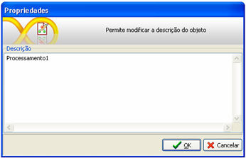

Figura 7 - Editando um comentário no objeto Processamento

- Agora execute um clique duplo sobre o objeto [Processamento](../../maker_2/fluxos_e_acoes/objeto_processamento) para definir a ação do objeto no Montador de Expressões. Esta etapa armazenará, temporariamente, na variável CONTA MASTER, o código da conta superior. O campo que possui o valor do código da conta superior chama-se PL_ID_CONTA_MASTER. Para obter a informação do campo, é necessário utilizar a função OBTER CAMPO da categoria FORMULÁRIO e, já que a função OBTER CAMPO retorna como resposta uma variante, deveremos converter o resultado em letras. Para isso utilizaremos a função PARA LETRAS da categoria CONVERSÃO (deveremos converter, pois a variável CONTA MASTER é do tipo LETRAS). Já que a tecnologia de fluxo trabalha de baixo para cima, observe, nas imagens a seguir, esta estruturação:

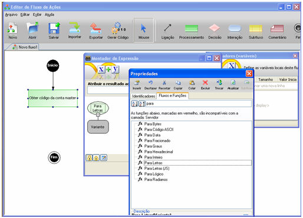

Figura 8 - Definindo a ação do objeto

- A Figura 8 apresenta a seleção da função Para Letras da Categoria Conversão.

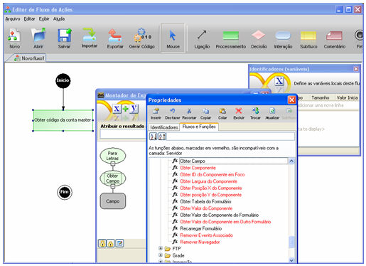

Figura 9 - Definindo a ação do objeto

- A Figura 9 apresenta a seleção da função Obter Campo da categoria Formulário.

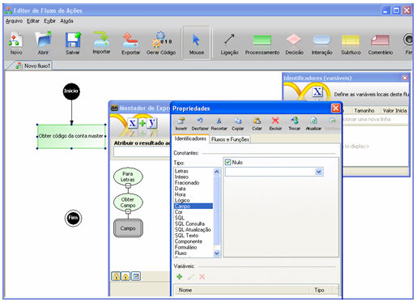

Figura 10 - Definindo a ação do objeto

- A Figura 10 apresenta a definição do campo PL_ID_CONTA_MASTER, um objeto constante que utiliza um tipo Campo para capturar a informação da tela que corresponde ao código da conta superior. Abaixo, no campo Atribuir Para, define-se o nome da variável que armazenará este resultado temporariamente, no caso CONTA MASTER.

- Para confirmar, clique no botão Ok.

- Para facilitar a visualização de expressões dos objetos no fluxo:
- Para executar a operação, o usuário passa com o mouse e o maker disponibilizará a imagem. Caso deseje carregar o objeto pelo hint, basta posicionar no objeto escolhido, como mostra a imagem.

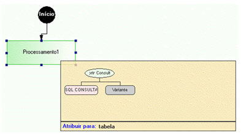

- Agora insira um outro objeto Processamento na área de criação.do fluxo. Ao inserir o objeto, ocorre a conexão automática com o objeto logo anterior a ele. Clique sobre ele com o botão da direita do mouse e selecione o comando Propriedades para escrever um breve comentário que irá ajudar a identificar a ação que o objeto vai executar. Clique no botão Ok para fechar a tela Propriedades. Caso deseje mais informações, acesse o tópico Processamento.

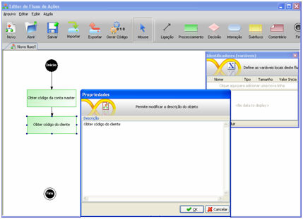

Figura 11 - Definindo a ação do objeto

- Agora execute um clique duplo sobre o objeto para definir a ação do objeto no Montador de Expressões. Esta etapa armazenará, temporariamente, na variável CÓDIGO CLIENTE, o código da conta que estará sendo incluída. O campo que possui o valor do código da conta chama-se ID_CLIENTE. Para obter a informação do campo é necessário utilizar a função OBTER CAMPO da categoria FORMULÁRIO e, já que a função OBTER CAMPO retorna como resposta uma variante, deveremos converter o resultado em inteiro. Para isso utilizaremos a função PARA INTEIRO da categoria CONVERSÃO (deveremos converter, pois a variável CÓDIGO CLIENTE é do tipo INTEIRO). Já que a tecnologia de fluxo trabalha de baixo para cima, observe, nas imagens a seguir, esta estruturação:

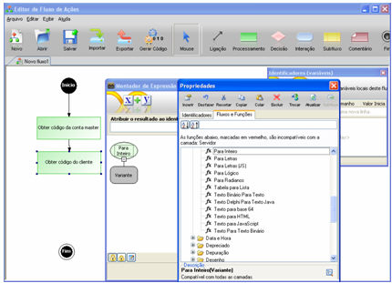

Figura 12 - Definindo a ação do objeto

- A Figura 12 apresenta a seleção da função Para Inteiro da Categoria Conversão.

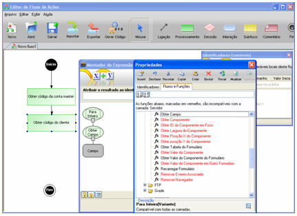

Figura 13 - Definindo a ação do objeto

- A Figura 13 apresenta a seleção da função Obter Campo da categoria Formulário.

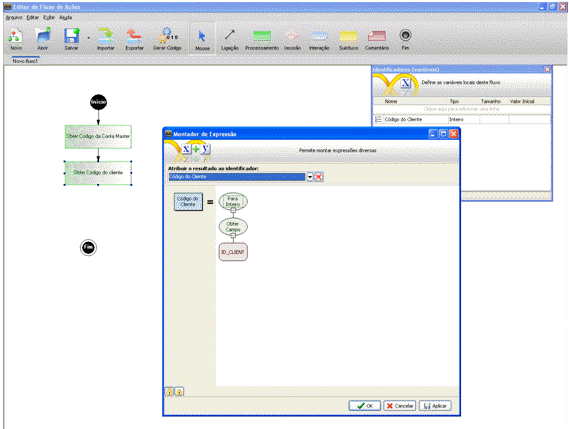

Figura 14 - Definindo a ação do objeto

- A Figura 14 apresenta a definição do campo ID_CLIENTE, um objeto constante que utiliza um tipo Campo para capturar a informação da tela que corresponde ao código da conta. Abaixo, no campo Atribuir Para, define-se o nome da variável que armazenará este resultado temporariamente, no caso CODIGO CLIENTE;
- Para confirmar, clique no botão Ok;

- Agora insira um objeto [Decisão](../../maker_2/fluxos_e_acoes/objeto_decisao) na área de criação do fluxo. Ao inserir o objeto, ocorre a conexão automática com o objeto logo anterior a ele. Clique sobre ele com o botão da direita do mouse e selecione o comando Propriedades para escrever um breve comentário que irá ajudar a identificar a ação que o objeto vai executar. Clique no botão Ok para fechar a tela Propriedades. Caso deseje mais informações, acesse o tópico [Decisão](../../maker_2/fluxos_e_acoes/objeto_decisao).

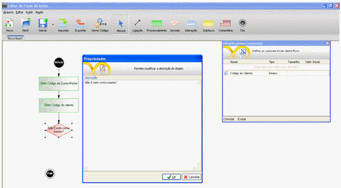

Figura 15 - Definindo a ação do objeto

- Agora execute um clique duplo sobre o objeto para definir a ação no [Montador de Expressões](../../maker_2/fluxos_e_acoes/montador_de_expressoes). Esta etapa analisará se a conta que está sendo criada possui ou não uma conta superior e se existem contas superiores no mesmo nível. Essa rotina irá conduzir o processamento para que seja criado outro número de conta superior. Será utilizada a variável CONTA MASTER, onde anteriormente armazenamos o conteúdo da conta superior, se existir:

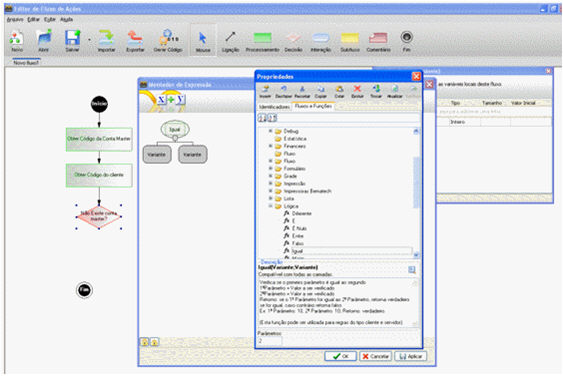

Figura 16 - Definindo a ação do objeto

- A Figura 16 apresenta a seleção da função Igual da Categoria Lógica.

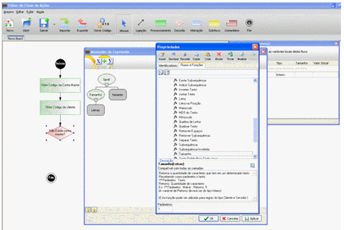

Figura 17 - Definindo a ação do objeto

- A Figura 17 apresenta a seleção da função Tamanho da Categoria Texto.

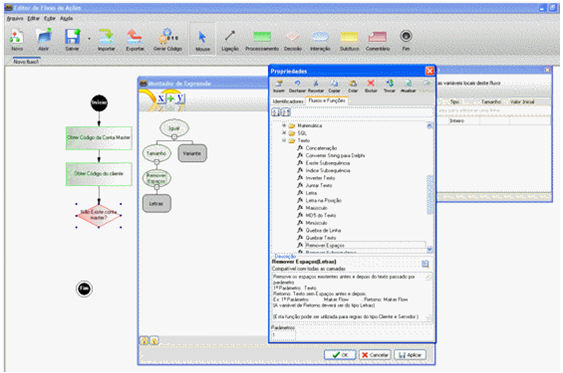

Figura 18 - Definindo a ação do objeto

- A Figura 18 apresenta a seleção da função Remover Espaços da Categoria Texto.

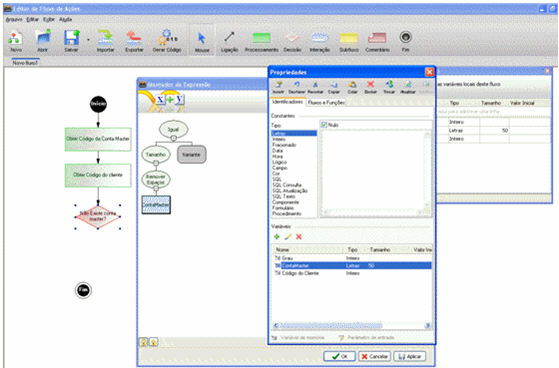

Figura 19 - Definindo a ação do objeto

- A Figura 19 apresenta a seleção da variável CONTA MASTER.

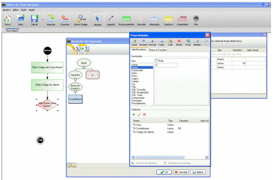

Figura 20 - Definindo a ação do objeto

- A Figura 20 apresenta a definição do valor fixo 0 (zero). Com isso conclui a decisão. Agora o fluxo poderá correr por dois caminhos: caso tenha ou caso não tenha conta superior;

- Para confirmar, clique no botão Ok.

Criando um Fluxo - este vídeo demonstra os passos para a criação de um fluxo e sua aplicação no formulário.
