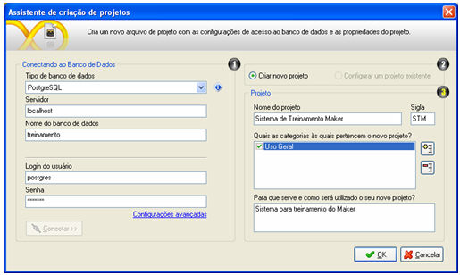
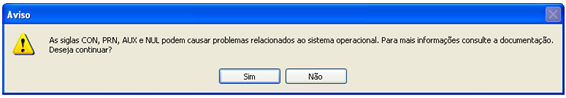

Após acessar o Maker, clique no botão Novo para a criação de um novo projeto.

Observe as opções da tela:

- Tipo de banco de dados - selecione entre as opções: Firebird 1.5 / Interbase, Oracle 9i ou Oracle 10g, Microsoft SQLServer, PostgreSQL 8.2.5, MySQL. Caso seja escolhida a opção Firebird 1.5 / Interbase, ao abrir a janela para apontar a localização do banco de dados, só serão listados bancos de dados com a extensão FDB. Neste caso, o recomendado é que o usuário informe o caminho do banco de dados manualmente no campo Nome do banco de dados.
- Dependendo do tipo de banco de dados selecionado, informe no campo Servidor a máquina em que estará localizado o seu banco de dados;
- Informe o Nome do banco de dados, que será criado ou utilizado. O endereço e nomenclatura a ser utilizada dependerão do tipo;
- Informe o Login do usuário e a Senha para o acesso ao banco de dados;
- Com a finalidade de checar as configurações da conexão do projeto ou edição da base de dados, utilize a opção Configurações avançadas. Este ponto do sistema exige um conhecimento dos drivers no SGBD que deseja utilizar, para configurar os parâmetros de conexão. Complementando este tópico, saiba mais, acessando o tópico Informações adicionais da estrutura do Maker;
- Para efetivar a conexão com o banco de dados, utilize o botão  ou, antes disso,
- Caso o banco de dados não exista, o Maker solicita a confirmação da criação.Se o banco for de uma versão anterior, o Maker  solicitará a confirmação da atualização.

Após identificar dados sobre o acesso ao banco de dados, informe:

- Criar novo projeto - permite gerar um novo projeto numa base de dados existente ou numa nova base;
- Configurar um projeto existente - esta opção estará disponível apenas quando for utilizada uma base que possui projetos que possam ser aproveitados para fins de atualização.

Na área Projeto, temos as opções:

- Defina o Nome do Projeto;
- Defina uma Sigla composta por três letras;
- No campo Quais as categorias às quais pertencem o projeto? - selecione as opções de categorias a fim de que seja identificado o ramo, atividade ou negócio a que se aplica. Utilize o botão  Adicionar Categoria para criar e associar novas opções. É possível também a exclusão com a opção  Excluir Categoria;
- No campo Para que serve e como será utilizado o seu novo projeto?, faça uma descrição breve sobre a aplicação e objetivo do projeto que será criado ou utilizado.

Finalizando:

- Clique no botão OK.

Na próxima tela, deve-se definir o nome do projeto. Este arquivo de extensão *.WFRE é também utilizado pelo WebRun para acessar o sistema por meio do navegador. Este será criado na pasta ...\Softwell Solutions\Maker 2\Webrun 2\systems do seu diretório de instalação do Maker.

Após definir o nome do projeto, clique no botão Salvar.

Observações:

1. Ao tentar criar um novo sistema com as siglas CON, AUX, PRN e NULL o Maker exibirá uma mensagem, informando que o sistema operacional pode estar utilizando tais siglas, como demonstra a figura abaixo:

1. Lembrete: a Softwell Solutions não recomenda a criação de sistemas com estas siglas, por ser palavras reservadas do sistema operacional.

2. As funções disponíveis para o [Editor de Fluxo de Ações](../../maker_2/fluxos_e_acoes/editor_de_fluxo_de_acoes) sempre aparecerão na linguagem de acordo com o idioma escolhido quando o Maker foi acessado;
3. A [API de funções](../../maker_2/api_de_funcoes) será atualizada nos novos bancos de dados a cada atualização do Maker, logo após acessar um projeto do banco de dados.

Criação do Sistema - Este vídeo demonstra a criação de um novo projeto utilizando assistente.
