Este exemplo irá descrever como transportar dados (registros) de um arquivo-texto para uma tabela existente no banco de dados.

Os dados (registros) do arquivo deverão estar separados por ponto e vírgula (;).

Para este exemplo, foi criada uma tabela Funcionário contendo os campos: Código e Funcionário.

Utilizando o Assistente de criação de formulários, defina o nome para o formulário e não defina Fonte de Dados:

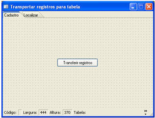

O formulário criado conterá um fluxo. Para facilitar o entendimento, o fluxo ficará da seguinte forma:

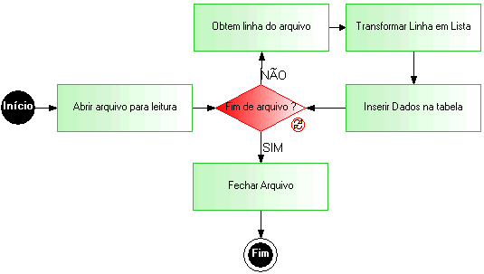

Criando um Novo Fluxo, salve com o Destino Servidor. Defina os Identificadores:

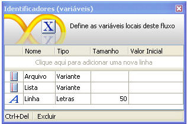

Coloque um 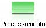 para abrir o arquivo que contém os dados. No Montador de Expressão, na aba Fluxos e Funções, localize a função Abrir arquivo para leitura:

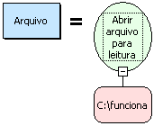

Coloque uma  para verificar se é fim de arquivo. No Montador de Expressão, na aba Fluxos e Funções, localize a função Fim do Arquivo:

Coloque um  para obter as linhas do arquivo. No Montador de Expressão, na aba Fluxos e Funções, localize a função Ler linha do arquivo:

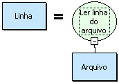

Coloque um  para obter as linhas do arquivo. No Montador de Expressão, na aba Fluxos e Funções, localize a função Separar Texto:

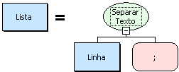

Coloque um  para inserir dados na tabela. No Montador de Expressão, na aba Fluxos e Funções, localize a função Executar Atualização:

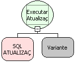

Na SQL ATUALIZAÇÃO, clique em . Abrirá a tela Construtor SQL: Inserção. Localize a tabela FUNCIONARIO:

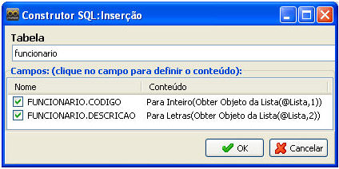

Na tela acima, observe que é necessário selecionar os campos. Abrirá a tela Montador de Expressão.

Para FUNCIONARIO.CODIGO:

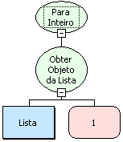

Para FUNCIONARIO.DESCRICAO:

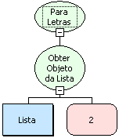

Coloque um  para fechar o arquivo. No Montador de Expressão, na aba Fluxos e Funções, localize a função Fechar arquivo:

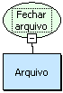

Associando fluxo a Eventos: Associe este fluxo ao formulário criado, aplicando ao componente Botão e ao Evento "Ao Clicar".

Exportando dados para Tabela - este vídeo exemplifica a utilização de fluxos para a importação de dados de arquivo texto para o banco.
