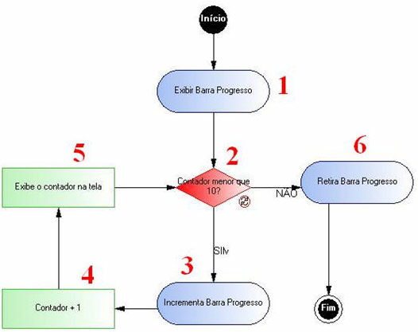
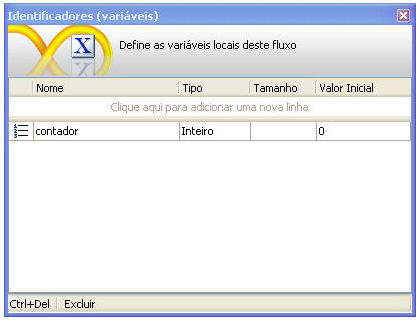
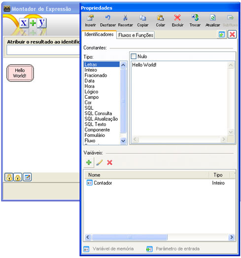
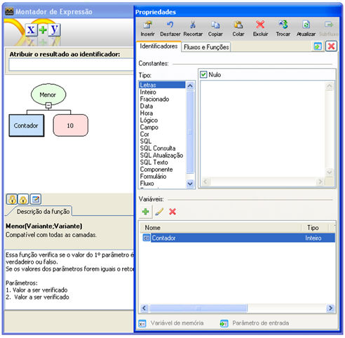
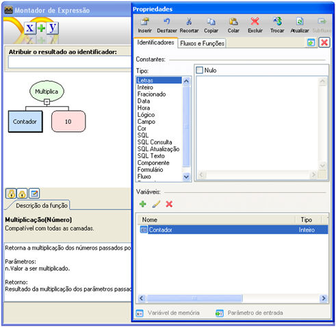
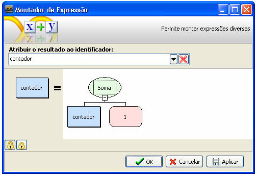
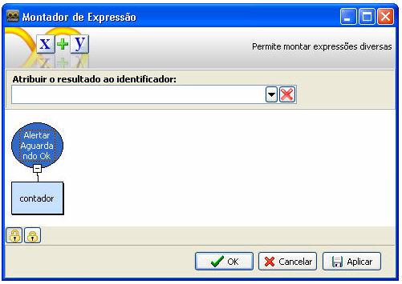
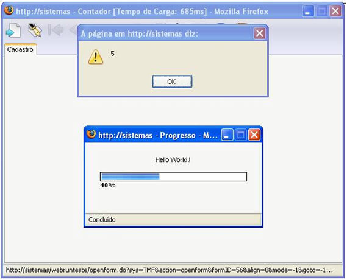

A barra de progresso é utilizada para que aja um acompanhamento do que ocorre durante a execução do fluxo, quando se sabe que levará alguns momentos para processar uma determinada tarefa. Um bom exemplo da utilização deste recurso é:

- Um contador que começa com o valor zero e que terá o seu valor incrementado de um;
- Fazendo um *Loop* no qual a condição de saída será que o valor do contador seja maior que dez, será exibida uma barra de progresso que terá seu valor aumentado de 10% a cada incremento que o contador sofrer.

Observe imagem do fluxo que exemplificaremos:

Siga os passos abaixo e crie um fluxo que apresentará uma Barra de Progresso:

1. Crie um Identificador (variável) com o nome contador, do tipo Inteiro;

2. Insira, na área de edição de fluxo, um objeto Interação **(1)**;
3. Clique duplo para editar o objeto;
4. A tela do objeto Interação, está composta pela lista de funções (à esquerda) e os parâmetros da função selecionada (à direita). Selecione a função Exibir Barra Progresso e:

   1. Clique na linha de parâmetro da função;
   2. Na tela Montador de Expressões, clique sobre o objeto retângulo e defina Constante do tipo Letras onde o conteúdo será "Hello World !!!" (mensagem que será exibida dentro da caixa de diálogo da barra de progresso).

3. Confirme com o botão Ok do Montador de Expressões e outro Ok da tela do objeto Interação;
4. Documente o objeto como mostra a figura acima;
5. Insira um objeto Decisão (2) (esse objeto criará o contador);
6. Clique duplo para editar o objeto:

5. Na tela Montador de Expressões, clique sobre o objeto retângulo e defina as Propriedades:

   - Na aba Fluxos e Funções, localize a função Menor;
   - Clique no primeiro parâmetro da função, e clique na aba Identificadores, associe a variável contador (desta forma está passando o valor da variável que se chama contador para o primeiro parâmetro da função Menor);

   

6. Clique no segundo parâmetro da função e clique na aba Identificadores. Associe uma Constante do tipo Inteiro, cujo valor é 10 (dessa forma, está passando o valor 10 para ser analisado com a variável contador para o segundo parâmetro da função Menor);

   

7. Clique no botão Ok para sair da expressão do objeto Decisão;
8. Documente o objeto como mostra a figura acima;
9. Insira na área de edição de fluxo, um objeto Interação (3);
10. Clique duplo para editar o objeto;
11. Na tela do objeto Interação, selecione a função Incrementar Barra Progresso e defina os parâmetros:
12. Na tela Montador de Expressões, clique sobre o objeto retângulo e defina as Propriedades:

1. Na aba Fluxos e Funções, localize a função Multiplicação;
2. Clique no primeiro parâmetro da função, e clique na aba Identificadores, associe a variável contador (dessa forma está passando o valor da variável que se chama contador para o primeiro parâmetro da função Multiplicação);

3. Clique no segundo parâmetro da função, e clique na aba Identificadores, associe uma Constante do tipo Inteiro cujo valor é 10 (desta forma está passando o valor 10 para ser analisado com a variável contador para o segundo parâmetro da função Multiplicação);
4. Confirme com o botão Ok do Montador de Expressões e outro Ok da tela do objeto Interação;
5. Documente o objeto como mostra a figura acima;
6. Insira, na área de edição de fluxo, um objeto Processamento (4);
7. Clique duplo para editar o objeto;

13. Na tela Montador de Expressões, clique sobre o objeto retângulo e defina as Propriedades:

1. No campo Atribua o resultado ao identificador, associe o resultado à variável contador;
2. Na aba Fluxos e Funções, localize a função Soma;
3. Clique no primeiro parâmetro da função, e clique na aba Identificadores, associe a variável contador (desta forma está passando o valor da variável que se chama contador para o primeiro parâmetro da função Soma);
4. Clique no segundo parâmetro da função e clique na aba Identificadores, associe uma Constante do tipo Inteiro cujo valor é 1 (dessa forma está passando o valor 1 para ser somado ao valor da variável contador para o segundo parâmetro da função Soma);

14. Confirme com o botão Ok do Montador de Expressões;
15. Documente o objeto como mostra a figura acima;
16. Insira, na área de edição de fluxo, outro objeto Processamento (5);
17. Clique duplo para editar o objeto;
18. Na tela Montador de Expressões, clique sobre o objeto retângulo e defina as Propriedades:
    1. Na aba Fluxos e Funções, localize a função Alertar agardadndo Ok;
    2. Defina para parâmetro da função: clique na aba Identificadores e associe a variável contador;

    

19. Confirme com o botão Ok do Montador de Expressões;
20. Documente o objeto como mostra a figura acima;
21. Ligue o objeto Processamento ao objeto Decisão;
22. Insira, na área de edição de fluxo, um objeto Interação (6);
23. Clique duplo para editar o objeto;
24. Na tela do objeto Interação, selecione a função Retira Barra Progresso;
25. Documente o objeto como mostra a figura acima;
26. Salve o fluxo e feche a tela do Editor de Fluxo de Ações.

    Associe o fluxo à um componente do formulário ou à um Evento que dispare o fluxo.

    Acione o programa na Web e utilize o formulário que recebeu o fluxo.

    
