# Utilizando a propriedade Formulário do Serial

Esse tutorial tem por objetivo especificar o uso da propriedade Formulário do Serial e seus eventos relacionados. O exemplo a seguir irá desmostrar a utilização de um formulário para serial que permitirá controlar o direito de uso de um projeto.

***Importante:*** O exemplo simples abaixo serve apenas para demonstrar o uso da propriedade Formulário do Serial e eventos referidos. Não faz parte deste tutorial à demonstração de um controle complexo de direitos de uso do projeto, outras formas podem ser desenvolvidas de acordo com as necessidades do cliente e/ou do projeto.

**Funções que serão utilizadas:**

- Abrir Consulta;
- Campo;
- Menor ou igual;
- Executar Atualização;
- Alertar Aguardando Ok;
- Fechar Formulário;

**Siga os seguintes passos:**

1. Crie um formulário que servirá para alterar os parâmetros de configurações. Para este caso, será utilizado um campo do tipo Data. Segue abaixo o script da tabela, script de inserção e layout do formulário que chamaremos de Formulário Serial.

Script da tabela:

*create table formulario_serial(*

*id_form serial not null,*

*date_validate timestamp not null,*

*primary key(id_form)*

*);*

Script de inserção:

insert into formulario_serial (date_validate) values ('02-07-2013');

Layout:

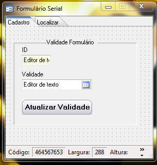

2. Vincule o formulário à propriedade Formulário do Serial: clique com o botão direito do mouse sobre a Área de Trabalho do Maker, Propriedades contida no menu, localize a propriedade Formulário do Serial e atribua o Formulário Serial criado anteriormente.

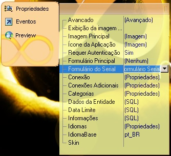

3. Crie um fluxo que será usado no evento Ao Verificar Serial;

1. Crie duas variáveis (Variáveis locais) que irão armazenar os valores como na imagem abaixo:

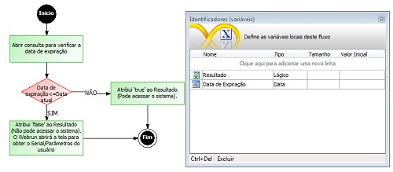

2. Processamento Abrir consulta para verificar data de expiração, utilize a função Abrir consulta e atribua o resultado da consulta após obter o campo date_validade com a função Campo a variável Data de Expiração.

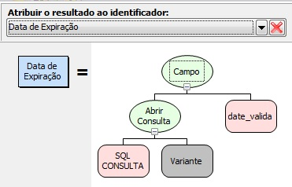

3. Decisão: Data de expiração &lt;= Data atual

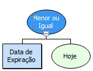

4. Processamento Atribui 'False' : atribua : Resultado = False;

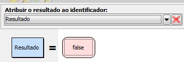

5. Processamento Atribui 'True' : atribua : Resultado = True;

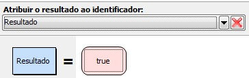

6. O resultado lógico tem que ser passado ao Webrun, para isso dê um duplo clique no fim do fluxo e será aberta uma janela, no campo Tipo de retorno selecione Lógico e atribua o retorno da sua variável no campo Valor de retorno;

   *Importante:* Ao passar o valor lógico como true o Webrun entende que o serial está válido desta forma temos acesso ao sistema, quando passamos o valor lógico como false o Webrun entende que o serial expirou e será requisitado uma nova data de expiração. Desta forma o Formulário Serial será aberto para que o usuário informe uma nova data de expiração.

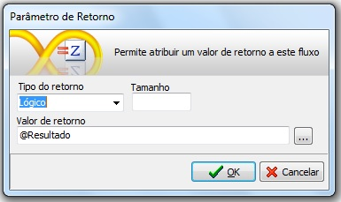

7. Salve o fluxo na camada servidor, chamaremos de Validar_data.

4. Na área de trabalho do Maker clique com o botão direito do mouse, localize Eventos e atribua o fluxo criado anteriormente ao evento Ao Verificar Serial.

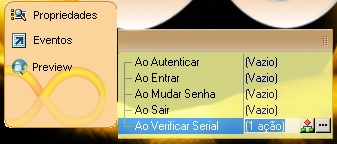

5. O próximo passo é criar o fluxo que irá realizar a atualização caso o acesso ao projeto tenha expirado.

1. Crie o fluxo que realizará a atualização da data de expiração no banco de dados, com dois parâmetros de entrada como na imagem abaixo:

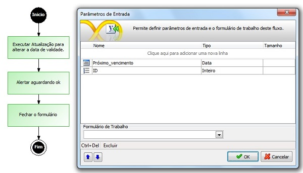

2. No processamento use a função Executar Atualização para alterar a data de validade, selecione atualização e clique no botão Wizard SQL, feito isso a seguinte janela será aberta:

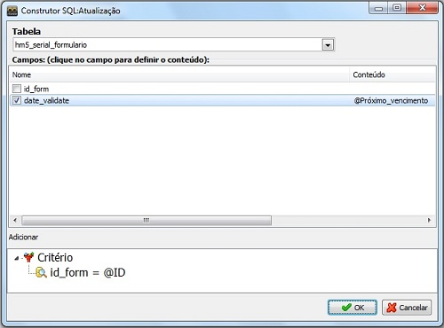

3. Marque o campo date_validate, uma janela será aberta, clique no processamento e atribua o parâmetro de entrada Próximo_vencimento, que possuirá a nova data de expiração:

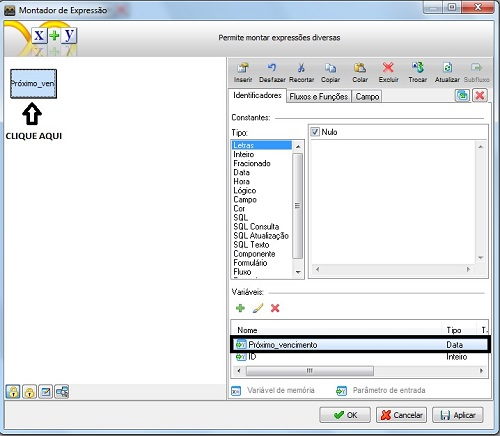

4. No campo Critério clique com o botão direito do mouse e selecione a opção Critério, feito isso selecione o campo que será a condição para a atualização, neste caso o campo id_form da tabela formulario_serial, selecione o operador de igualdade e depois clique em Editar e atribua o parâmetro de entrada ID.

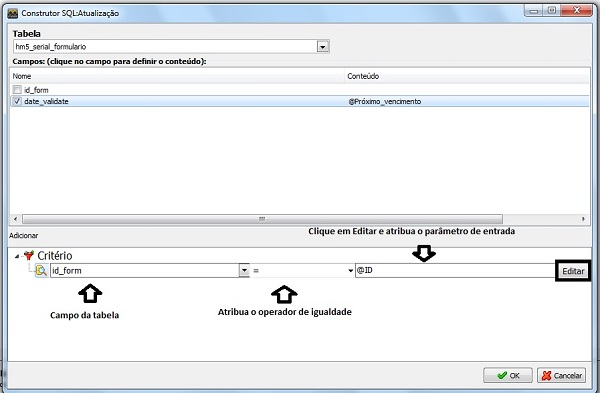

5. Clique em OK, o próximo processamento realizará uma interação com o usuário informando que atualização foi bem sucedida, para tal iremos usar a função Alertar Aguardando OK.

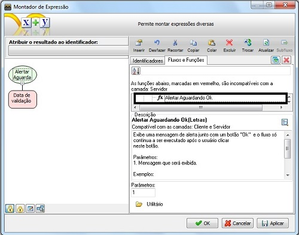

6. No processamento Fechar formulário, utilize a função Fechar formulário que fechará o formulário atual:

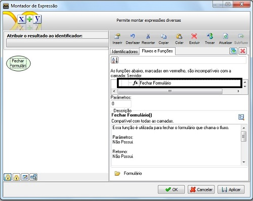

7. Salve o fluxo na camada servidor, chamaremos de Atualizar Serial.

6. Abra o Formulário Serial, clique com o botão direito do mouse sobre o botão, no menu selecione Eventos, clique no botão  e associe o fluxo Atualizar Serial, depois selecione Componente e informe os componentes que irão possuir os valores para os parâmetros de entrada do fluxo.

   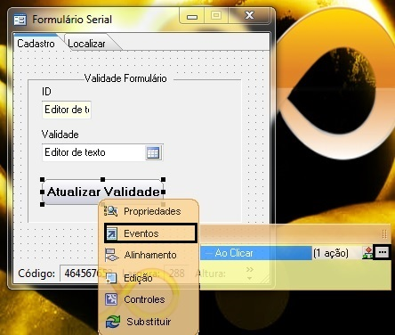
   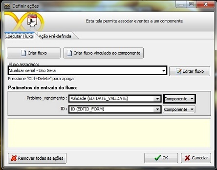

   *OBSERVAÇÃO :* Após a utilização do formulário para serial e configurado um fluxo de ação no evento Ao Verificar Serial é necessário salvar o projeto e reiniciar o WEBRUN para que a alterações no projeto possam entrar em vigor. Assim que o usuário logar no sistema (WEBRUN) o Formulário Serial aparecerá para que o usuário informe uma nova data de expiração (acesso para aplicação).
