Para fazer a importação de dados de arquivos com a extensão *.DBF, é necessário criar [uma conexão ODBC](../banco_de_dados/configurando_uma_fonte_de_dados_odbc), no padrão Fonte de dados de Sistema (não usar a opção Usuário), apontando para o arquivo que será importado.

Após a criação das Conexões ODBC, crie, no seu banco, uma tabela com a mesma estrutura do arquivo que será importado.

Para este exemplo, utilizaremos duas tabelas:

Primeira Tabela:

/* CADASTRO DE ALUNOS */

CREATE TABLE [dbo].[ALUNOS] (

[MATRICULA] [nvarchar] (6) COLLATE Latin1_General_CI_AS NULL ,

[NOME] [nvarchar] (40) COLLATE Latin1_General_CI_AS NULL ,

[GRAU] [nvarchar] (1) COLLATE Latin1_General_CI_AS NULL ,

[SERIE] [nvarchar] (1) COLLATE Latin1_General_CI_AS NULL ,

[TURNO] [nvarchar] (1) COLLATE Latin1_General_CI_AS NULL ,

[TURMA] [nvarchar] (1) COLLATE Latin1_General_CI_AS NULL ,

[DT_MATR] [smalldatetime] NULL

) ON [PRIMARY]

GO

Segunda Tabela:

/* CADASTRO DE NOTAS */

CREATE TABLE [dbo].[NOTAS] (

[MATRICULA] [nvarchar] (6) COLLATE Latin1_General_CI_AS NULL ,

[NOTA1] [decimal](18, 0) NULL ,

[NOTA2] [decimal](18, 0) NULL ,

[NOTA3] [decimal](18, 0) NULL ,

[NOTA4] [decimal](18, 0) NULL

) ON [PRIMARY]

GO

Observação: A criação das tabelas acima servirão como destino dos dados vindo de um arquivo DBF (Origem. É necessário que os campos das tabelas criadas possuam as mesmas características do arquivo DBF).

Utilizando o Assistente de criação de formulários, defina o nome para o formulário e não defina Fonte de Dados. Utilize o componente Botão:

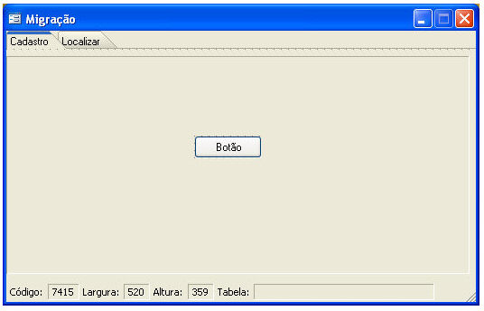

Crie um fluxo para importar os dados do arquivo:

1. Pela tela Identificadores (variáveis), crie duas variáveis do tipo Tabela:

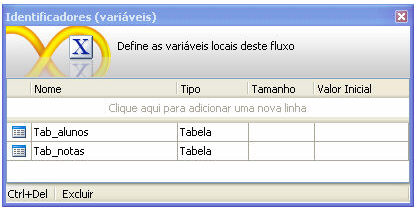

2. Salve o fluxo para o Destino Servidor.

O fluxo ficará da seguinte forma:

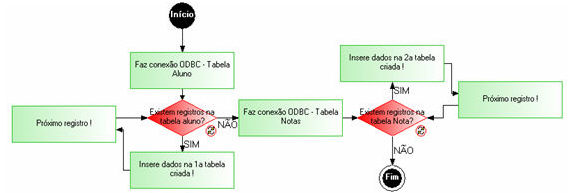

3. Coloque um 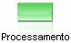 para fazer a Conexão ODBC. Utilize as funções Abrir Consulta Dinâmica e Abrir Conexão ODBC:

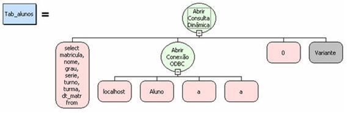

Observações:

1. No primeiro parâmetro (select matricula, nome,...) da função Abrir Consulta Dinâmica, os campos devem estar na mesma ordem do arquivo DBF. Neste exemplo, a conexão é na tabela Aluno.
2. No segundo parâmetro (Aluno) da função Abrir Conexão ODBC, é o nome dado ao Nome da Fonte de Dados durante a configuração ODBC.

4. Coloque um componente  para verificar se existem registros na tabela:

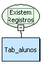

5. Coloque um componente 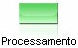 para fazer inserção dos dados no banco. Utilize a função Executar Atualização. No primeiro parâmetro (SQL Atualização), defina Tipo do SQL e selecione Inserção na tela Propriedade:

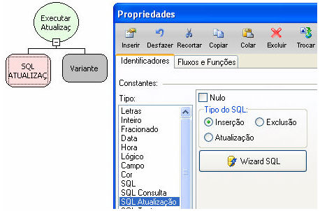

6. Em seguida, clique no botão 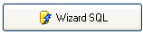  e na tela Construtor SQL: Inserção, escolha a tabela que você criou no seu banco e selecione os campos correspondentes:

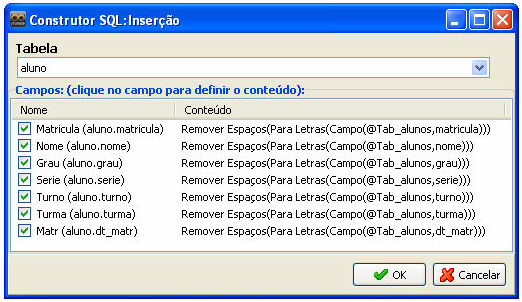

Observação: Para cada campo selecionado, no Montador de Expressão, use as funções: Remover Espaços, Para Letras e Campo.

Exemplo:

Campo Matrícula:

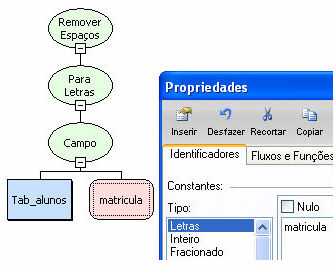

Observação: Na função Campo, no segundo parâmetro, na tela Propriedade, é necessário clicar em Tipo: Letras e escrever o nome do campo da mesma forma que está na tabela.

7. Coloque um componente  para o próximo registro. Utilize a função Próximo Registro:

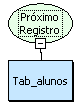

8. Coloque um  para fazer a Conexão ODBC. Utilize as funções Abrir Consulta Dinâmica e Abrir Conexão ODBC:

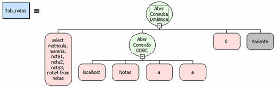

Observações:

1. No primeiro parâmetro (select matricula, materia,...) da função Abrir Consulta Dinâmica, os campos devem estar na mesma ordem do arquivo DBF. Neste exemplo, a conexão é na tabela Nota.
2. No segundo parâmetro (Notas) da função Abrir Conexão ODBC, é o nome dado ao Nome da Fonte de Dados durante a configuração ODBC.

9. Coloque um componente 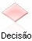 para verificar se existem registros na tabela:

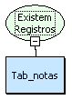

10. Coloque um componente  para fazer inserção dos dados no banco. Utilize a função Executar Atualização. No primeiro parâmetro (SQL Atualização), defina Tipo do SQL selecione Inserção na tela Propriedade:

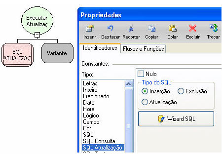

11. Em seguida, clique no botão 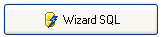 e, na tela Construtor SQL: Inserção, escolha a tabela que você criou no seu banco e selecione os campos correspondentes:

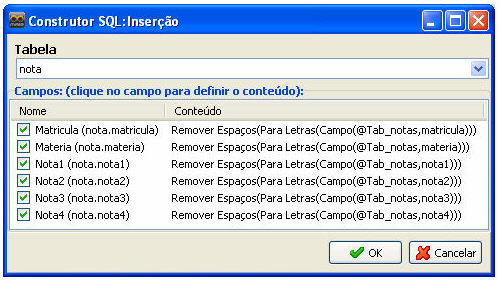

Observação: Para cada campo selecionado, no Montador de Expressão, use as funções: Remover Espaços, Para Letras e Campo.

Exemplo:

Campo Matéria:

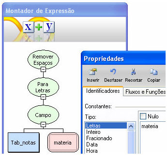

Observação: Na função Campo, no segundo parâmetro, na tela Propriedade, é necessário clicar em Tipo: Letras e escrever o nome do campo da mesma forma que está na tabela.
