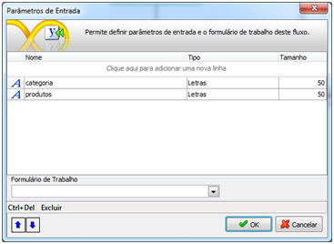
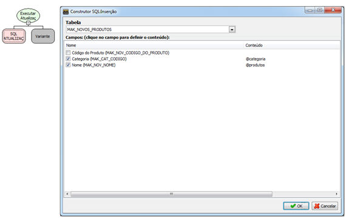
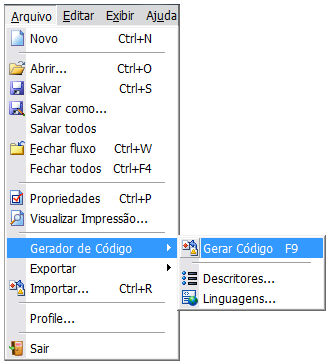
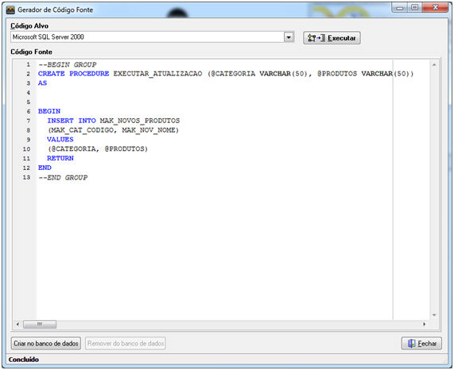
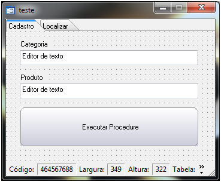
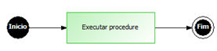
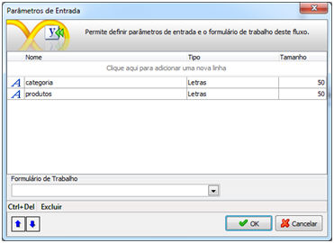
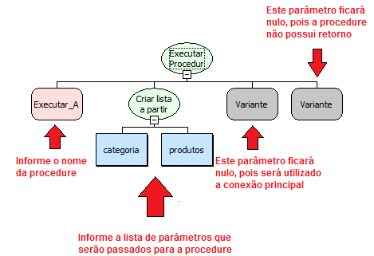
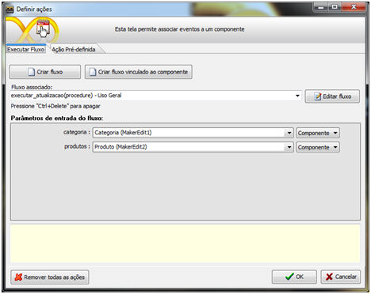

Este documento tem por finalidade, apresentar aos usuários um recurso que às vezes é pouco utilizado pelo desenvolvedor Maker, que é a utilização de fluxos na camada Banco de dados. Mas para a criação de triggers e procedures é essencial que esta camada seja utilizada.

O que é uma procedure?

- Procedures – Stored Procedures são blocos de conjuntos de instruções Transact-SQL que são executas no próprio banco de dados.

Criação e utilização de Procedures no Maker

Primeiramente será criada a procedure no Maker, e em seguida, será inserida no banco de dados.

O fluxo possui dois parâmetros de entrada.

Crie um fluxo, adicione um processamento e no Montador de Expressões, selecione Executar atualização.

Salve o fluxo na camada Banco de dados.

Criado a regra, a transformaremos em uma procedure, selecionando o menu Arquivo->Gerador de código->Gerar Código.

A tela do gerador de código será aberta, selecione o código alvo e clique sobre o botão Executar.  Observe o código criado.

Clique sobre o botão Criar no banco de dados, para que a procedure seja adicionada.

Criada e adicionada a procedure, é hora de criarmos o fluxo que executará tal procedimento.

Primeiramente, será criado um formulário com as seguintes características:

O formulário não possui fontes de dados e as propriedades Aba Localizar e Navegação estão marcadas como Não.

Para um melhor entendimento o fluxo ficará da seguinte forma:

Clique sobre o botão inicio e adicione os seguintes parâmetros de entrada.

Em seguida, adicione um objeto processamento e selecione a função Executar Procedure

Salve o fluxo, associe-o ao botão Executar Procedure e associe os parâmetros de entrada aos componentes do formulário.

Salve o formulário e em seguida execute-o no Webrun.
