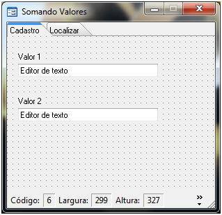
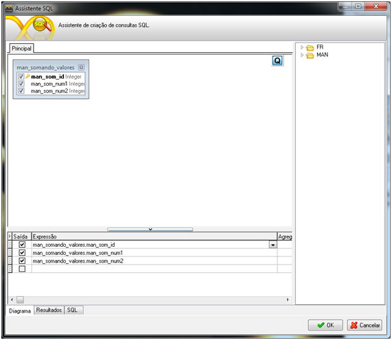
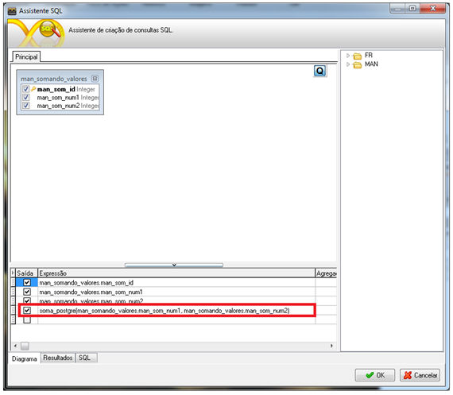
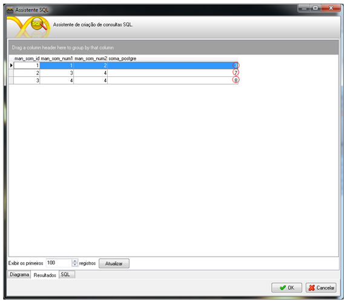
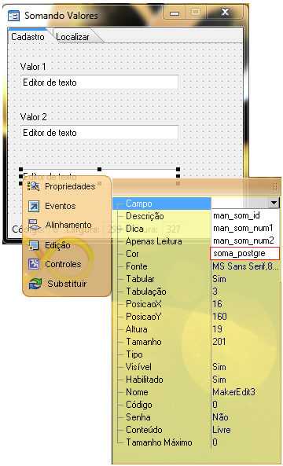
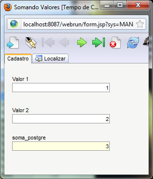

# Utilizando funções do banco de dados no Assistente SQL do Maker

Este tutorial tem como objetivo, exemplificar a utilização de funções de banco de dados no Assistente SQL do Maker.

Neste exemplo utilizaremos uma função bastante simples, que consiste basicamente em somar dois valores:

CREATE OR REPLACE FUNCTION soma_postgre(num1 bigint, num2 bigint)

  RETURNS bigint AS

$BODY$

BEGIN

 return num1 + num2;

END$BODY$

  LANGUAGE plpgsql VOLATILE;

ALTER FUNCTION soma_postgre(bigint, bigint) OWNER TO postgres;

A função foi criada no PostgreSQL. Para saber como criar funções no PostgreSQL, consulte o manual do banco de dados.

Criada a função, é hora de adicioná-la a consulta.

Com o Maker aberto, selecione o formulário onde será utilizado a função. Neste exemplo será utilizado o formulário Somando Valores.

Clique sobre o botão  , para que o Assistente SQL seja aberto.

Informe o nome da função e os parâmetros que a mesma receberá, como demonstra a figura abaixo:

A função deverá ser informada da seguinte forma: nome da função(campo1,campo2).

Exemplo: soma_postgre(man_somando_valores.man_som_num1,man_somando_valores.man_som_num2)

Selecione Resultados e observe a consulta.

Para obter o retorno da função no Webrun, basta adicionar um novo componente ao formulário e em sua propriedade Campo, determinar a função, como demonstra a figura abaixo:

