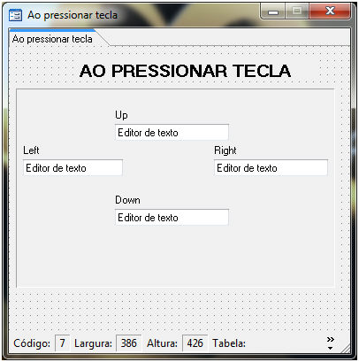
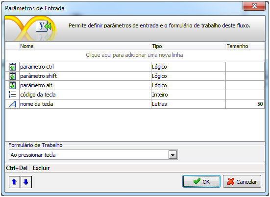
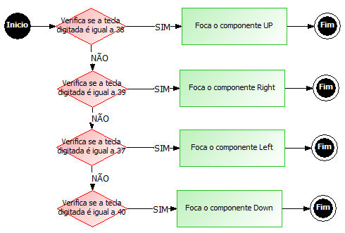
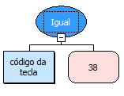
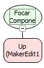
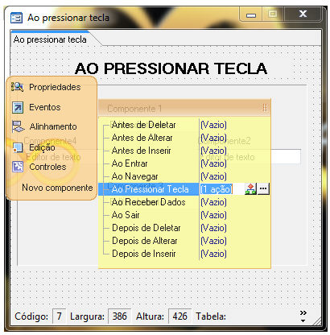
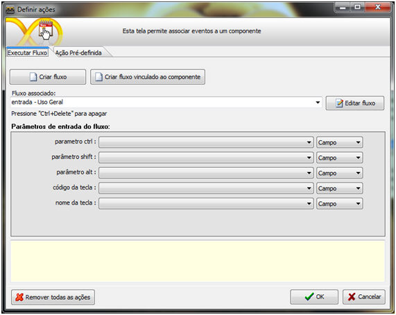
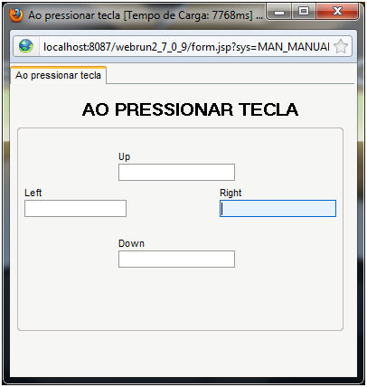

Neste exemplo será apresentado a utilização do evento ao pressionar tecla do Maker. O exemplo consiste basicamente em obter as teclas UP, DOWN, LEFT e RIGHT do teclado e focar o componente associado à mesma.

Primeiramente, crie um formulário com as seguintes características.

Nota: O formulário possui a propriedade Navegação definida como Não e a propriedade Aba localizar definida como Não.

O evento Ao Pressionar Tecla, por padrão recebe 5 parâmetros de entrada automáticos, [Saiba mais!](../../maker_2/formulario/propriedades_e_eventos#ao_pressionar_tecla_dica)

É necessário informá-los, para que a regra seja executada corretamente.

Para um melhor entendimento o fluxo ficará da seguinte forma:

1. Insira um objeto Decisão e no Montador de Expressões selecione a função Igual, informando como parâmetro o código da tecla e o valor 38, que é o código da tecla pressionada.

2. Insira um objeto processamento e no Montador de Expressões selecione a função Focar componente.

Repita o processo anterior para as demais decisões e processamentos, informando respectivamente os códigos 37, 39 e 40, junto com os componentes Left, Right e Down.

Criado o fluxo salve-o e associe-o ao evento Ao pressionar tecla do formulário.

Não é necessário associar os parâmetros de entrada aos componentes, pois se tratam de parâmetros automáticos.

Salve o formulário e execute-o no Webrun.

