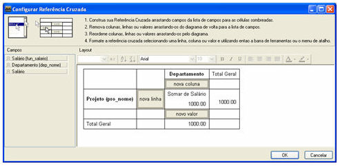
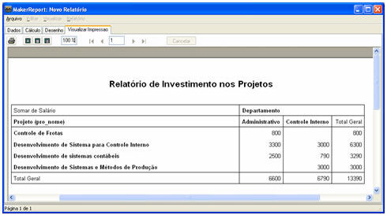

Vamos demonstrar como utilizar o componente  (**Referência Cruzada**) no **MakerReport**.

1. Crie uma consulta que permita o cruzamento de informações. Supomos que queremos mostrar a soma dos salários dos funcionários envolvidos nos Projetos. Na aba **Dados,** serão utilizadas as tabelas **sig_funcionario**, **sig_departamento**, **sig_trabalha_em** e **sig_projeto**. Na aba **Campos,** utilize os campos **fun_nome** (Nome do Funcionário), **fun_salario** (Salário do Funcionário) e **pro_nome** (Nome do Projeto). Em seguida, clique em **OK**.
2. Selecione a aba **Desenho**. No *menu* Relatório, clique em **Resumo.**
3. Clique no componente  e, em seguida, coloque na banda **Resumo**. Clicando com o botão direito do *mouse* sobre **Referência Cruzada** na banda **Resumo**, selecione a opção **Configurar...**. Será apresentada a tela **Configurar Referência** **Cruzada**. Observe que o lado esquerdo da tela mostrará todos os campos selecionados no item 1. E na parte Superior da tela informa como construir a referência cruzada. Arraste os campos necessários para compor o relatório:

4. Após montar a **Referência Cruzada**, clique em **OK**.

Pronto. A referência cruzada já está criada. Na aba **Visualizar Impressão,** veja o resultado:

Observação: Caso seja modificada a cor do texto e/ou o tipo de fonte do texto do título da coluna da referência cruzada, os valores relacionados com essa coluna sofrerão alteração. No exemplo acima, se, na coluna Projeto, for colocada a fonte no tamanho 20, o contexto contido na coluna mudará também.

Demonstrando relatório com referência cruzada - Esta vídeoaula demonstra o uso de referência cruzada em relatório.
