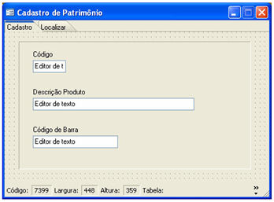
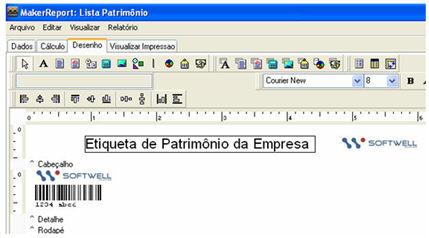

Este exemplo irá descrever como criar relatório com Código de Barras.

Para este exemplo, foi criada uma tabela Patrimônio contendo os campos: Código do Produto, Descrição do Produto e Cod_Barra.

Utilizando o Assistente de criação de formulários, defina o nome para o formulário e associe Fonte de Dados PATRIMONIO:

Criar um relatório (legado) para listar o Código de Barra.

Após seleção de todos os campos da tabela PATRIMONIO no menu Arquivo, em Novo, clique na aba Desenho. Na área Detalhe, coloque os componentes  (Texto) ,  (Campo com Código de Barras) e  (Imagem):

Resultado do Relatório Legado:

