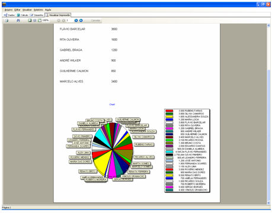
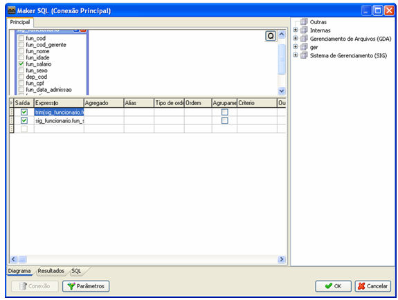
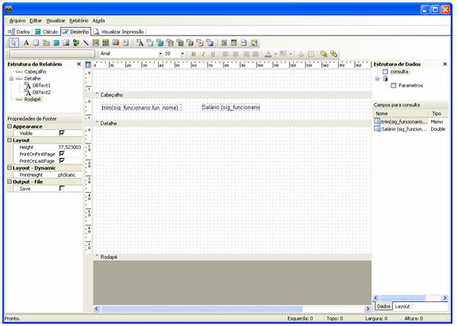
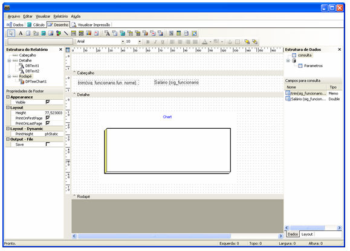
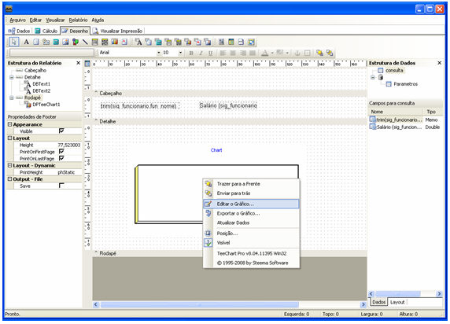
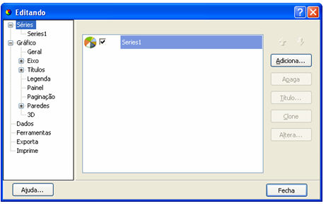
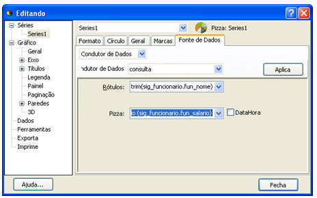

A dica a seguir exemplificará a utilização do componente Gráfico para a exibição de dados. O relatório terá o seguinte *layout*.

Este formulário deve apresentar, em um gráfico do tipo circular de setores, os funcionários destinados ao projeto e detalhar os valores correspondentes ao salário de cada envolvido.

1. Abra um novo relatório e na aba Dados e faça uma consulta SQL com as seguintes características:

2. Na aba desenho, insira dois componentes-texto. O primeiro será uma consulta informando o nome do funcionário e segundo o seu salário:

3. Na barra de ferramentas, selecione o campo Gráfico e insira no componente Rodapé:

Em seguida, clique com o botão direito sobre o componente para configurá-lo:

Em séries, selecione Adiciona... para incluir uma nova

Clique sobre a série criada e selecione a fonte de dados, para que o gráfico possa ser feito. Em seguida, clique em Aplica.

Em seguida, selecione Visualizar impressão.

Criando Gráfico em um relatório - este vídeo demonstra os passos para a criação de gráfico em um relatório.
