# Gerando imagem de relatório e abrindo numa moldura

Pense no seguinte caso, ao criar a imagem do relatório com a utilização de fluxo, sendo necessário abrir essa imagem em uma moldura em um formulário. Criaremos este fluxo para executar esta função.

O usuário deverá ter conhecimentos sobre: Criação de relatórios e criação de formulários.

Crie um formulário com as seguintes caracteristicas:

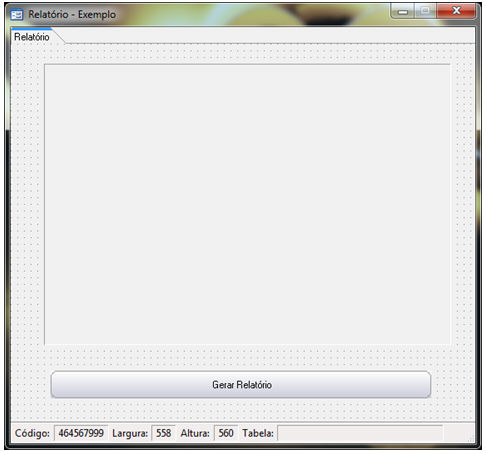g

O formulário não possui fonte de dados e possui as propriedades Aba Localizar e Navegação definidas como Não.

Criado o formulário, defina um relatório que possua um componente gráfico por exemplo, para ser exibido na moldura.

Primeiramente criaremos o fluxo que será responsável pela criação do relatório. Para um melhor entendimento o fluxo ficará da seguinte forma:

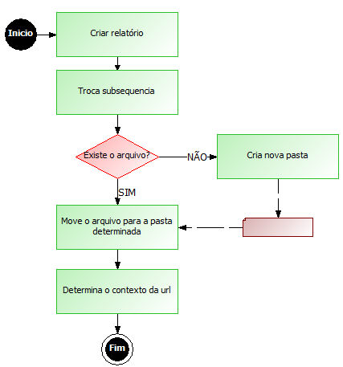

Defina as seguintes variáveis:

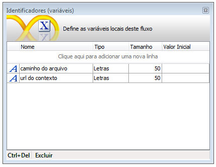

Selecione um objeto processamento e no Montador de Expressões determine a função Gerar relatório.

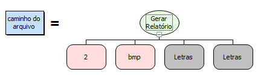

1. No primeiro parâmetro, informe o código do relatório que será gerado;
2. No segundo parâmetro informe o tipo de arquivo que será criado, neste exemplo bmp.

Os demais parâmetros deixaremos nulos, pois não será necessário filtragem de dados. Fazendo isso, informe seu retorno a variável caminho do arquivo.

No segundo processamento, informe a função trocar Subsequência, para que o caminho gerado seja o correto.

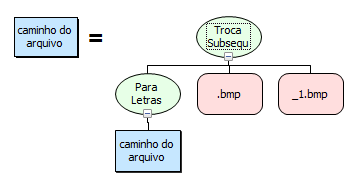

1. No primeiro parâmetro informe a função para Letras para garantir que o caminho informado seja do tipo letras;
2. No segundo parâmetro informe bmp;
3. No terceiro parãmetro informe _1.bmp.

Observação: É necessário modificar o caminho do arquivo, pois ao gerar relatórios com o tipo bmp serão criadas imagens  para cada página do relatório, onde para cada arquivo será adicionada a terminação _numero da página.

Na decisão informe a função Existe o Arquivo? para verificar se o arquivo criado.

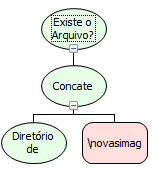

1. No primeiro parâmetro informe a função Concatenação
   1. No primeiro parâmetro informe a função Diretório de Arquivos;
   2. No segundo parâmetro informe \novasimagens\relatorio.bmp.

Para a decisão Não, selecione um objeto processamento e no Montador de Expressões selecione a função Criar Nova pasta

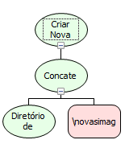

1. No primeiro parâmetro informe a função Concatenação;
   1. No primeiro parâmetro informe a função Diretório de Arquivos;
   2. No segundo parâmetro informe \novasimagens\

No terceiro processamento, informe a função Mover arquivo, para que o relatório seja movido.

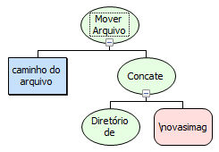

1. No primeiro parâmetro informe a variável caminho do arquivo;
2. No segundo parâmetro informe a função Concatenação.
   1. No primeiro parâmetro informe a função Diretório de arquivos;
   2. No segundo parâmetro informe e \novasimagens\relatorio.bmp.

No quarto processamento Informe a função Obter URL do Contexto e retorne seu valor a variável url do contexto.

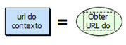

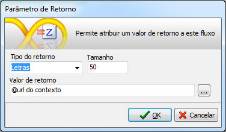

Criado o primeiro fluxo, partiremos para a criação do segundo o qual será responsável por abrir a url na Moldura.

Para um melhor entendimento o fluxo ficará da seguinte forma:

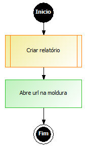

Defina as seguintes variáveis:

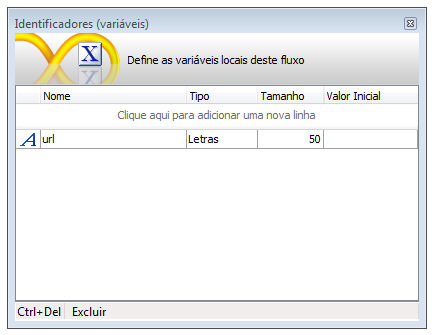

No objeto subfluxo, informe o fluxo criado anteriormente atribuindo o resultado ao identificador url.

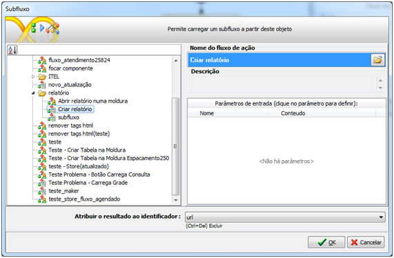

No primeiro processamento informe a função Abrir URL numa moldura.

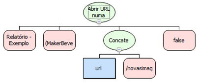

1. No primeiro parâmetro informe o formulário onde se encontra a moldura;
2. Informe a Moldura do formulário;
3. No terceiro parâmetro informe a função Concatenação.
   1. No primeiro parâmetro informe a variável url;
   2. No segundo parâmetro informe /novasimagens/relatorio.bmp.
4. No  quarto parâmetro informe o valor false.

Informe um nome para o fluxo e salve-o na camada cliente.

Associe o fluxo criado ao botão Gerar relatório do formulário

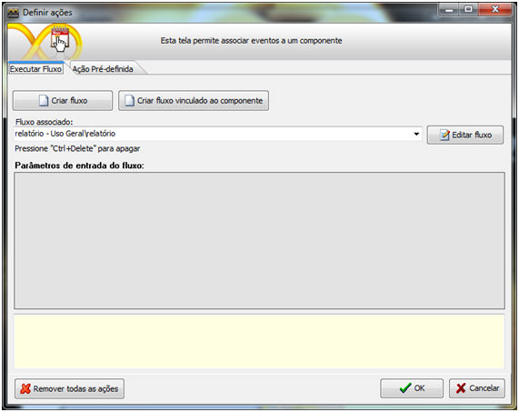

Salve o formulário e execute-o no Webrun.

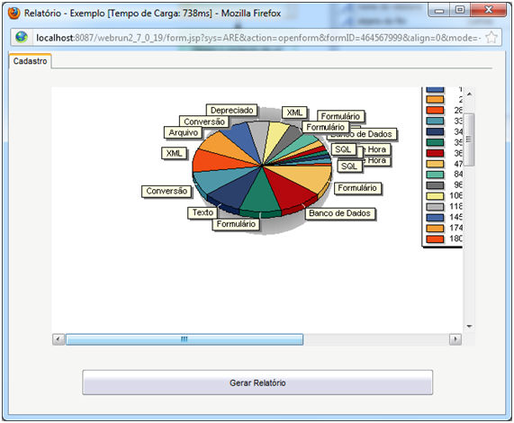
