Este exemplo tem como objetivo demonstrar a utilização do critério LIKE em consultas SQL de Relatórios.

Crie um novo relatório, vá até a aba Dados e adicione uma nova fonte de dados. Para este exemplo, utilizaremos a tabela fr_acao. Marque os dois campos disponíveis.

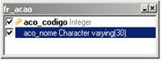

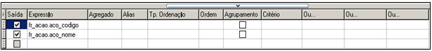

Observe que, ao clicar em Resultados, todos os registros serão retornados porque nenhum filtro foi informado.

Agora, adicionaremos o critério LIKE na coluna Critério da linha referente à coluna aco_nome ficando assim LIKE '%' || :contendo || '%' observe a utilização de || (pipes) para concatenação SQL pois, o exemplo utiliza o banco de dados PostgreSQL.

Veja na imagem abaixo, como ficou após a configuração.

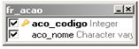

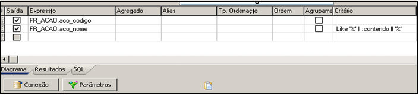

Clique em OK do assistente SQL para fechá-lo e salvar as configurações. Vá até a aba Desenho e adicione dois componentes Texto na banda Cabeçalho.

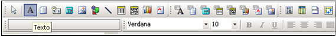

Logo em seguida, adicione dois componentes Campo Texto à banda Detalhe.

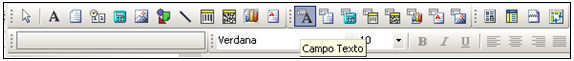

Configure os componentes Campo Texto  para obter os dados de cada coluna da Fonte de dados.

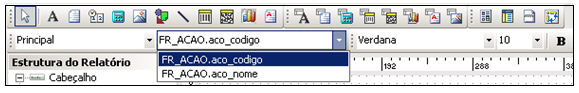

Veja abaixo como ficou a disposição dos componentes.

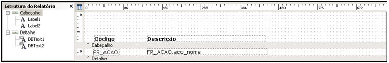

Salve o relatório, defina um nome desejado.

O próximo passo é criar um fluxo para abrir o relatório. Crie um novo fluxo e o objeto Início adicione uma variável de entrada do tipo Letras, chamaremos de conteúdo.

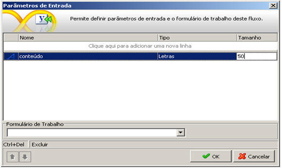

Adicione um novo processamento e utilize a função Abrir relatório imediatamente e informe os parâmetros necessários. Veja a descrição da função para mais detalhes.

Observe que o segundo parâmetro deve ser a concatenação do parâmetro de entrada com o nome do parâmetro do relatório. Logo, deverá ser feito da seguinte forma:

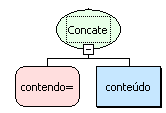

Ao final, o processamento deverá ficar como na imagem abaixo:

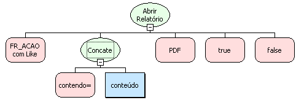

Salve o fluxo na camada Servidor definindo o nome desejado.

O próximo passo é criar um formulário simples para chamar o fluxo recém criado. Crie um formulário sem fonte de dados e adicione um componente Botão e outro componente Caixa de Texto. Configure as propriedades Navegação, Aba Localizar e Abas do formulário para Não.

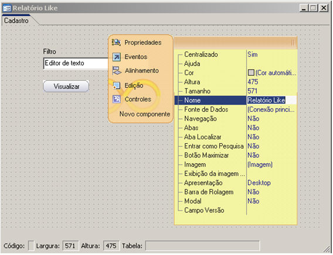

Associe o fluxo criado ao evento Ao clicar do componente Botão ao formulário. No parâmetro de entrada do fluxo, escolha o tipo Componente e selecione o componente Caixa de Texto.

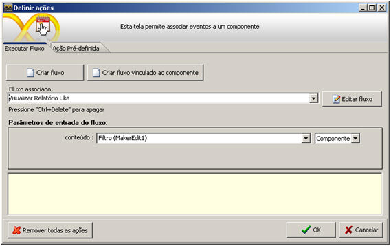

Clique em OK e salve o formulário. Ignore o assistente de banco de dados. Associe o Formulário ao menu do sistema e abra-o pelo Webrun.

Com o formulário aberto, basta informar o conteúdo para filtro e clicar no botão Visualizar.

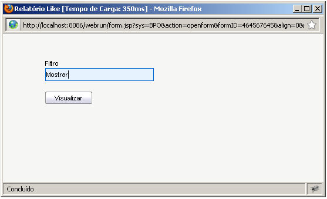

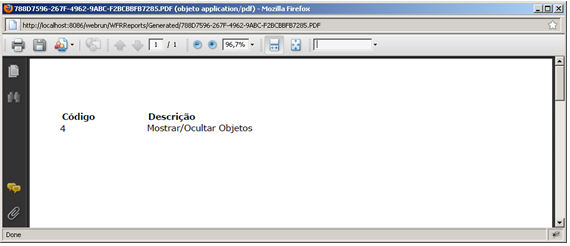

Para o exemplo feito, o relatório listará todas as ações que contenham o valor informado no parâmetro
