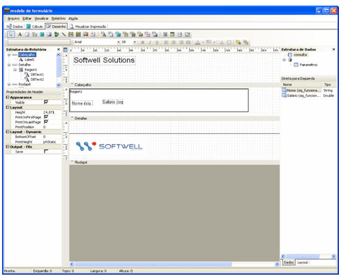
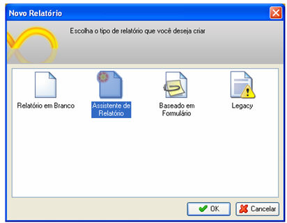
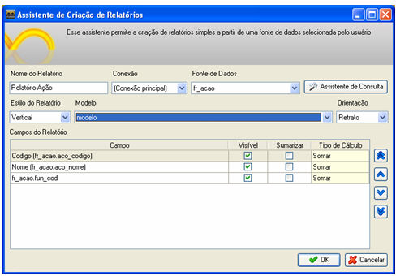
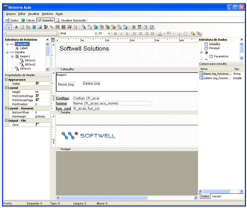

Esse passo a passo demonstrará como criar modelos de relatório.

1. Crie um novo relatório que servirá de modelo aos seguintes.

No exemplo usaremos o seguinte modelo:

2. Salve o relatório modelo dentro da pasta C:\Documents and Settings\All Users\Documentos\Softwell Solutions\Maker 2\Templates\

Observação: Caso a pasta Templates não exista, ela deverá ser criada.

3. Crie um novo relatório e na tela Novo Relatório selecione Assistente de Relatório

4. Na tela Assistente de Relatório selecione o Nome do relatório, sua Conexão, a Fonte de Dados, seu estilo e em Modelo selecione o relatório salvo e em seguida clique em OK.

Observe que o relatório criado segue o mesmo estilo do anterior :

