# Utilizando o iReport com o Maker

O iReport é uma ferramenta que provê suporte para a criação de relatórios nos formatos PDF (arquivo somente leitura),
XLS (arquivo do aplicativo Microsoft Excel) e HTML (linguagem de marcação para o ambiente web), os quais são suportados pelo Webrun. Apesar da existência desse suporte, a
Softwell Solutions não se responsabiliza por subsidiar o usuário em como utilizar a ferramenta, descrevendo apenas os recursos básicos para a criação de um relatório conforme a documentação abaixo.

Pré-Requisitos:

- Habilitar a opção: "Conversão dos relatórios para JASPER", para isso no Maker clique em: Projetos  --> Configurações  --> Outros marque o checkbox "Conversão dos relatórios para JASPER", e reinicie o Maker.
- Baixe e Instale a versão homologada pela Softwell Solutions do iReport versão 3.1.2, para isso efetue o download da ferramenta através do site do iReport ou pelo seguinte link:
  &lt;http://www.mirrorservice.org/sites/download.sourceforge.net/pub/sourceforge/i/ir/ireport/iReport/iReport-nb-3.1.2/iReport-nb-3.1.2-src.zip&gt;
  Após a conclusão do download, basta instalá-lo. Cabe ainda lembrar que, para a perfeita execução da ferramenta, é necessário ter instalada no computador a Máquina Virtual Java (JDK 5.0) que pode ser obtido no site da Oracle
  &lt;http://www.oracle.com/technetwork/java/javasebusiness/downloads/java-archive-downloads-javase5-419410.html&gt;.

Configurando e Acessando o Banco de Dados pelo iReport:

Primeiramente é necessário adicionar o drive JDBC que será util no momento de configuração do banco de dados, para isso abra a iReport e clique em: Banco de Dados --> Drivers --> Novo Driver JDBC e escolha o diretório onde encontra-se o driver, clicando em Adicionar.

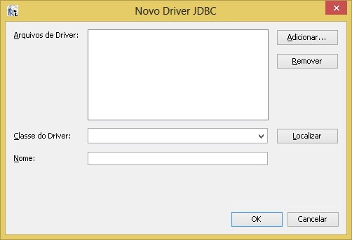

Normalmente encontra-se em:

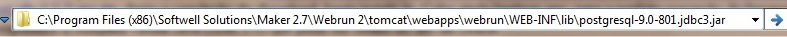

Uma vez adicionado o driver do postgres (ou outro banco de dados do seu interesse). Crie a conexão com o banco de dados, conforme a imagem abaixo

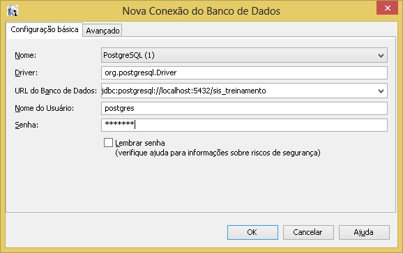

Criando um Relatório Simples no iReport:

Para criar um relatório, clique em Arquivo --> New Empty report, na tela que será aberta, escolha o nome do relatório e o local onde o mesmo será salvo.

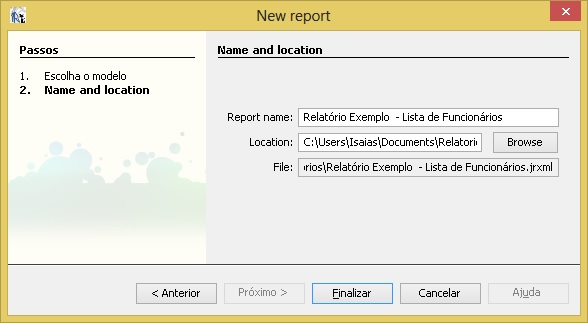

Observe que uma página em branco foi aberta, esta página será nossa área de trabalho dos relatórios, verifique que a mesma contém:

- Paleta de Elementos --> serve para arrastarmos os diversos elementos para a área de trabalho, estes elementos podem ser: Label, Gráfico, Linhas,Imagens, Sub-Relatórios etc.
- Report Inspector --> serve para adicionar parâmetros, estilos, váriaveis, campos do banco de dados etc.
- Área Central --> serve para montar o relatório em sí, inserindo títulos, cabeçalhos, colunas e rodapé, nesta área também é possivel visualizar o código xml gerado, e visualizar uma prévia do relatório através da aba Preview .
entre outras funcionalidades.

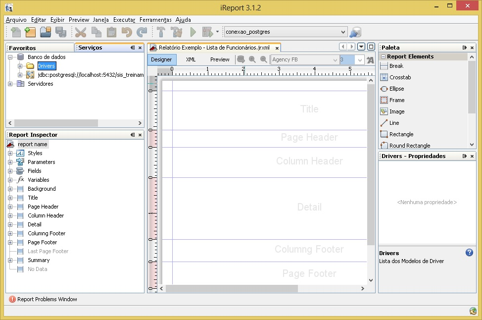

Inserindo Fonte de Dados no Relatório

Para colocar tabelas e campos no relatório clique com o botão direito do mouse em: report name do Report Inspector e em seguida clieque em: Edit Query será aberta uma tela na qual deverá ser informada a consulta desejada, que poderá ser de forma manualmente digitando no espaço sql correspondente ou através do Query Designer.

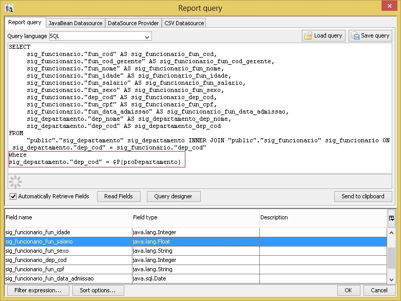

para inserir através do Query Designer clique em:  Query Designer -->  public selecionando e marcando os campos das tabelas desejadas.

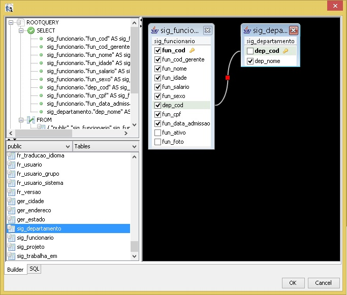

Montando o Relatório

- Caso todos os passos acima tenham sido executados corretamente, no Report Inspector, clique em: Fields.
  Essa tela mostrará todos os campos existentes. Clique em cima do campo e arraste até a banda Detail, coloque também os respectivos "labels". Para adicionar um label, arraste-o da Paleta de elementos.
  Para cada campo desejado, posicionando-os no espaço "column header" da área de trabalho do iReport, veja o posicionamento de cada campo e clique em Preview para visualizar uma prévia do relatório.

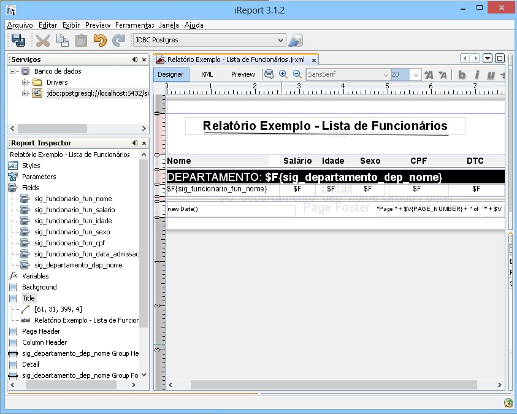

Efetuando Filtro via Parâmetro

No iReport

Para filtrarmos um registro do relatório via parâmetro, basta clicar em: Parameters do Report Inspector e em seguida Adicionar Parâmetro
renomei-e para o nome que preferir, em seguida insira a cláusula Where no Report Query e acrescente o seguinte comando:
WHERE sig_departamento."dep_cod" = $P&#123;proDepartamento&#125; Este trecho é o responsável por filtrar pelo departamento desejado. Caso exista alguma dúvida, Observe na
sexta imagem deste tutorial, a parte grafada do código sql já com esta implementação.

Para selecionar o departamento desejado no iReport, basta digitar o código desejado do mesmo, conforme a imagem abaixo:

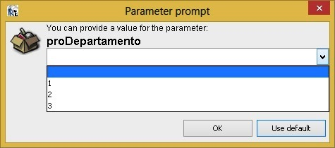

No relatório do Maker

No relatório feito no Maker, é ao invés de selecioná-los via código, é possivel selecioná-los via nome do departamento, para isso acesse o relatório e na aba Dados do relatório, clique em Código SQL,
será aberta a tela conforme a imagem abaixo, observe a numeração na mesma e insira na guia(aba) Critério a variável do respectivo campo,
o parâmetro desejado e a definição dos dados.

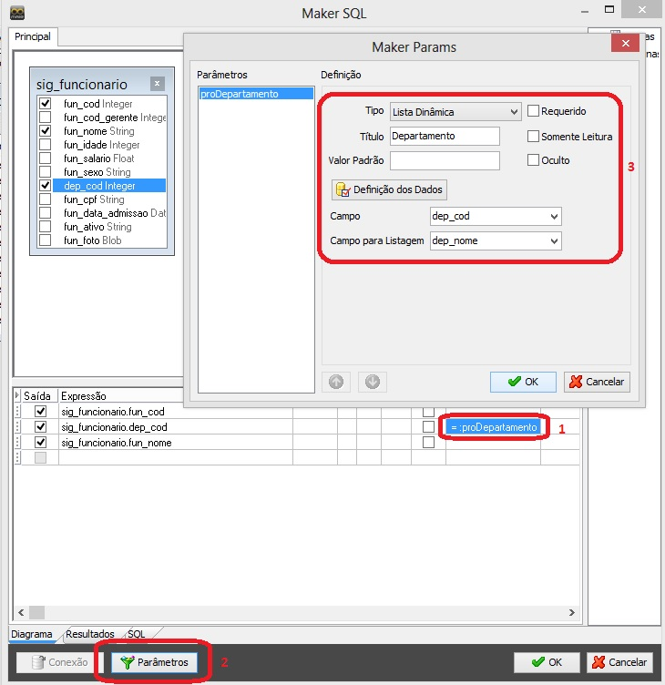

Clique em Visualizar Impressão, verás a imagem abaixo:

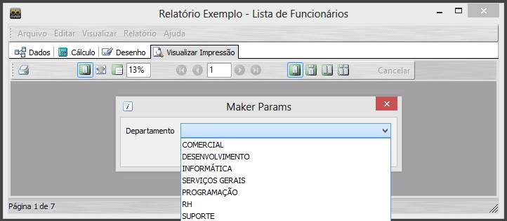

### Integrando com o Maker e Publicando no WebRun

Para visualizar o relatório criado no WebRun crie um relatório vazio pelo Maker e adicione ao menu do sistema.
Este relatório não precisa ter o mesmo nome do relatório criado pelo iReport. Perceba que ao criar um relatório no Maker ele é salvo na tabela FR_RELATORIO. Executando um Select nesta tabela, teremos o seguinte resultado:

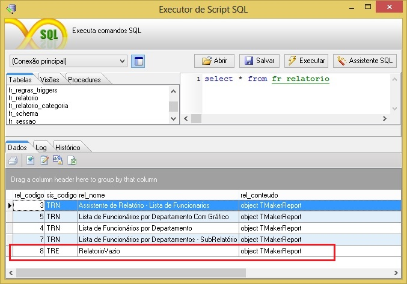

Para integrar o relatório com o webrun, é necessário efetuar mais dois procedimentos, um no maker e outro no iReport.

- No Maker --> Clique em: Utilitários--> Exportar Relatório para Jasper marque o relatório vazio criado anteriormente
  e clique em Exportar exporte-o para o seguinte endereço: 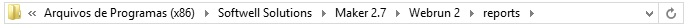

  Observe que após a exportação no diretório acima mencionado o Maker encarregou-se de criar outros três diretório, ficando assim:

  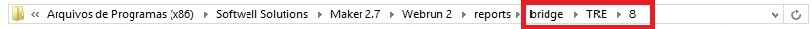

É a pasta "bridge" que servirá como ponte, efetuando a ligação entre o Maker com o iReport, dentro da mesma conterá os relatórios.
Observe que a pasta TRE corresponde a sigla do sistema (treinamento) a pasta com o número 8 corresponde o campo "rel_codigo" da tabela FR_RELATORIO.
Dentro desta pasta serão colocados dois arquivos:

- Relatório criado com o iReports (arquivo de extensão .jrxml)

- Arquivo de configuração chamado "report.data"

- No iReport --> basta salvar o relatório no diretório acima mencionado, para isso clique em Arquivo --> Salvar Como e selecionar o diretório com o mesmo código da tabela FR_RELATORIO, ficando assim:

  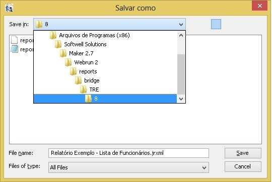

Altere o conteúdo do "report.data" colocando o nome do relatório feito no iReport, conforme a imagem abaixo:

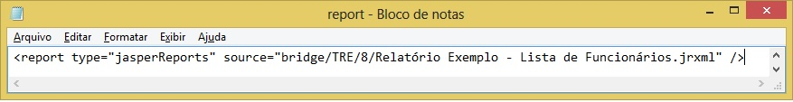

O parâmetro "source" da imagem acima deve ser ajustado de acordo com o caminho da sua aplicação.

Feito isso, bastará acessar a aplicação e gerar o relatório.

Observações importantes no Maker;:

- Verifique se no Maker ->&gt; Configurações se o checkbox "Conversão de relatório para Jasper" esta ativado.

- Exporte o relatório vazio criado no Maker, para Jasper através do menu do maker Utilitários

- Observe que após exportar o relatório para Jasper, é criado a pasta "bridge", a pasta que contém a sigla do sistema (ex: "TRE"),
  a pasta com o código do relatório (ex: "8")" e o arquivo "report.data".

- Altere o arquivo, report.data com o nome do relatório feito pelo iReport, conforme os passos citados acima (ex: Relatório Exemplo - Lista de Funcionários.jrxml) parte alterada.

- Limpe o Cache da Aplicação

Acessando o Relatório no WebRun

Para acessar o Relatório feito no iReport, e visualizá-lo no WebRun, basta inserir o relatório no menu do Maker e acessá-lo normalmente.

Importante: lembre-se que todos os passos citados acima, deve ter sido feito corretamente para o perfeito funcionamento do relatório, e que o relatório adicionado no Maker, encontra-se vazio, pois neste caso estamos apontando para o relatório gerado no iReport.

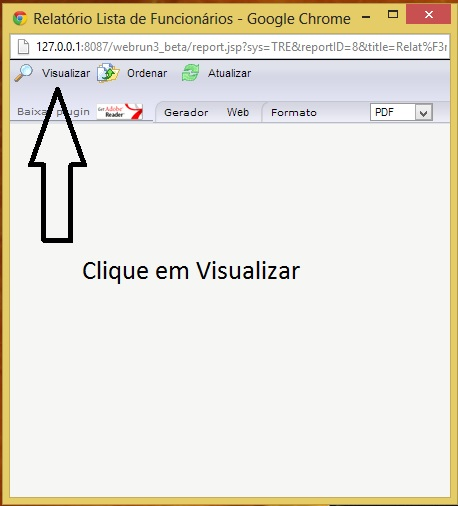

Veja o Relatório Final gerado

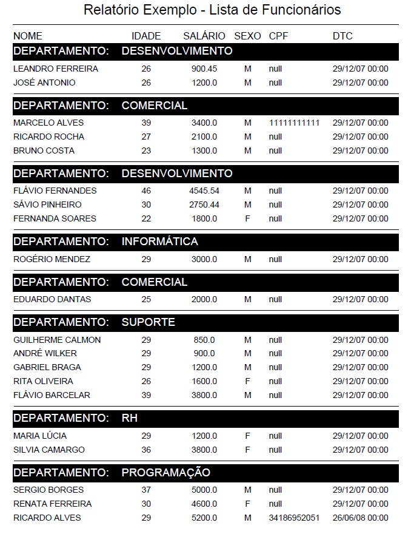

____________________________________________________________________________________________

Informações complementares sobre o iReport, consulte os seguintes links:

&lt;http://community.jaspersoft.com/project/ireport-designer&gt;
&lt;http://pt.scribd.com/doc/14811322/Desenvolvendo-Relatorios-Profissionais-Com-iReport-Para-Netbeans-IDE#download&gt;
