# Utilizando o iReport

O iReport é uma ferramenta que provê suporte para a criação de relatórios nos formatos PDF (arquivo somente leitura), XLS (arquivo do aplicativo Microsoft Excel) e HTML (linguagem de marcação para o ambiente web), os quais são suportados pelo Webrun. Apesar da existência desse suporte, a Softwell Solutions não se responsabiliza por subsidiar o usuário em como utilizar a ferramenta, descrevendo apenas os recursos básicos para a criação de um relatório (documentação abaixo).

Como Baixar:

O download da ferramenta pode ser feito por meio do link
&lt;http://www.mirrorservice.org/sites/download.sourceforge.net/pub/sourceforge/i/ir/ireport/iReport/iReport-nb-3.1.2/iReport-nb-3.1.2-src.zip&gt;.
Após a conclusão do download, basta instalá-la. Cabe ainda lembrar que, para a perfeita execução da ferramenta, é necessário ter instalada no computador a Máquina Virtual Java (JDK 5.0) que pode ser obtino no site da Oracle
&lt;http://www.oracle.com/technetwork/java/javasebusiness/downloads/java-archive-downloads-javase5-419410.html&gt;.

Configurando e Acessando o Banco pelo iReport:

Primeiramente é necessário adicionar o drive JDBC que será util no momento de configuração do banco de dados, para isso clique em Drivers --> Novo Driver JDBC e escolha o diretório onde encontra-se o driver.

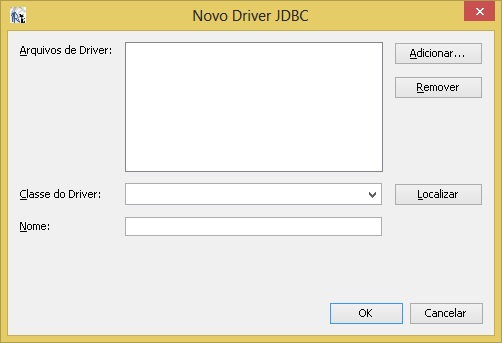

Normalmente encontra-se em:

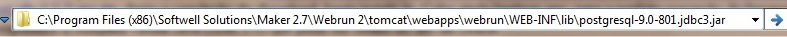

- Uma vez adicionado o driver do postgres(ou outro banco de dados do seu interesse.) crie a conexão com o banco de dados, conforme a imagem abaixo

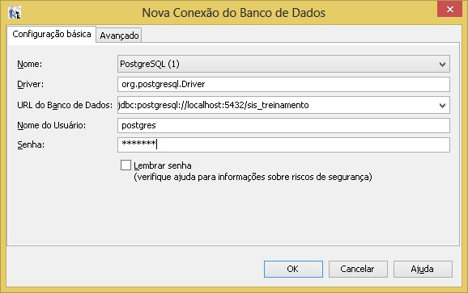

Criando um Relatório Simples:

Para criar um relatório, clique em Arquivo --> New Empty report, será aberto uma tela onde escolheremos o nome do relatório e o local onde o mesmo será salvo, conforme as imagens abaixo: onde em seguida será aberto uma pagina em branco que sera nossa área de trabalho dos relatórios.

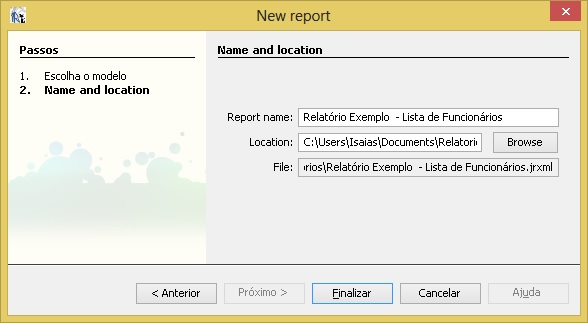

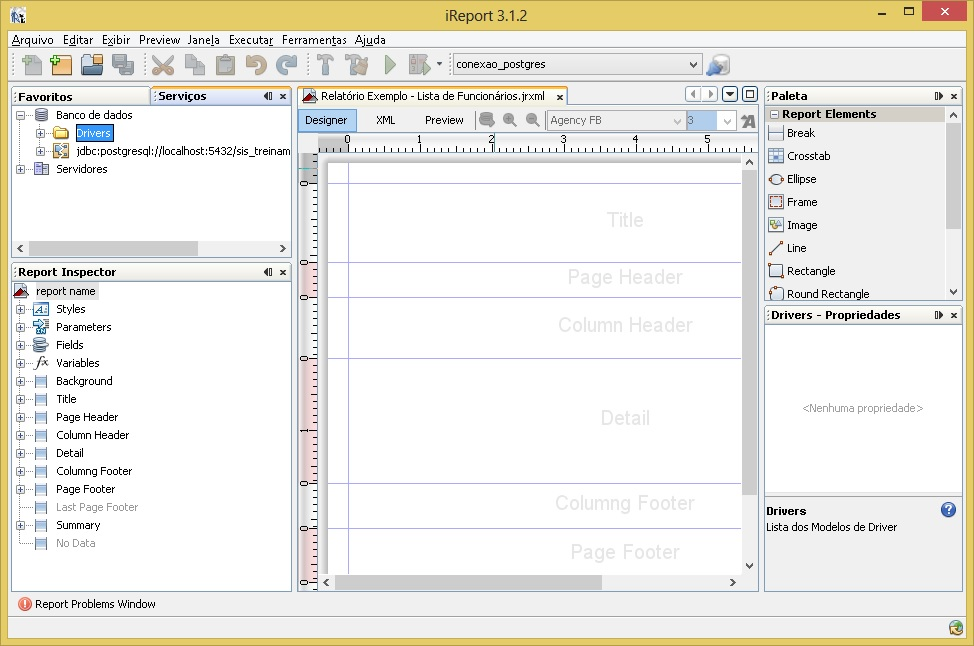

Observe no Report Inspector da imagem anterior, nele é possivel adicionar parâmetros, campos, estilos, váriaveis etc, observe também o formulário de relatório, no mesmo é sugestivo a localização de titulos, cabeçalhos, colunas, rodapé, páginas etc do relatório.

Antes de iniciarmos a manipulação de dados no relatório, é necessário efetuarmos mais uma configuração, e adicionar-mos o "data source" do postgres, veja na imagem abaixo como fazer. Ao clicar em New, preencha com os dados de sua conexão, test e salve.

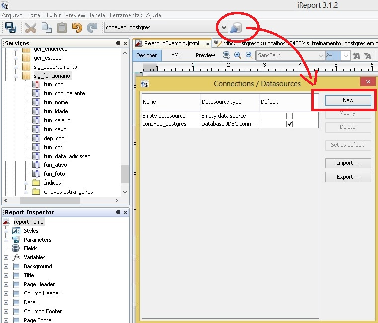

- Para colocar tabelas e campos no relatório clique com o botão direito do mouse em: report name do Report Inspector -->Edit Query, e será aberta uma tela na qual deverá ser informada a consulta desejada.
  Observe que foi inserido no relatório um título e inserido uma imagem no mesmo, veja diversas funcionalidades que pode ser obtida, através da Paleta de elementos. Clique em Read Fields para finalizar.

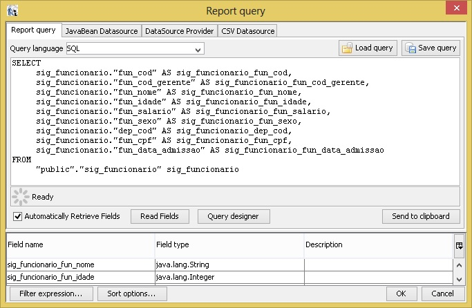

- Outra forma de colocar a tabela no relatório é acessando os mesmos passos descritos acima. Quando for aberta a tela de consulta, ao invés de clicar em Read Fields, clique no botão "Query designer".
  Quando clicar, abrirá uma tela com todas as tabelas criadas no seu banco, arraste uma para o espaço vazio da tela e selecione os campos. Clique em Ok para finalizar. Após colocar todas as tabelas, salve o relatório.

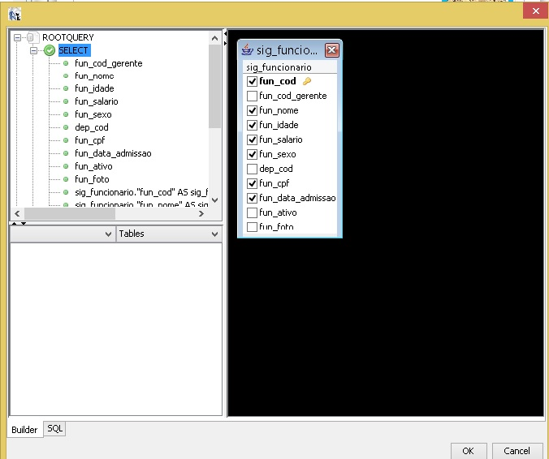

Montando o Relatório

- Caso todos os passos acima tenham sido executados corretamente, no Report Inspector, clique em:Fields.
  Essa tela mostrará todos os campos existentes. Clique em cima do campo e arraste ate a banda Detail, coloque também os respectivos "label", para adicionar um label, arraste-o da Paleta de elementos.
  Para cada campo desejado, posicionando-os no espaço "collum header" da area de trabalho do iReport, veja o posicionamento de cada campo

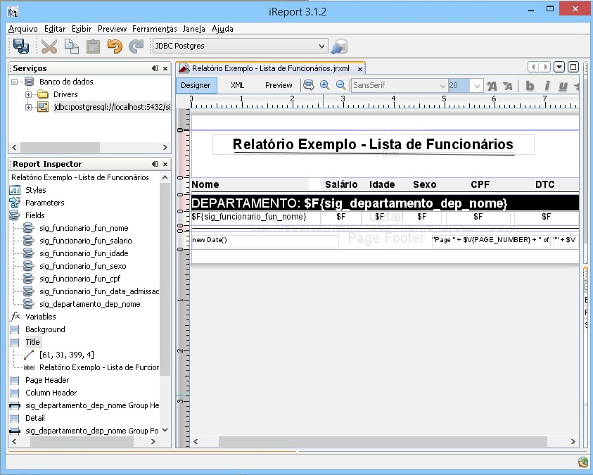

Clique em Preview para visualizar uma prévia do relatório, e visualizar como o mesmo esta ficando.

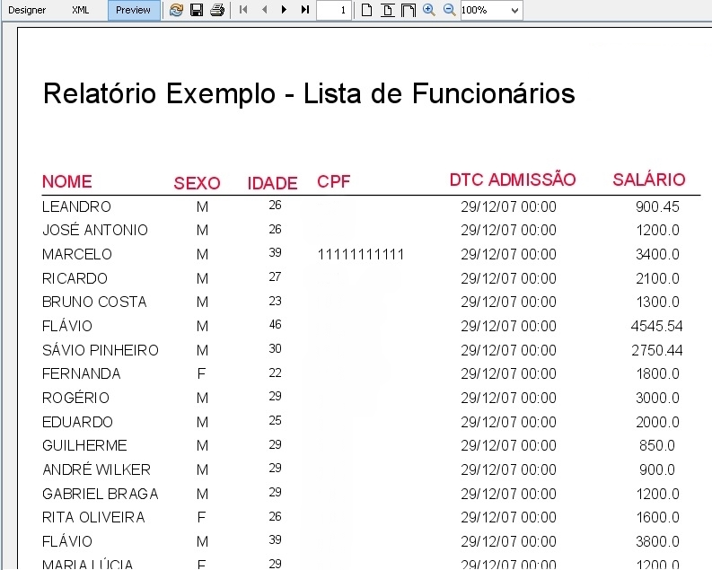

Agrupamentos do Relatório:

Utilizando os conhecimentos acima, poderá ser adicionado um grupo ao relatório. Clique com o botão direito do mouse em report name do Report Inspector ---> Add report Group....
Na tela que abriu, informe o nome do grupo e sua expressão. Marque a opção Iniciar em uma nova coluna. Após a criação do grupo, salve o relatório, observe que será adicionado na área de trabalho
do relatorios os espaços referentes ao header do grupo e o detail do mesmo.

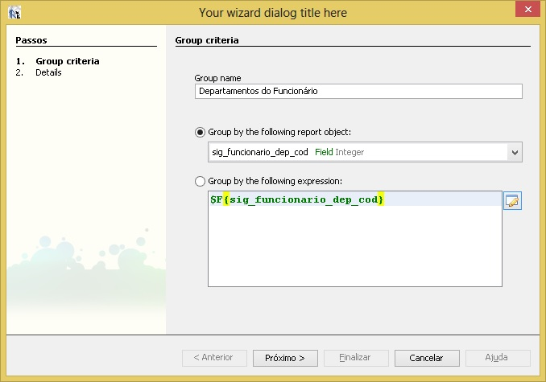

Observação 01: É preciso editar a Query (conforme os passos anteriores) ir em Query designer do Relatório e colocar a expressão order by pra poder funcionar o agrupamento.

- Quando é criado um grupo, são criadas duas novas bandas Nomedogrupo Header e Nomedogrupo Footer.

- Coloque o campo que é passado na expressão do grupo na banda para funcionar com o título do grupo. Após configurar o relatório, salve - o .

Outros recursos:

É possivel criar variáveis, parâmetros, expressões (chave, valor e texto), filtros, gráficos etc e utilizá-los no relatório, clique no
Report Inspector ---> em Variables. Na tela que se abriu, clique em novo. Em propriedades das variaveis informe o nome da variável, seu tipo, o tipo de cálculo e sua variável de expressão.

- Para adicionar a variável no relatório, é só arrastá-la para a banda  e selecionar onde deseja  introduzir . Nesse caso, coloque na banda Ordem Alfabética Footer.

Observação 02: As variáveis criadas devem ter o mesmo tipo dos campos da tabela.

Criando Parâmetro:

Para criar um parâmetro, siga os mesmos procedimentos de criação de variaveis, clique em Report Inspector--->&gt; Adicionar Parâmetro.Em propriedades dos parãmetros informe o nome, o valor-padrão, se tiver, e a descrição.

Observação 03: Os parâmetros criados devem ser do mesmo tipo do campo da tabela.

Observação 04: A montagem do Relatório, também poderá ser feita pelo Wizard, em 7 etapas.

- Para criar um relatório pelo Wizard, clique em Arquivo-->&gt; Report Wizard será aberto uma tela, siga os passos descritos na mesma e o relatório será gerado.

Colocando Filtro no Relatório:

Para colocar um filtro, você terá que modificar no Query do Relatório(passos executados anteriormente). Usando a condição Where, informe que campo receberá o parâmetro. Após essas configurações, salve seu formulário e o execute.
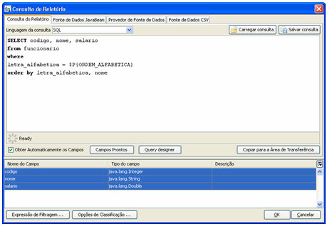

- Ao visualizar, uma tela aparecerá pedindo que informe o campo de pesquisa que deseja filtrar:

Em seguida, o relatório será gerado:

Colocando Gráfico no Relatório:

Selecione o componente e coloque na banda summary.Para este exemplo, vamos utilizar um gráfico do tipo torta, clique com o botão direito em cima dele e, depois, clique em Propriedades do Gráfico, ou de um duplo clique em cima do componente, vá ate a aba Dados do Gráfico e depois Detalhes.

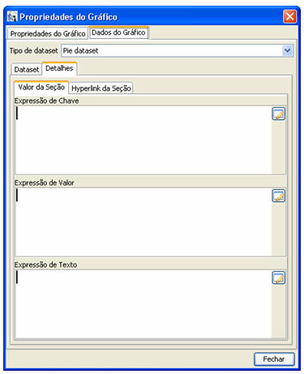

- Expressão de Chave - identifica cada fatia. Ex: $F&#123;letra_alfabetica&#125;
- Expressão de Valor - a variável que criamos. Ex: $V&#123;Valor_Total&#125;
- Expressão de Texto - é o rótulo que será exibido para cada fatia. Ex: $F&#123;letra_alfabetica&#125;

Salve o relatório e o execute, o gráfico se localiza na ultima página do relatório.

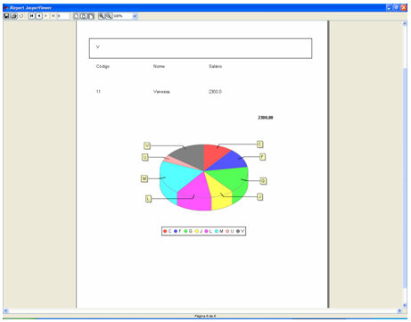

Criando Sub-relatório:

Para a criação do sub-relatório, você deverá escolher o componente e na tela que será aberta clique em finalizar, depois dê um duplo clique no subformulário e navegue até a aba Sub-Relatório (Outros), onde será informado o campo Expressão de Sub-Relatório. o local onde o sub-report. jasper está, ou seja, o seu sub-relatório compilado. Na aba Parâmetro do Sub-Relatório, clique em Adicionar na tela que foi aberta e informe o nome do parâmetro e a expressão.

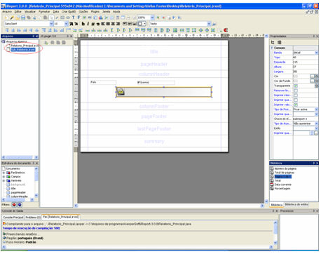

Observe os dois relatórios em destaque criados e o componente de sub-relatório.

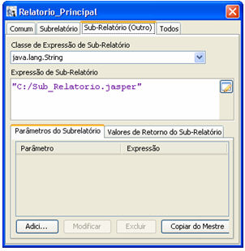

Aba propriedade do sub-relatório (outro).

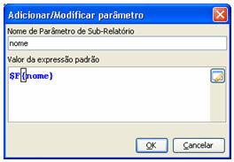

- Navegue para o subrelatório e crie um parâmetro com o mesmo nome e o mesmo tipo do parâmetro feito no formulário mestre. Na tela de consulta do relatório, usando a condição Where, informe o parâmetro;

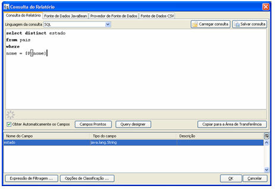

- Depois compile o sub-relatório e navegue para o relatório principal. Em seguida, salve e visualize.

Integrando relátórios em Jasper feitos com o iReports com o MAKER e visualizando-os no Webrun:

Observação Importante::

- A versão atual do iReport suportado pelo Webrun é a 3.1.2. Versões diferentes podem ocasionar erros de compatibilidade (Por exemplo: Relátorio que usa imagens criados no iReport 3.0.0, geram erro, quando gerado no formato PDF)"

Para visualizar o relatório criado noWebRun crie um relatório vázio pelo Maker e adicione ao menu do sistema.
Este relatório não precisa ter o mesmo nome do relatório criado pelo Ireports. Perceba que ao criar um relatório no Maker ele é salvo na tabela FR_RELATORIO. Executando um Select nesta tabela, teremos o seguinte resultado:

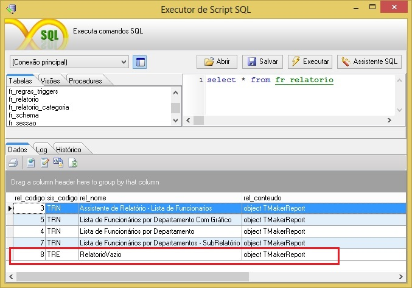

Observações:

- - $F para campos;
  - $V para variáveis;
  - $P para parâmetros;
  - $R para recursos localizados.

Observação 05 geral: A versão atual do iReport suportado pelo Webrun é a 3.1.2. Versões  diferentes podem ocasionar erros de compatibilidade (Por exemplo: Relátorio que usa imagens criados no iReport 3.0.0, geram erro, quando gerado no formato PDF) Como resolução, pode-se tomar um dos caminhos a seguir:

1 - Utilizar a versão 3.1.2 do IReport.

ou

2 - Modificar a biblioteca utilizada pelo Webrun:

1. Remova o arquivo pasta webrun\WEB-INF\lib\jasperreports-3.1.2.jar;
2. Inclua o arquivo correspondente à versão em utilização. Ex.: jasperreports-3.0.0.jar;
3. Reinicie o Webrun.
