Os cálculos são uma parte vital do relatório. O gerador de relatórios do Maker fornece um rico conjunto de componentes e eventos que permitem ao usuário realizar uma vasta gama de cálculos. O componente Campo Calculado, por exemplo, exibe opções para cálculo de média, soma e contagem. Vamos exemplificá-los a seguir.

Observação: A seguinte consulta SQL será utilizada nos exemplos que serão demonstrados abaixo:

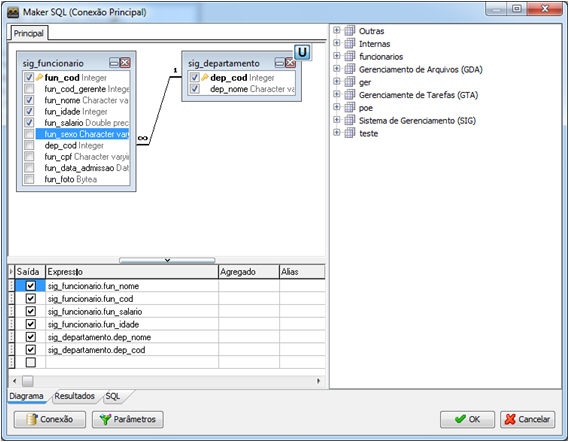

## Contar

Imagine que se deseja contar a quantidade de funcionários por um determinado grupo e apresentar essas informações em um relatório. Para isso basta seguir os passos que serão apresentados abaixo.

Primeiramente deve-se utilizar um relatório com o seguinte layout.

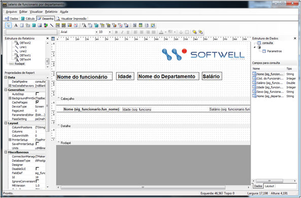

Veja que o relatório utiliza  3 campos texto   com os campos sig_funcioario , fun_idade e fun_salario.

Ao definir o design do relatório, siga os seguintes passos:

1. Defina um grupo para o relatório criado, selecione o menu Relatórios em seguida Grupos...  ou pressione as teclas CTRL+ G e a tela de grupos será aberta.

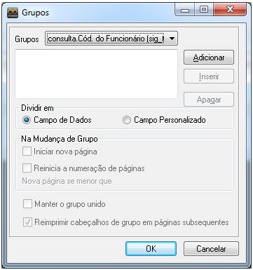

2. Selecione o grupo consulta.Nome(sig_departamento_dep_nome) e clique sobre o botão Adicionar.

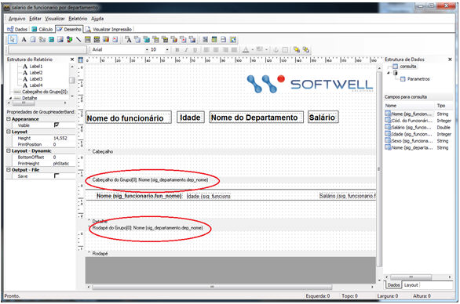

Observe que o Cabeçalho e o Rodapé do grupo foram adicionados.

3. Selecione um componente Campo Texto  e adicione no cabeçalho do grupo, em seguida selecione o campo dep_nome

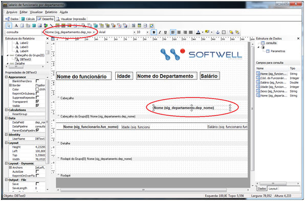

4. Selecione um componente Campo Calculado  e insira-o na frente do nome do funcionário, em seguida execute um clique com o botão direito sobre o mesmo e selecione a propriedade Cálculos....

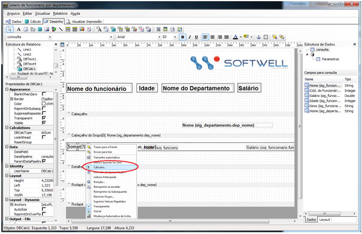

5. Ao ser selecionada a propriedade Cálculos, a tela Cálculos será aberta. Selecione o Tipo de Cálculo Contar e o Grupo para Reinício selecione Grupo [0]: Nome (sig_departamento.dep_nome) e selecione OK.

Observação: É muito importante a criação do grupo, pois é através dele que o componente Campo Calculado se baseará para realizar os cálculos necessários.

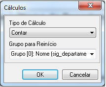

6. Visualize o relatório.

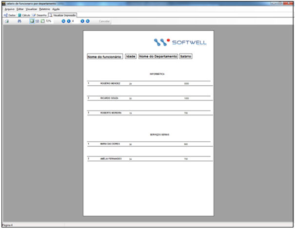

## Total de um grupo

O total de um grupo pode ser facilmente calculado. Para isso basta pôr um componente Campo Calculado  na faixa do rodapé do grupo, fazendo com que o componente obtenha sua referência através do mesmo.

Primeiramente nosso relatório terá o seguinte layout

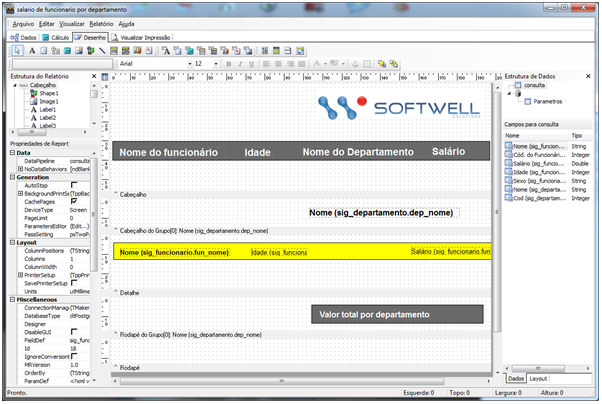

Observe que o grupo adicionado é o mesmo do exemplo anterior.

Depois de ter desenvolvido o layout é hora de adicionar o componente que calculará a soma do salário de todos os funcionários por departamento.

1. Selecione o componente Campo Calculado  , localizado na barra de ferramentas e adicione no Rodapé do Grupo, ao lado do Valor total por departamento.

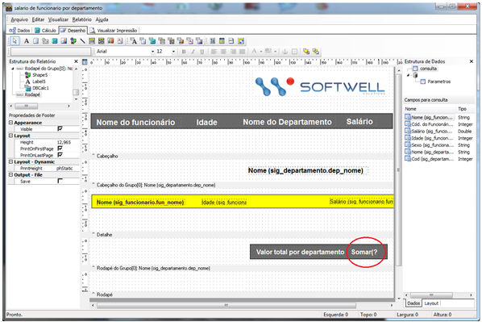

2. Selecione o campo que será calculado, no nosso exemplo será fun_salario.

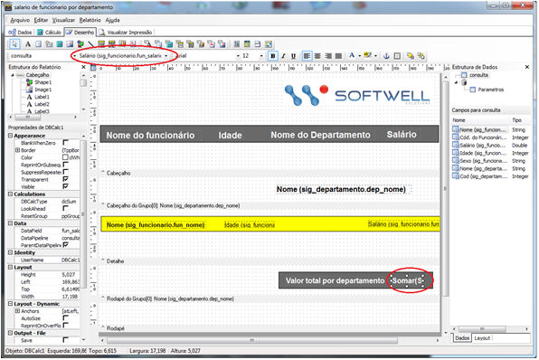

3. Clique com o botão direito sobre o componente e selecione a propriedade Cálculos...

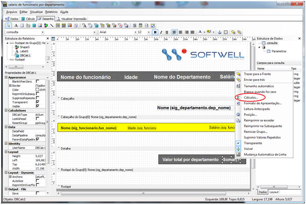

4. Ao ser selecionada a propriedade Cálculo a tela Cálculos será aberta na propriedade Cálculos selecione Somar e no Grupo para reinicio selecione Grupo [0]: Nome (sig_departamento.dep_nome) e clique no botão OK.

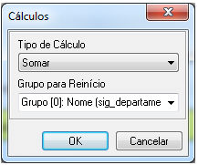

5. Visualize o relatório e observe que a soma do salário de todo o grupo será apresentada.

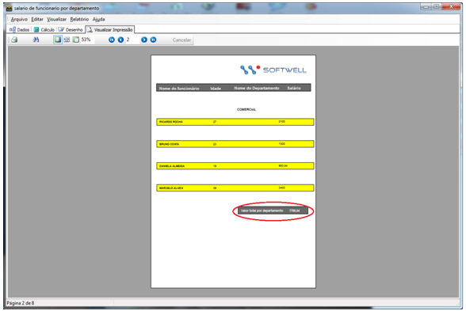

## Grande total

Para adicionar o total de todos os grupos, basta seguir os mesmos passos do item anterior, mas na hora adicionarmos o componente Campo Calculado  na região do grupo, adicionaremos na região Rodapé.

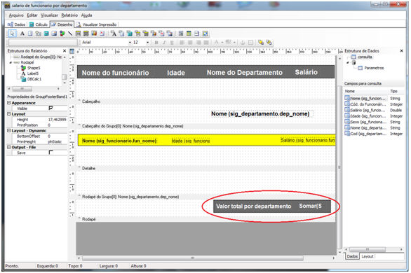

Observe que o total de salário de todos os grupos será apresentado.

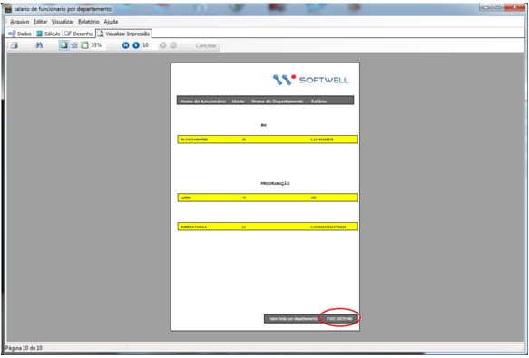

## Soma Acumulativa

Para adicionar o total de todos os grupos, basta seguir os mesmos passos do item anterior, mas na hora adicionar o componente Campo Calculado  na região do grupo, adicionaremos na região Detalhe.

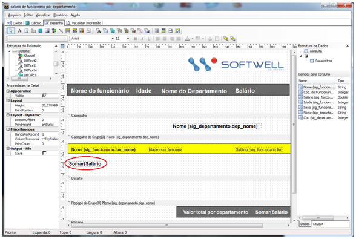

Observe que a soma do salário será acumulativa, somando o salário a cada funcionário.

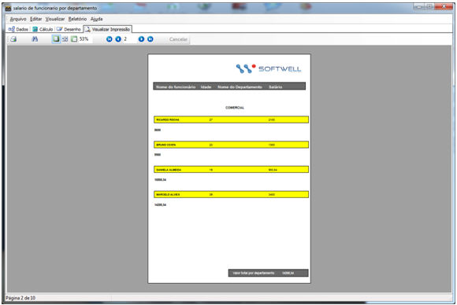

## Total de um Grupo em um cabeçalho

Para adicionar o total de um grupo no cabeçalho, seguiremos os mesmos passos do item Total de um grupo, mas adicionaremos o componente Campo Calculado  no cabeçalho do relatório e marcaremos a opção Look Ahead do componente:

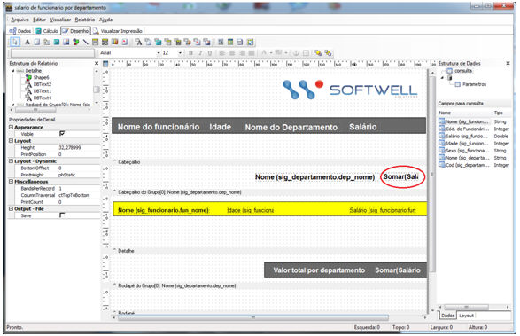

Para adicionar a opção Look Ahead basta clicar sobre o componente e selecionar a opção no canto esquerdo da tela. É muito importante que essa propriedade esteja marcada, para que o cálculo seja antecipado à impressão dos grupos.

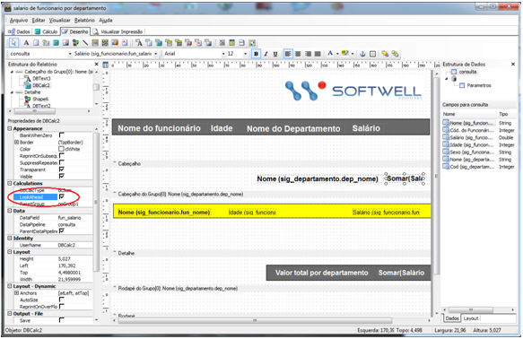

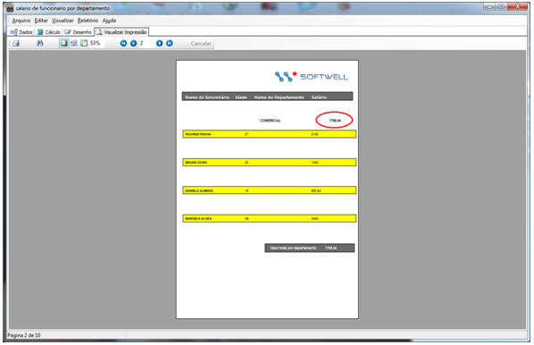
