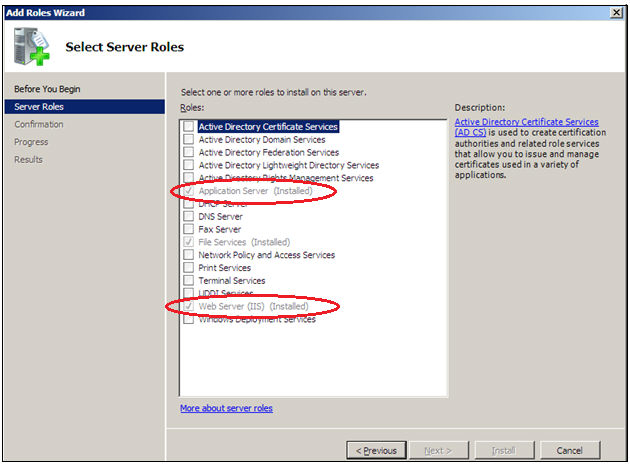
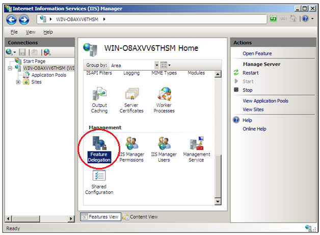
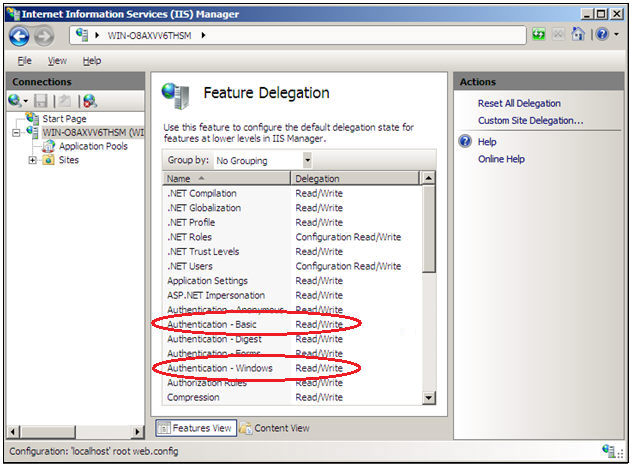

Abaixo seguem os passos para instalação Webrun.NET no Windows Server 2008.

1. Instale os pacotes do Application Server e do Web Server (IIS) para hospedar páginas .net.

2. Instale o Webrun.NET.
3. É necessário definir os tipos de permissões para os usuários autenticados de forma que o IIS permita fazer alterações na pasta de configurações.

