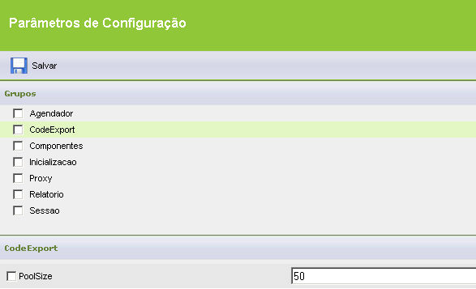

Uma nova implementação foi realizada para melhorar o desempenho de compilação do sistema (geração do WAR/JAR). A partir de agora, há a possibilidade de configurar o número de regras geradas simultaneamente. Por padrão, o Webrun gera 10 regras em paralelo, sendo que este valor pode ser configurado utilizando o parâmetro PoolSize. Cabe lembrar que a utilização deste recurso, aumentará o consumo de memória disponível para o tomcat, com isso sugerimos que [aumente a memória do tomcat](../../webrun_2/servidor_de_aplicacoes/tomcat/alterando_memoria_inicial_maxima_apache_tomcat_windows). Para configurar, utilize o passo a passo abaixo:

1. Dentro de Parâmetros de Configuração do Webrun, adicione um novo grupo, CodeExport:

2. Dentro do novo grupo criado, adicione o parâmetro PoolSize e informe a quantidade de threads que deseja utilizar. Ao configurar este parâmetro, o número de threads deixará de ser o padrão utilizado pelo Webrun, é muito útil para ambientes com poucos recursos de hardware.

3. Após realizar a alteração supracitada, será necessário reiniciar o servidor de aplicações (Tomcat) para que tal configuração comece a entrar em vigor.

Levando em consideração como boas práticas, é recomendado que haja um servidor separado para geração de versões. Isso evitará que a máquina de desenvolvimento influencie no processo de compilação do sistema.
