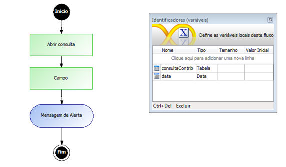
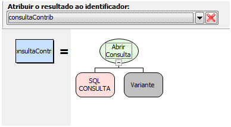
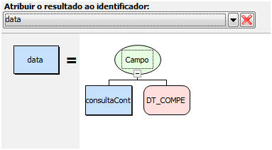
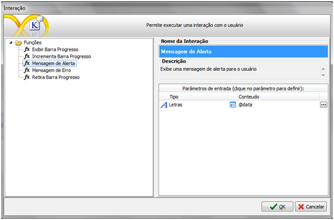

# Problemas com o Fuso horário da aplicação ao obter hora em um campo do tipo data

Ao atribuir um dado contido de um campo de tipo Tabela a uma variavel do tipo Data. A hora será incrementada instantaneamente.

Por exemplo:

Criando um fluxo para obter um campo ( tipo Data) de uma consulta e atribuir a uma variavel do tipo Data.

No processamento Abrir consulta, usa-se a função homônima a este. No primeiro parametro será selecionado a tabela desejada e seus demais campos. Já no segundo parametro será nulo uma vez que consulta será feita na conexão principal. Assim, atribui-se o resultado da consulta numa variavel do tipo tabela.

No processamento Campo, o primeiro parâmetro será a variável do tipo Tabela, resultante do processamento anterior e o segundo parâmetro, o nome do campo cujo tipo é Data. Dessa forma, atribui-se o resultado desse processamento a uma variável do tipo Data.

Na interação, seleciona-se para escrever na tela, a variável obtida através da consulta.

Ao executar o fluxo, é possível perceber que a hora exibida no final de sua execução é automaticamente incrementada. Por exemplo, em vez de escrever na tela 01/11/2009 00:00:00.000, sairá 01/11/2009 01:00:00.000. Isso acontece devido ao fuso horário configurado no computador de aplicação.

Para solucionar este caso será necessário trocar o fuso horário na máquina para outro diferente de (UTC – 3:00) Brasilia, por exemplo, (UTC – 3:00) Caiena , Fortaleza, clicando com a direita no relógio no canto inferior direito da tela – Ajustar data/hora – Alterar fuso horário ...  e selecionar o fuso desejado.
