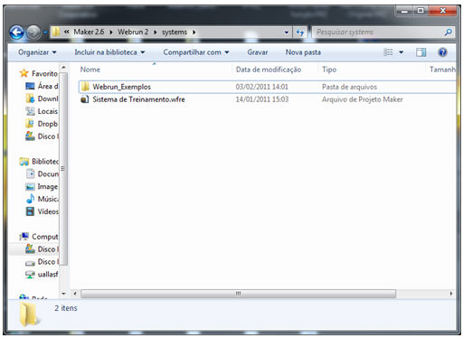
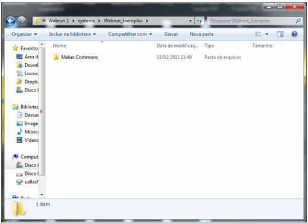
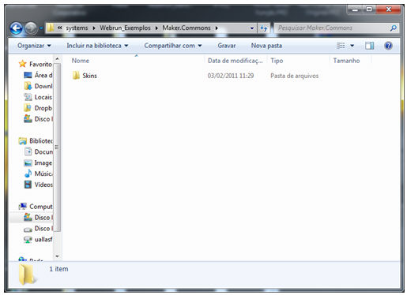
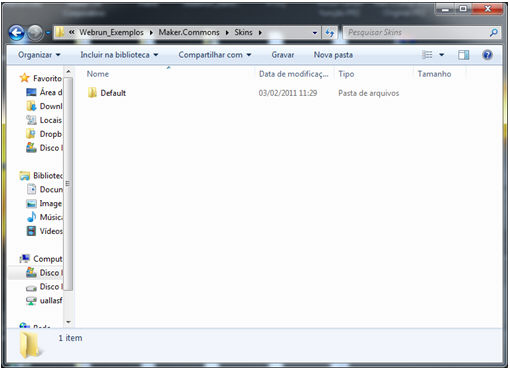
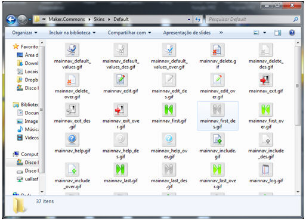
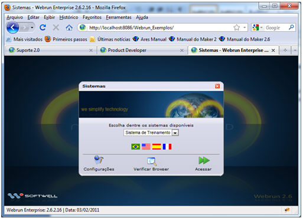
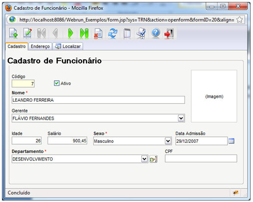

É uma pasta que pode ser criada dentro da estrutura C:\Arquivos de programas\Softwell Solutions\Maker 2.6\Webrun 2\systems, com a função de restaurar componentes personalizados do usuário (estruturas de bibliotecas de terceirtos, applets, imagens e outros).

Nesse exemplo iremos demonstrar como personalizar apenas 1 contexto, mesmo que haja outros na máquina.

Na pasta systems, que se encontra no diretório C:\Arquivos de programas\Softwell Solutions\Maker 2.7\Webrun 2, vamos criar uma pasta com o nome do contexto que queremos atualizar, nesse caso Webrun_Exemplos.

1. Criando pasta Webrun_Exemplos.

Depois de criarmos a pasta Webrun_Exemplos (Nome do contexto), vamos adicionar dentro da mesma a pasta Maker.Commons.

2. Criando pasta Maker.Commons

Dentro da pasta Maker.Commons, vamos colocar as pastas que serão modificadas. Nesse exemplo vamos mexer na pasta Skins, que é uma das pastas que existe no contexto(Webrun_Exemplos).

3. Criando pasta Skins

Dentro da pasta Skins, existe um subpasta com o nome Default.

4. Criando pasta Default

Dentro da pasta Default vamos, colocar os arquivos personalizados, quando reiniciarmos o servidor, todos os arquivos que estiverem dentro dessa pasta serão carregados para todos os sistemas que utilizarem o contexto "Webrun_Exemplos". O nome de cada arquivo deve ser o mesmo do arquivo original, para verificar o nome do arquivo, basta ir até a pasta que será atualizada.

5. Colocando arquivos personalizados na pasta Default

Depois de adicionar os arquivos, pare o serviço do servidor de aplicação, limpe o cache tanto do servidor quanto do browser , levante o serviço do servidor de aplicações e acesse o contexto que nesse caso é Webrun_Exemplos.

6. Acessando o contexto

Para demonstrar os componentes da barra de navegação personalizados vamos utilizar o sistema Sistema de Treinamento formulário Cadastro de Funcionário

7. Mostrando barra de navegação personalizada.

Observação: Caso exista apenas um contexto ou deseja atualizar todos os contextos existentes, a pasta Maker.Commons deve ficar na pastasystems.
