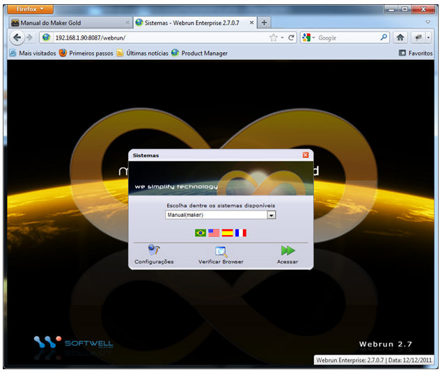
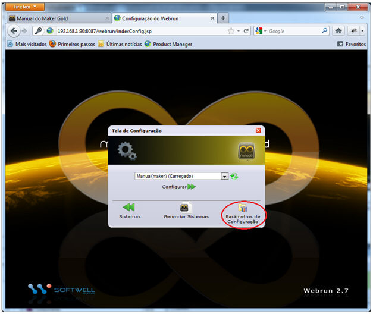
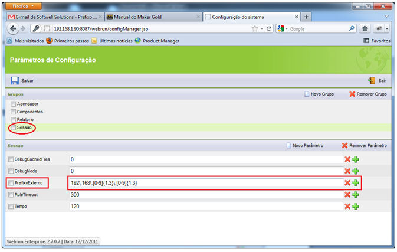
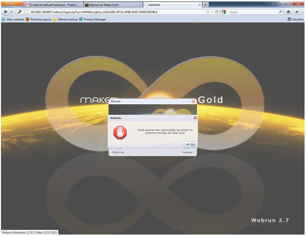

O parâmetro avançado PrefixoExterno é uma propriedade utilizada para definir quais IP's não terão acesso ao Webrun. Abaixo será apresentado uma demonstração de utilização.

Primeiramente, será necessário definir qual sistema irá utilizar o parâmetro, neste exemplo será utilizado o sistema Manual(Maker).

Selecionado o sistema é hora de configurar o parâmetro. Clique em configurações, informe admin para o login, webrun para a senha e selecione Parâmetros de Configuração.

Clique sobre o grupo Sessão e adicione o parâmetro PrefixoExterno.

Ao lado do parâmetro deve ser inserido o ip através de uma expressão regular, (Ex: 192\.168\.[0-9]&#123;1,3&#125;\.[0-9]&#123;1,3&#125;). Neste exemplo serão bloqueadas as tentativas de acesso ao sistema, IP'S que comecem com 192.168.

Informando todos os dados corretamente, clique sobre o botão Salvar e saia da tela de configuração.

Observe que usuários que possuem o ip iniciado por 192.168 ao tentarem logar no sistema, serão bloqueados.

Observações:

1. O usuário não deve ser administrador do sistema. (Administradores possuem acesso independente do parâmetro)

2. No cadastro do usuário o checkbox "Acesso externo" deve estar desmarcado. (Caso esteja marcado, o usuário terá acesso independente de qualquer parâmetro)
