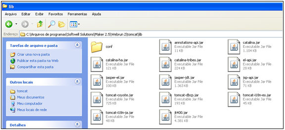
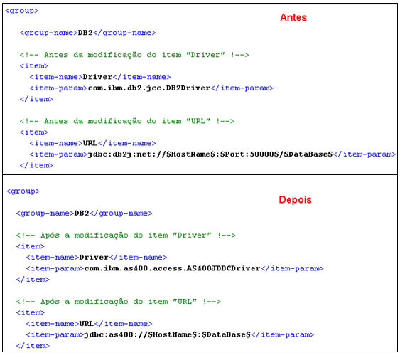
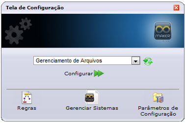
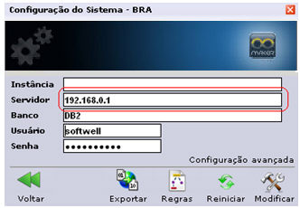

Após os dados [serem exportados para o DB2 AS400](utilizando_o_webrun_com_db2_no_as400#db2_as400_webrun) é necessário configurar o Webrun para acessá-los. Para isso, realize o download do arquivo jt400.jar disponível no link: &lt;http://download.softwell.com.br/webrun/jt400.zip&gt;.

Depois de realizar o download execute os seguintes passos:

1. Coloque o arquivo jt400.jar na pasta ...\ Softwell Solutions\Maker 2.x\Webrun 2\tomcat\lib (diretório padrão)

   
2. No arquivo databases.xml (...\Softwell Solutions\Maker 2.x\Webrun 2\config (diretório padrão)), faça as seguintes modificações:
   1. Localize o grupo DB2 e no item Driver substitua o conteúdo anterior por com.ibm.as400.access.AS400JDBCDriver e no item URL substitua o conteúdo anterior por jdbc:as400://$HostName$:$DataBase$. Veja imagem ilustrativa:

3. Altere o endereço do servidor de banco de dados do DB2 para o DB2 do AS400 nas configurações do Webrun.
   1. Selecione o sistema e clique em  Informe Usuário = admin e Senha = webrun (padrão). Em seguida, a  Tela de Configuração será aberta:

2. Clique em :

3. Altere as configurações do DB2 para o DB2 AS400.

Caso queira utilizar o Webrun de forma interpretada é necessário exportar todas as tabelas FR, caso queira utilizá-lo de forma publicada é necessário exportar somente as tabelas essenciais. Mais detalhes no link [http://suporte.softwell.com.br/maker/manual2_6/pt/dicas_e_truques/exemplo_script_da_publicacao_war_jar.htm](../diversos/exemplo_script_da_publicacao_war_jar).

Observações:

1. Essa informação é referente a conexão do Webrun com o banco DB2 que esteja no AS400.
2. Após as alterações o Webrun irá se conectar com banco DB2 apenas para AS400, não funcionará com outros DB2.
3. Caso queira utilizar a publicação via Jar ou War é necessário realizar as modificações no Webrun descritas anteriormente antes da exportação do Jar/War.
4. O Maker não se conecta com o DB2 AS400, dessa forma é necessário criar o projeto no banco DB2 e realizar a exportação para o DB2 do AS400.
   1. Detalhes sobre como configurar o DB2 para utilização com o Maker no link http://suporte.softwell.com.br/maker/manual2_6/pt/dicas_e_truques/configurando_banco_db2_para_que_possa_ser_utilizado_no_Maker.htm
5. Depois do projeto finalizado exporte as alterações do DB2 para o DB2 AS400. Para a exportação você pode utilizar as ferramentas INFOSPHERE CDC e DB2 CONNECT da IBM.
