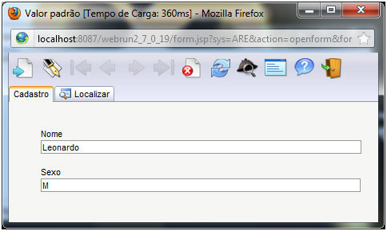
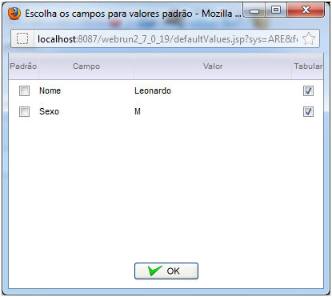
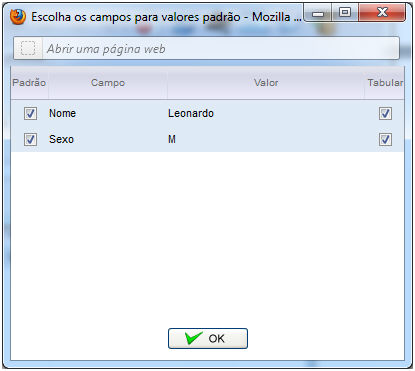
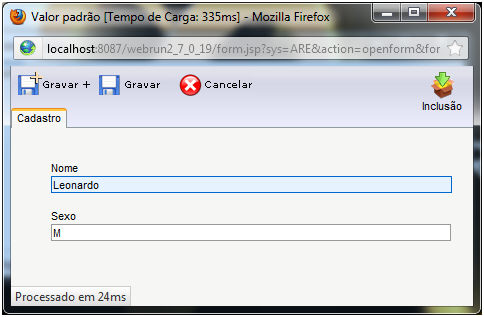
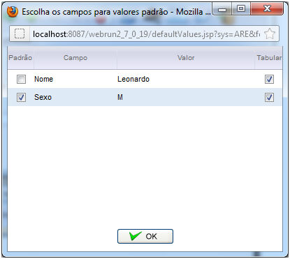
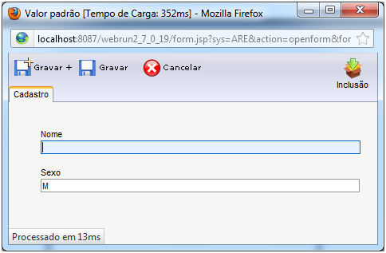

Permite definir valores padrão para o cadastramento de novos registros.

Ao inserir um registro em um formulário, o Webrun habilitará a opção de valor padrão

Ao clicar sobre a opção, o Webrun abrirá a tela com opções para selecionar o campo que terá o valor padrão e a opção de tabulação.

Observe que ao marcar um campo e tentar inserir novamente um dado, o campo marcado trará o valor que foi informado.

E selecionando apenas um campo,  o valor padrão será definido somente a ele.

Observação: O valor padrão só será removido , caso o usuário desmarque a opção na tela de valor padrão ou removendo o conteúdo da pasta saved do Webrun.
