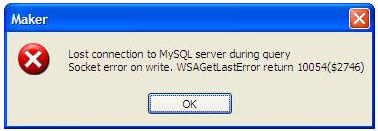
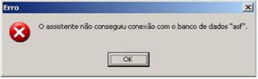
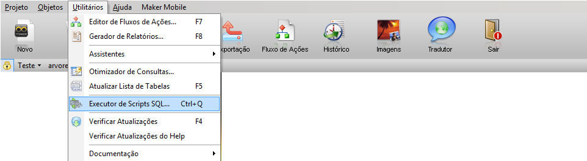
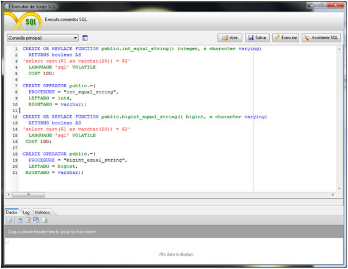

A Softwell Solutions busca através deste guia, apresentar ao usuário uma lista de erros mais comuns no Banco de dados e sua solução. Este tópico estará em constante atualização.

- ## Lost connection to MYSQL server during query socket error on write. WSAGetLastError return 1004($2746)

  

  Para corrigir, defina um novo tamanho máximo para pacotes de dados no servidor através das seguintes opções:

  Primeira opção - por meio da linha de comando de inicialização do servidor:

  shell&gt;mysql--max_allowed_packed=16M

  Segunda opção - por meio da adição de um parâmetro no INI de configuração do servidor:

  [mysqld]

  max_allowed_packet=16M

  ou

  [mysqld]

  set-variable = max_allowed_packet=10240000
- ## O assistente não conseguiu criar o novo banco de dados

  

  Causa: Ocorre porque o Charset Latin1 não está disponível nesta versão do Postgres.

  Solução: Ir até Configurações Avançadas e modificar o parâmetro CharSet de Latin1 para Win1252.
- Ao processar a consulta! Observe se todos os filtros foram passados com valores corretos!

  
- .

  ## No Suitable Driver

  Causa: A mensagem de erro *No Suitable Driver* é apresentada ao tentar acessar no Webrun um projeto criado sobre o banco de dados *Postgres*. O erro é apresentado nas versões anteriores do **Webrun 2.2.0.4**, ao tentar acessar os projetos de exemplos que acompanham o "**Instalador do Maker**" ou um novo projeto no Webrun.

  Solução: Para a correção do erro, acesse a tela Configurações do Sistema no Webrun. No campo Servidor, informe o IP ou o nome do computador no qual está o banco de dados e, no campo Banco, informe o nome do banco de dados. Em seguida, clique no botão  e na sequência, clique em .
- ## Operator does not exist: integer = character varying

  Ao exportar um banco criado no postgres 8.x para a versão 9, poderá apresentar erro de operador de comparação de inteiro com string(varchar), isso ocorre pois as versões do postgres a partir da 8.3 não utilizam charset Latin1 como padrão.

  Executando o script abaixo é possível fazer com que haja uma conversão de tipos, forçando um CAST que converte o valor de um tipo de dado para outro.

  Para executar o script, siga os seguintes passos

  ### Maker

  No projeto selecionado, abra o menu Utilitários, selecione a opção Executor de Scripts SQL... e insira o script abaixo:

  

  

  Script:

  CREATE OR REPLACE FUNCTION public.int_equal_string(i integer, s character varying)
  RETURNS boolean AS
  'select cast($1 as varchar(20)) = $2'
  LANGUAGE 'sql' VOLATILE
  COST 100;

  CREATE OPERATOR public.=(
  PROCEDURE = "int_equal_string",
  LEFTARG = int4,
  RIGHTARG = varchar);

  ---
  CREATE OR REPLACE FUNCTION public.bigint_equal_string(i bigint, s character varying)
  RETURNS boolean AS
  'select cast($1 as varchar(20)) = $2'
  LANGUAGE 'sql' VOLATILE
  COST 100;

  CREATE OPERATOR public.=(
  PROCEDURE = "bigint_equal_string",
  LEFTARG = bigint,
  RIGHTARG = varchar);

  Informado o script , execute-o, salve o projeto e observe que os problemas de conversões de tipos será solucionado.

  Outra solução seria configurar o banco postgres 9.0 para usar o Charset Latin1 como padrão para os novos bancos criados, para efetuar tal configuração acesse o seguinte [link](http://www.postgresql.org/docs/9.1/static/multibyte.html).

  Observação: A partir da versão 2.7.0.10 do Maker o banco ja é criado com o sistema charset Latin1 como padrão.
