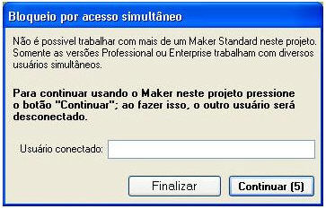

# Bloqueio por acesso simultâneo

Causa: Acesso de 2 ou mais usuários ao mesmo projeto, utilizando o maker Standard.

Solução:

O nome do usuário logado será demonstrado no campo Usuário conectado.

1. Desabilitação de todos os itens do submenu Controle de Acesso do menu Projeto na versão Standard Edition.
2. O usuário com perfil de Administrador ou Gerente pode executar qualquer ação em formulário bloqueado por qualquer usuário, e somente o Administrador poderá desbloquear qualquer restrição criada pelo usuário.
3. Login de acesso automático a projetos desenvolvidos pela versão Standard Edition;
4. Caso o usuário esteja utilizando o Maker no Sistema Operacional Windows Vista e for o administrador da máquina, recomenda-se que abra o executável do Maker com clique direito do mouse e escolha Executar como administrador.
5. Quando um usuário é promovido do status de usuário comum, ícones que deveriam aparecer após a promoção não aparecem. Para resolver o problema, basta reiniciar o Tomcat. Após reiniciar, alguns ícones poderão ser exibidos sobrepostos, portanto será necessário teclar "F4" para reorganizar os ícones.
