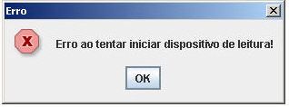

Causa: Ao tentar utilizar o [Identificador Biométrico](http://suporte.softwell.com.br/maker/manual2_6/pt/maker_2/instalacoes/como_instalar_o_servidor_biometrico.htm) no mesmo browser para mais de um sistema que estejam abertos.

Solução: Para que funcione corretamente, é necessário reiniciar o browser antes de acessar novamente o applet do outro sistema.
