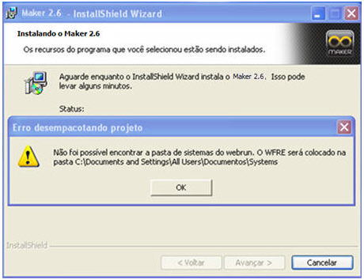
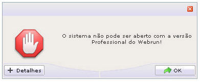
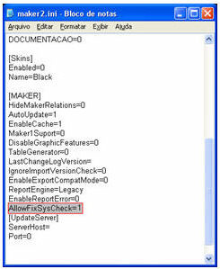
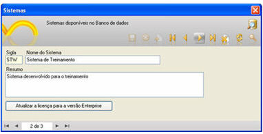
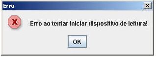

A Softwell Solutions busca através deste guia, apresentar ao usuário uma lista de erros mais comuns no Webrun e sua solução. Este tópico estará em constante atualização.

- ## Não foi possível encontrar a pasta de sistemas do webrun

  

  Causa: Não foi possível encontrar a pasta de sistemas do webrun.

  Solução: Após a conclusão do processo de instalação do Webrun, é necessário copiar a pasta Systems referenciada na mensagem apresentada no parágrafo anterior para a pasta "C:\Arquivos de Programas\Softwell Solutions\Webrun Enterprise" (pasta sugerida para a instalação do Webrun, quando instalado pelo instalador individual).
- ## O sistema não pode ser aberto com a versão Professional do Webrun!

  

  Causa: Isso ocorre, quando o Maker não armazena o valor correto durante a criação do novo projeto.

  Solução:

  Isso ocorre, quando o Maker não armazena o valor correto durante a criação do novo projeto.

  Siga os passos:

  1. Feche o Maker;
  2. Abra o Windows Explorar e acesse a pasta C:\Documents and Settings\&lt;usuário&gt;\Configurações locais\Dados de aplicativos\Softwell Solutions\Maker 2;
  3. Abra o arquivo maker2.ini
  4. Adicione a linha AllowFixSysCheck=1 no agrupamento [Maker]:

  

  5. Salve a modificação executada no arquivo;
  6. Em seguida, por meio do Maker, abra o projeto no qual houve o problema do não reconhecimento da versão e ative o item Lista de Sistemas do menu Projeto. Assim que a tela aparecer, navegue até o sistema no qual houve o problema e clique sobre o botão Atualizar a licença para a versão Enterprise.

  

  7. Por fim, reinicie o Webrun para que este reconheça as novas configurações do projeto.
- ## Acesso duplo utilizando o Identificador Biométrico

  

  Causa: Ao tentar utilizar o [Identificador Biométrico](http://suporte.softwell.com.br/maker/manual2_6/pt/maker_2/instalacoes/como_instalar_o_servidor_biometrico.htm) no mesmo browser para mais de um sistema que estejam abertos.

  Solução: Para que funcione corretamente, é necessário reiniciar o browser antes de acessar novamente o applet do outro sistema.
