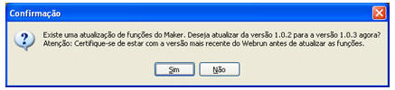
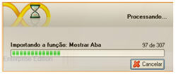

No diretório C:/Arquivos de Programas/Softwell Solutions/Maker 2.7/resource/XX. Onde XX é a lingua em que está a API. Ex: PT (Portugues), EN (Inglês), ES (Espanhol), constam arquivos api_*.frz (que correspondem às atualizações das funções utilizadas no [Editor de Fluxo de Ações](../maker_2/fluxos_e_acoes/editor_de_fluxo_de_acoes).)

Toda vez que carregar um projeto no Maker, será feita uma busca por esse arquivo, verificando se, no diretório, existe uma versão mais atual. Caso encontre, o Maker interage com o usuário para atualização destas funções.

Confirmando o processo, o Maker inicia atualização:

Ao final da atualização, o Maker sugere que o Webrun seja reiniciado.
