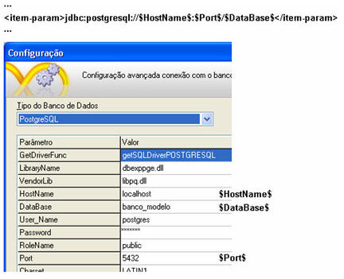

As declarações das chaves de conexão encontram-se nas tags &lt;group&gt;. Este arquivo está composto pelas chaves de conexão com os bancos de dados que o Webrun suporta.

Cada banco de dados possui a sua própria sintaxe de chaves e particularidades nas configurações. O Webrun lê o conteúdo do arquivo *.wfre e substitui as informações nas chaves. Por exemplo:

- Chaves que identificam o driver de conexão:
- - Para PostgreSQL 8.2.5:

  &lt;item&gt;

  &lt;item-param&gt;org.postgresql.Driver&lt;/item-param&gt;

  &lt;/item&gt;

  - Para FireBird:

  &lt;item&gt;

  &lt;item-param&gt;org.firebirdsql.jdbc.FBDriver&lt;/item-param&gt;

  &lt;/item&gt;

  - Para MSSQL:

  &lt;item&gt;

  &lt;item-param&gt;net.sourceforge.jtds.jdbc.Driver&lt;/item-param&gt;

  &lt;/item&gt;

  - Para Oracle:

  &lt;item&gt;

  &lt;item-param&gt;oracle.jdbc.driver.OracleDriver&lt;/item-param&gt;

  &lt;/item&gt;

  - Para MySQL:

  &lt;item&gt;

  &lt;item-param&gt;com.mysql.jdbc.Driver&lt;/item-param&gt;

  &lt;/item&gt;

  - Para DB2:

  &lt;item&gt;

  &lt;item-param&gt;com.ibm.db2.jcc.DB2Driver&lt;/item-param&gt;

  &lt;/item&gt;

  - Para ODBC:

  &lt;item&gt;

  &lt;item-param&gt;sun.jdbc.odbc.JdbcOdbcDriver&lt;/item-param&gt;

  &lt;/item&gt;
- Chaves que identificam a URL de conexão:
- - Para PostgreSQL:
  - &lt;item&gt;

    &lt;item-param&gt;jdbc:postgresql://$HostName$:$Port$/$DataBase$&lt;/item-param&gt;

    &lt;/item&gt;
  - Para FireBird:
  - &lt;item&gt;

    &lt;item-param&gt; jdbc:firebirdsql:$Database$?lc_ctype=$ServerCharSet$&lt;/item- param&gt;

    &lt;/item&gt;
  - Para MSSQL:
  - &lt;item&gt;

    &lt;item-param&gt;:jtds:sqlserver://$HostName$:1433/$DataBase$;charset=iso-8859-1;useLOBs=false;sendStringParametersAsUnicode=false;useCursors=true&lt;/item-param&gt;

    &lt;/item&gt;
  - Para Oracle:
  - &lt;item&gt;

    &lt;item-param&gt;jdbc:oracle:thin:@$DataBase$&lt;/item-param&gt;

    &lt;/item&gt;
  - Para MySQL:
  - &lt;item&gt;

    &lt;item-param&gt;jdbc:mysql://$HostName$/$DataBase$&lt;/item-param&gt;

    &lt;/item&gt;
  - Para DB2:
  - &lt;item&gt;

    &lt;item-param&gt;jdbc:db2j:net://$HostName$:50000/$DataBase$&lt;/item-param&gt;

    &lt;/item&gt;
  - Para ODBC:
  - &lt;item&gt;

    &lt;item-param&gt;sun.jdbc.odbc.JdbcOdbcDriver&lt;/item-param&gt;

    &lt;/item&gt;
- Chave que identifica o usuário:
- O formato é o mesmo para todos os bancos:

  &lt;item&gt;

  &lt;item-name&gt;UserField&lt;/item-name&gt;

  &lt;item-param&gt;User_Name&lt;/item-param&gt;

  &lt;/item&gt;
- Chave que identifica o Servidor:
- - Para Interbase e Firebird:
  - &lt;item&gt;

    &lt;item-param&gt;Database&lt;/item-param&gt;

    &lt;/item&gt;
  - Para MSSQL, Oracle e PostgreSQL:
  - &lt;item&gt;

    &lt;item-param&gt;HostName&lt;/item-param&gt;

    &lt;/item&gt;
- Chave que executa o comando Commit:
- O Webrun abre uma transação para cada vez que o formulário estiver no modo de inserção, exclusão ou edição, e é verificado tudo que ocorreu dentro da transação. Havendo algum erro, é dado um rollback. O parâmetro pode ser configurado com o valor 0 ou 1. Se o valor for 1, significa que toda vez que for feita alguma transação, o Webrun dará um Commit. Segue abaixo um exemplo que é o mesmo para todos os bancos de dados:

  &lt;item&gt;

  &lt;item-name&gt;AutoCommit&lt;/item-name&gt;

  &lt;item-param&gt;1&lt;/item-param&gt;

  &lt;/item&gt;
- Chave que executa o CommitClausule:
- Significa que a cláusula do Commit (confirmação) fecha todos os Datasets (fonte de dados). Se houver o Retain (reter) vai manter as fontes de dados abertas, nas quais manterão a transação. Este recurso é disponível apenas para FireBird:

  &lt;item&gt;

  &lt;item-name&gt;CommitClausule&lt;/item-name&gt;

  &lt;item-param&gt;COMMIT RETAIN&lt;/item-param&gt;

  &lt;/item&gt;
- Chave que executa o TrimString:
- Caso o driver de conexão do banco de dados coloque caracteres especiais, utilizando o valor 1 para o parâmetro, o Webrun executará TrimString removendo os caracteres especiais (retirando todos os espaços, caracteres de tabulação, quebra de linha no começo e no  final):

  &lt;item&gt;

  &lt;item-name&gt;TrimString&lt;/item-name&gt;

  &lt;item-param&gt;1&lt;/item-param&gt;

  &lt;/item&gt;
- Chave que executa o FetchSize:
- Configura a quantidade de registros para o cash do servidor, quando abrir uma consulta com um formulário. Pega a primeira página de dados do servidor que fica guardada na memória. Este parâmetro é disponível para todos os bancos de dados:

  &lt;item&gt;

  &lt;item-name&gt;FetchSize&lt;/item-name&gt;

  &lt;item-param&gt;100&lt;/item-param&gt;

  &lt;/item&gt;
- Chave que executa o TimeOut:
- Solicita uma conexão de abertura de um formulário. O Webrun fica tentando abrir, aguardando até que o banco de dados retorne com os dados. Por padrão, vem com o valor 1, significando que fica aguardando indefinidamente até que o banco de dados retorne com algum erro. Este parâmetro é utilizado para todos os bancos de dados:

  &lt;item&gt;

  &lt;item-name&gt;TimeOut&lt;/item-name&gt;

  &lt;item-param&gt;-1&lt;/item-param&gt;

  &lt;/item&gt;
- Chave que executa o Generator:
- - O caractere @ que é colocado na frente do Valor-Padrão ou no Dicionário de Dados. É detectável pelo Webrun, que será obtido pelo URL, ao inserir do formulário:
  - Para PostgresSQL
  - &lt;item&gt;

    &lt;item-name&gt;Generator&lt;/item-name&gt;

    &lt;item-param&gt;SELECT NEXTVAL('$generator$')&lt;/item-param&gt;

    &lt;/item&gt;
  - Para FireBird
  - &lt;item&gt;

    &lt;item-param&gt;SELECT GEN_ID($generator$,1) FROM RDB$DATABASE&lt;/item-param&gt;

    &lt;/item&gt;
  - Para MSSQL
  - &lt;item&gt;

    &lt;item-param&gt;DECLARE @AUTOINC INT EXEC SP_GEN_ID '$generator$', 1, @AUTOINC OUT SELECT @AUTOINC&lt;/item-param&gt;

    &lt;/item&gt;
  - Para Oracle
  - &lt;item&gt;

    &lt;item-param&gt;SELECT $generator$.NEXTVAL FROM dual&lt;/item-param&gt;

    &lt;/item&gt;
  - Para DB2
  - &lt;item&gt;

    &lt;item-param&gt;SELECT NEXTVAL FOR $generator$ FROM SYSIBM.DUAL&lt;/item-param&gt;

    &lt;/item&gt;
- Chave que executa o ExceptionPrimaryKey:
- - Na identificação do PrimaryKey, é verificado por exemplo, se existe outro usuário com o mesmo ID. Caso o banco de dados seja diferente do idioma inglês, será necessário que faça alteração:
  - Para PostgresSQL
  - &lt;item&gt;

    &lt;item-name&gt;ExceptionPrimaryKey&lt;/item-name&gt;

    &lt;item-param&gt;unique constraint&lt;/item-param&gt;

    &lt;/item&gt;
  - Para FireBird
  - &lt;item&gt;

    &lt;item-param&gt;violation of PRIMARY&lt;/item-param&gt;

    &lt;item-param&gt;UNIQUE KEY&lt;/item-param&gt;

    &lt;/item&gt;
  - Para MSSQL
  - &lt;item&gt;

    &lt;item-param&gt;Violation of PRIMARY&lt;/item-param&gt;

    &lt;item-param&gt;duplicate key&lt;/item-param&gt;

    &lt;item-param&gt;UNIQUE KEY&lt;/item-param&gt;

    &lt;/item&gt;
  - Para Oracle:
  - &lt;item&gt;

    &lt;item-param&gt;ORA-00001&lt;/item-param&gt;

    &lt;item-param&gt;ORA-01400&lt;/item-param&gt;

    &lt;/item&gt;
  - Para MySQL:
  - &lt;item&gt;

    &lt;item-param&gt;Duplicate entry&lt;/item-param&gt;

    &lt;/item&gt;
  - Para DB2:
  - &lt;item&gt;

    &lt;item-param&gt;DB2 SQL error: SQLCODE: -803&lt;/item-param&gt;

    &lt;/item&gt;
- Chave que executa o ExceptionForeignKey;
- - Identificação do ForeingKey é verificado, por exemplo, se existe outro usuário com o mesmo ID. Caso o banco de dados seja diferente da língua inglesa será necessário que faça alteração no arquivo.
  - Para PostgresSQL:
  - &lt;item&gt;

    &lt;item-name&gt;ExceptionForeignKey&lt;/item-name&gt;

    &lt;item-param&gt;foreign key constraint&lt;/item-param&gt;

    &lt;/item&gt;
  - Para FireBird:
  - &lt;item&gt;

    &lt;item-param&gt;violation of FOREIGN KEY&lt;/item-param&gt;

    &lt;/item&gt;
  - Para MSSQL:
  - &lt;item&gt;

    &lt;item-param&gt;REFERENCE constraint&lt;/item-param&gt;

    &lt;item-param&gt;FOREIGN KEY constraint&lt;/item-param&gt;

    &lt;item-param&gt;COLUMN REFERENCE constraint&lt;/item-param&gt;

    &lt;item-param&gt;foreign key constraint&lt;/item-param&gt;

    &lt;/item&gt;
  - Para Oracle:
  - &lt;item&gt;

    &lt;item-param&gt;ORA-02291&lt;/item-param&gt;

    &lt;item-param&gt;ORA-02292&lt;/item-param&gt;

    &lt;/item&gt;
  - Para MySQL:
  - &lt;item&gt;

    &lt;item-param&gt;foreign key constraint&lt;/item-param&gt;

    &lt;/item&gt;
  - Para DB2:
  - &lt;item&gt;

    &lt;item-param&gt;DB2 SQL error: SQLCODE: -532&lt;/item-param&gt;

    &lt;/item&gt;
- Chave que executa o AppendSQL4MetaData;
- - Para PostgreSQL:
  - &lt;item&gt;

    &lt;item-name&gt;AppendSQL4MetaData&lt;/item-name&gt;

    &lt;item-param&gt;LIMIT 0&lt;/item-param&gt;

    &lt;/item&gt;
  - Para MSSQL:
  - &lt;item&gt;

    &lt;item-param&gt;FOR BROWSE&lt;/item-param&gt;

    &lt;/item&gt;
  - Para Oracle:
  - &lt;item&gt;

    &lt;item-param&gt;) where (rownum &lt; 1)&lt;/item-param&gt;

    &lt;/item&gt;
  - Para MySQL:
  - &lt;item&gt;

    &lt;item-param&gt;LIMIT 0,0&lt;/item-param&gt;

    &lt;/item&gt;
  - Para DB2:
  - &lt;item&gt;

    &lt;item-param&gt;FETCH FIRST 1 ROWS ONLY&lt;/item-param&gt;

    &lt;/item&gt;
- Chave que executa o ModifySQL4MetaData:
- - Atributo para quando extrair dados de um select. Cada banco tem a sua particularidade para obter informações de metadados. Exemplo: para um banco de dados que tenha 6 mil registros com esse atributo, retorna a nenhum resultado, para não se tornar lento.
  - Para MSSQL:
  - &lt;item&gt;

    &lt;item-name&gt;ModifySQL4MetaData&lt;/item-name&gt;

    &lt;item-param&gt;top 0&lt;/item-param&gt;

    &lt;/item&gt;
- Chave que executa o Autoinc (autoincremento):
- - Para PostgresSQL:
  - &lt;item&gt;

    &lt;item-name&gt;Autoinc&lt;/item-name&gt;

    &lt;item-param&gt;SELECT CURRVAL('$table$_$field$_seq')&lt;/item-param&gt;

    &lt;/item&gt;
- Chave que executa o AutoincSupport:
- - Para MySQL, DB2:
  - &lt;item&gt;

    &lt;item-name&gt;AutoincSupport&lt;/item-name&gt;

    &lt;item-param&gt;1&lt;/item-param&gt;

    &lt;/item&gt;
- Chave que executa o CaseSensitive:
- - Caso tenha essa propriedade, é necessário que o desenvolvedor respeite a particularidade do banco.
  - Para PostgresSQL e FireBird:
  - &lt;item&gt;

    &lt;item-name&gt;CaseSensitive&lt;/item-name&gt;

    &lt;item-param&gt;1&lt;/item-param&gt;

    &lt;/item&gt;
- Chave que executa o SchemaField:
- - Parâmetro do *.Wfre do Schema.
  - Para PostgresSQL:
  - &lt;item&gt;

    &lt;item-name&gt;SchemaField&lt;/item-name&gt;

    &lt;item-param&gt;RoleName&lt;/item-param&gt;

    &lt;/item&gt;
- Chave que executa o Schema:
- - Para a definição de regras de validação, caso o driver não passe como padrão, pode-se configurar o Schema, colocando uma sintaxe SQL para definir.
  - Para PostgresSQL:
  - &lt;item&gt;

    &lt;item-name&gt;Schema&lt;/item-name&gt;

    &lt;item-param&gt;SET search_path=$schema$&lt;/item-param&gt;

    &lt;/item&gt;
- Chave que executa o InsertOnStarSQL4MetaData:
- - Inserir depois da cláusula select.
  - Para Oracle:
  - &lt;item&gt;

    &lt;item-name&gt;InsertOnStarSQL4MetaData&lt;/item-name&gt;

    &lt;item-param&gt;select * from (&lt;/item-param&gt;

    &lt;/item&gt;
- Chave que executa o ConcatOperator:
- - Operador de concatenação.
  - Para MySQL:
  - &lt;item&gt;

    &lt;item-name&gt;ConcatOperator&lt;/item-name&gt;

    &lt;item-param&gt;||&lt;/item-param&gt;

    &lt;/item&gt;

Uma vez instalado o databases.xml, o atualizador automático não o altera, e por isso, é criado o databases.dist para receber as atualizações. Isso ocorre para quando o usuário fizer alguma alteração e queira retornar às configurações.

## CheckSQLCommand no datatabase.xml

Caso o usuário esteja logado e, por algum motivo, a conexão do banco cair, é possível continuar sem necessidade de logar novamente no banco, mas o banco de dados deve estar ativo.

Para que o Webrun restabeleça essa conexão, use "CheckSQLCommand" no databases.xml e defina uma consulta. Por exemplo: para o banco de dados MySQL, "SELECT 1".
