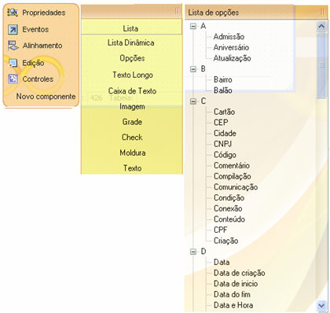

O diretório C:\Arquivos de programas\Softwell Solutions\Maker 2.7\Resources\XX\ contém um arquivo de nome WORDS.DIC.

Este arquivo é um mecanismo de sugestão de nomes do Maker. A partir deste arquivo, os nomes sugeridos dentro dele poderão ser utilizados pelo dicionário de dados.

EX:

>&gt;F

formulario=Formulário

funcionario=Funcionário

foto=Foto

O arquivo está organizado por categorias onde cada uma representa uma letra do alfabeto e suas respectivas palavras. No momento da sincronização do dicionário de dados, os nomes das tabelas e campos terão suas descrições baseadas neste arquivo-dicionário. Por exemplo:

Se uma tabela de nome sig_funcionario for encontrada durante a sincronização do dicionário, será iniciada uma busca pela palavra "funcionario" no arquivo WORDS.DIC, e substituirá a mesma por "Funcionário". É possível adicionar novas palavras ao arquivo manualmente a qualquer momento.

## Sugestão de nomes para Novos componentes

Ao adicionar ou modificar um nome no arquivo WORDS.DIC o mesmo aparecerá na lista de opções de sugestão de nomes para criação de novos componentes, como demonstra a figura abaixo.

Observações:

1. Ao efetuar qualquer alteração no arquivo words.dic, é necessário fechar e abrir o Maker novamente.
2. Se o arquivo for alterado (adicionada ou removida algumas palavras), o atualizador automático do Maker acusará que o arquivo é diferente do existente no atualizador automático e fará o download do mesmo, sobrescrevendo toda a alteração feita.
3. O usuário é responsável por qualquer alteração feita no arquivo, incluso backups do mesmo.
