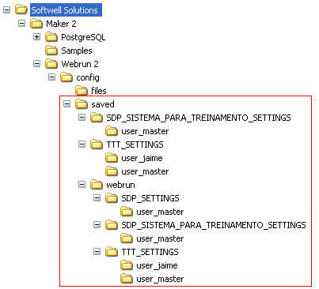

Nesta pasta, são registradas configurações do Webrun, referentes à personalização de Grid, Pesquisas Avançadas, Atalhos. Esta pasta encontra-se em C:\Arquivos de programas\Softwell Solutions\Maker 2.7\Webrun 2\config\saved.

Observe a sequência de pastas abaixo:

Esta pasta é composta por diversas subpastas: pasta de sistemas acessados (inicia com a sigla do sistema, como exemplo SDP_). Quando um sistema possui formulários compostos por grades configuradas por usuários, teremos uma pasta &lt;sigla do sistema&gt;_SETTINGS e, dentro desta, teremos a pasta user_&lt;nome do usuário&gt;, contendo arquivos *.XML:

- advanced_query.xml - são arquivos que configuram Pesquisas Avançadas criadas pelo usuário;
- grid.xml - são arquivos que registram configurações personalizadas para componentes Grades.

Deve-se observar que esses arquivos de configuração são criados para cada usuário. Caso ocorra uma mudança de servidor, por exemplo, para não perder as personalizações, devem-se copiar as pastas contidas em ...\SAVED. Na pasta C:\Arquivos de programas\Softwell Solutions\Maker 2.7\Webrun 2\config\saved\webrun, temos subpastas para os mesmos sistemas registrados no nível acima, contendo subpastas de usuários, armazenando arquivos *.XML das configurações dos atalhos criados, descritos nos arquivos shortcuts.xml.
