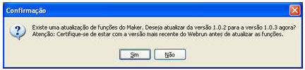
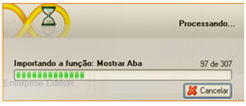

No diretório C:\Arquivos de programas\Softwell Solutions\Maker 2, temos arquivos api_*.frz que corresponde a atualização das Funções utilizadas no Editor de Fluxo de Ações.

Toda vez que carregar um projeto no Maker, será feita uma busca por este arquivo, verificando se no diretório existe uma versão mais atual. Caso encontre, o Maker interage com o usuário para atualização:

Confirmando o processo, o Maker inicia atualização:

Ao final, o Maker sugere que reinicie o Webrun caso esteja em uso.
