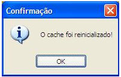

Esta função é utilizada quando adicionamos novas tabelas ou mudamos a estrutura de uma das fontes de dados do sistema em uso no Maker. Ative o menu Utilitários e, neste, a opção . Pode-se utilizar a tecla de função F5. A seguinte mensagem será apresentada:

