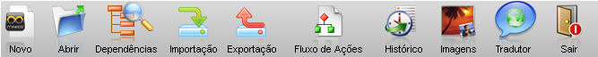

A Barra de Ferramentas do Maker é composta por botões de acesso rápido às principais funcionalidades demonstradas na imagem abaixo:

### Componentes da Barra de Ferramentas

- Novo - abre a tela Assistente de criação de projetos na qual é possível criar um novo projeto em uma nova base de dados ou configurar um novo projeto em uma base de dados já existente;
- Abrir - abre o projeto para o qual o arquivo *.WFRE escolhido está apontando;
- Dependências - abre a tela [Visualizador de Dependências](visualizador_dependencia), permitindo rastrear os objetos dependentes e precedentes do objeto selecionado;
- [Importação](importacao_e_exportacao/importacao) - abre a tela Importação que utiliza arquivos *.FRZ (contendo objetos exportados do mesmo ou de outros projetos);
- [Exportação](importacao_e_exportacao/exportacao) - abre a tela Exportação na qual é possível a criação de um arquivo contendo objetos do projeto;
- [Fluxo de Ações](fluxos_e_acoes/editor_de_fluxo_de_acoes) - abre a janela do Editor de Fluxo de Ações (ferramenta utilizada para a criação de ações e compilações, transformando-as em trechos de código de uma linguagem de programação que tenha sido escolhida);
- Histórico - abre a tela [Histórico de alterações de objetos do sistema](historico/historico_de_alteracoes_de_objetos_do_sistema). Nele podem ser pesquisadas todas as alterações feitas nos objetos (as pesquisas podem ser feitas delimitando um período compreendido entre duas datas ou pelo do nome/login do usuário);
- [Cadastro de Imagens](cadastro_de_imagens/catalogo_de_imagens) - abre a tela Galeria de Imagens. É uma espécie de container de imagens, podendo uma delas, por exemplo, servir de tela de fundo para um sistema;
- [Tradutor](tradutor/tradutor) - ativa a tela Tabela de Tradução permitindo que o desenvolvedor configure o tradutor, para internacionalização de suas aplicações;
- Sair - Sai do Maker.

Observação: Existem restrições para usuários da versão Standard Edition aos itens [Repositório de Objetos](repositorio_objetos/repositorio_objetos), [Importação](importacao_e_exportacao/importacao), [Exportação](importacao_e_exportacao/exportacao) e [Histórico de alterações](historico/historico_de_alteracoes_de_objetos_do_sistema). Para mais detalhes, acesse o tópico [Recursos e Características das Versões do Maker](../recursos_e_caracteristicas_das_versoes_do_maker).
