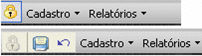
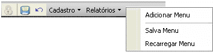
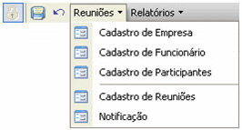

Abaixo da [Barra de Ferramentas do Maker](barra_de_ferramenta_do_sistema) fica a Barra de Menus do Projeto. Nela você pode criar menus, submenus e principalmente vincular atalhos aos diversos objetos do projeto em desenvolvimento.

Detalhamento do Menu

Para que a barra de menu fique em estado editável, clique sobre o cadeado à esquerda da barra (a imagem do cadeado ficará desabilitada  e outros dois componentes se tornarão visíveis  e  - a imagem de um disquete e de uma seta. Ao clicar na primeira imagem, todas as edições feitas na barra de menu serão salvas; quanto à ação executada ao clicar na segunda imagem, todas as edições feitas na barra de menu serão desfeitas).

Para criar menus, coloque a barra de menu em estado de edição e clique com o botão direito do mouse sobre ela (aparecerão as opções Adicionar Menu, Salvar Menu e Recarregar Menu.

A opção :

- Adicionar Menu - abre uma caixa de diálogo para que o usuário informe o título do menu.

Se o usuário clicar em OK, o menu aparecerá na barra de menus automaticamente, caso contrário, nenhuma ação será executada. Cada vez que um menu é criado dessa forma, é inserido à direita dos demais.

- Salvar Menu - clicando sobre essa opção, todas as alterações feitas na barra de menus são salvas. Mesmo que o usuário clique sobre Cancelar (na imagem que é uma seta, conforme descrito anteriormente), as alterações feitas até o momento não serão desfeitas.
- Recarregar Menu - clicando sobre essa opção, todas as operações feitas até o momento imediatamente posterior à ação Salvar Menu são canceladas, visto que não houve confirmação das alterações.

Para criar submenu, é necessário clicar com o botão direito do mouse sobre o menu no qual se quer criar o submenu ou na barra de menus. Em seguida, aparecerão as ações Adicionar Menu Antes, Adicionar Menu Após, Adicionar Menu Dentro, Inicia Grupo, Remover, Renomear, Salvar Menu e Recarregar Menu.

Sobre as opções:

- Adicionar Menu Antes - com esta opção, o menu criado aparecerá automaticamente à esquerda do menu sobre o qual o usuário clicou com o botão direito do mouse.
- Adicionar Menu Após - com esta opção, o menu criado aparecerá automaticamente à direita do menu sobre o qual o usuário clicou com o botão direito do mouse;
- Adicionar Menu Dentro - com essa opção, será criado um submenu dentro do menu ou submenu sobre o qual o usuário clicou com o botão direito do mouse.
- Iniciar Grupo - marcando esta opção, aparecerá uma linha que tem como objetivo separar menus que estejam na mesma árvore, mas que não agrupem atalhos que tratem do mesmo assunto.
- Remover - com esta opção, toda a estrutura de menus, submenus e atalhos criados a partir do item no qual o usuário clicou serão apagados, inclusive o próprio item.
- Renomear - clicando nesta opção, aparecerá uma caixa de diálogo questionando o usuário sobre o novo título que se quer dar ao item
- Salvar Menu - salva as alterações executadas.
- Recarregar Menu - atualiza o contexto do menu.

Criação de Menu - Este vídeo demonstra a criação de menus no projeto.
