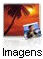
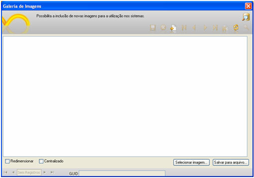

É um container de imagens, podendo uma delas, por exemplo, servir de tela de fundo para qualquer sistema que tenha sido criado na mesma base de dados na qual consta a imagem. Para incluir, excluir ou navegar entre as imagens, o usuário deve utilizar a [Barra de Ferramentas da Tela](../barra_de_ferramenta_do_sistema).

Acesse este recurso por meio do menu Projeto e deste clique em Galeria de Imagens ou pelo botão  da [Barra de Ferramentas do Sistema](../barra_de_ferramenta_do_sistema).

Clicando no botão  (Incluir) e, em seguida, no botão , aparecerá a tela Abrir Imagem, na qual pode ser escolhida a imagem que será gravada (os formatos de imagens passíveis de gravação estão dispostos na caixa de seleção Arquivos do Tipo). Para gravar a imagem selecionada, clique no botão  (Gravar).

Esta tela possui as opções:

- Redimensionar - ajusta a imagem na tela, porém, se a imagem for menor, ficará uma parte fora da área disponível;
- Centralizado - alinha a imagem no centro da área disponível;
- GUID - no momento da inclusão de uma nova imagem nesta tela, será gerado pelo Maker um identificador único;
- Selecionar imagem... - seleciona imagem localizada numa determinada pasta;
- Salva para arquivo - é possível salvar a imagem para o computador.

Ao clicar com o botão direito do mouse na tela Galeria de Imagens (modo Edição), um menu pop-up mostrará as opções ativas/inativas:

- Copiar - copia a imagem que está mostrada na tela Galeria de Imagens (modo Editando);
- Salvar  - salva a imagem com a extensão com o tipo JPEG ou JPG;
- Cortar, Colar, Apagar e Carregar ficam inativas/desabilitadas.

Observação: Não é possível exportar as imagens cadastradas na tela Galetria de Imagens para arquivos com extensão XLS (Microsoft Excel) e TXT(documento texto).
