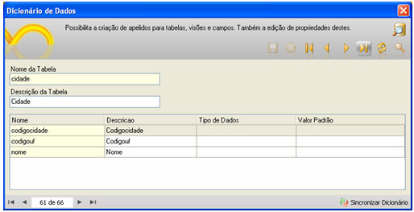

Cabe ao escopo do Dicionário de Dados sugerir uma descrição para nome das entidades (conexão principal e adicionais) e para seus respectivos atributos; cabe também o suporte à tipificação e ao valor padrão para um atributo. Ao acessar esse recurso, clique no botão  para que os campos da tabela apareçam na grade abaixo.

Acesse esse recurso por meio do menu Projeto e deste clique em Dicionário de Dados.

Para navegar e editar os registros, utilize a [Barra de Ferramentas da Tela](../barra_de_ferramenta_do_sistema). São componentes da tela:

- Parte superior da tela:
- nome da Tabela - apresenta o nome das entidades contidas no banco de dados associado à conexão principal e conexões adicionais configuradas no projeto;

- descrição da Tabela - possibilita a criação de uma descrição/apelido para a entidade.

- Da grade da tela:
- Nome - apresenta o nome do atributo;
- Descrição - possibilita a criação de uma nova descrição para o atributo da entidade, a qual é sugerida inicialmente pelo próprio Maker. O valor definido neste campo será utilizado automaticamente para nomear os:
- - campos de pesquisa da aba Localizar dos formulários, quando abertos no Webrun;
  - títulos dos componentes (propriedade Descrição) dos formulários criados pelo [Assistente de Criação de Múltiplos Formulários](../formulario/criacao_multiplos_formularios) ou manualmente.
- Tipo de Dados - vincula uma [Máscara](../mascaras) ao campo da tabela (Exemplo: moeda, cep, etc). Como esta alteração é feita no dicionário de dados, será aplicada a regra para todos os formulários que referenciem o campo, não sendo necessário definir a propriedade "Tipo" para os componentes.

- Valor Padrão - a documentação relativa a esta coluna é idêntica à documentação da coluna [Valor Padrão](../formulario/propriedade_do_formulario#valor_padrao_2_) da aba Valor Padrão e Máscara da tela Definições do Formulário, entretanto, atingindo um escopo global.

Observação: Caso em um determinado formulário/componente queira utilizar um valor diferente definido no escopo global do "Dicionário de Dados", deve-se setar o valor padrão/tipo de dado no formulário e/ou componente.

- Na barra de navegação inferior:

- Sincronizar Dicionário - ao clicar nesse botão, o Maker executa uma nova pesquisa na base de dados e apresenta, além daquelas entidades e atributos que já estavam no Dicionário de Dados, outras possíveis entidades e/ou atributos que tenham sido criados, modificados ou excluídos após a abertura do Maker.

Observação: Após efetuar alguma alteração no Dicionário de Dados, para que ela seja visível no Webrun, é necessário que o projeto seja reiniciado.

Utilizando Dicionário de Dados - esse exemplo demonstra o funcionamento do recurso chamado Dicionário de Dados.
