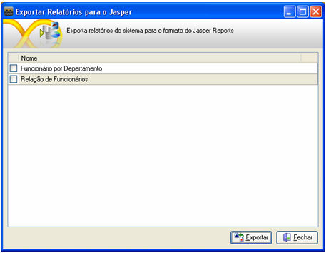

Para que o relatório seja exportado, é necessário ativar a opção por meio do menu Projetos e da tela Configurações, aba Outros* e selecione a opção Conversão dos relatórios para JASPER.

Após ter ativado a opção, no menu Utilitários, clique na opção Exportar relatórios para o Jasper.

Informe o local da exportação. Neste diretório, será criada uma pasta chamada BRIGE e, dentro dessa pasta, será criada outra pasta com a sigla do projeto (tabela FR_SISTEMA, campo SIS_CODIGO) e também serão criadas subpastas numeradas com o código de cada relatório definido na tabela FR_RELATORIO, campo REL_CODIGO do banco de dados do projeto.

Para que se possa proceder às exportações, deve-se ativar a opção por meio do menu Projetos e da tela [Configurações](../configuracao_das_conexoes/configuracoes), aba Outros*, ativar a opção Conversão dos relatórios para JASPER.

Pelo Gerenciador de Objetos, com um clique com o botão direito do mouse sobre qualquer relatório, teremos:

- Exportar para o JASPER: clicando sobre esta opção, será aberta uma janela que permite ao usuário salvar o relatório com a extensão *.JRXML. Relatórios com essa extensão podem ser utilizados em sistemas operacionais Linux e Windows (por meio de um Web Service, por exemplo). Observar que, pelo atalho da [Paleta de Objetos](../paleta_objetos), exporta-se apenas um relatório por vez e este deve ser utilizado quando a estrutura de pastas para a exportação (citada acima) estiver pronta.

Observação: Ao converter um relatório para jasper, alguns componentes podem não funcionar corretamente. Para que todos eles funcionem adequadamente será necessario o uso do [iReport](../../dicas_e_truques/relatorio/utilizando_o_ireport).

Exportando Relatório para JASPER - Este vídeo exemplifica a utilização do recurso de exportação individual de relatórios para o formato JASPER.
