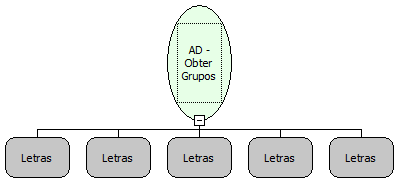

Descrição:

Obtém os grupos do Active Directory.

Parâmetros:

1. Servidor

2. Porta

3. Domínio

4. Usuário

5. Senha

Retorno:

Retorna uma lista contendo os grupos do Acitve Directory. Caso o Servidor ou a Porta estejam incorretos, um erro será lançado.

Exemplo:

Servidor: authserv

Porta: 389

Domínio: SOFTWELL.local

Usuário: maker

Senha: 1

Nome Real:

ebfADGetGroups

Compatibilidade:

Servidor
