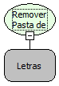

Descrição:

Apaga no servidor a pasta e todo o conteúdo existente na mesma.

Parâmetros:

1. Caminho absoluto da pasta.

Retorno:

Não Possui.

Exemplo:

1. Assumindo que o parâmetro seja "C:\MakerFlow", caso a pasta exista, ela será apagada juntamente com os arquivos existentes em seu contexto e a função retornará "true".

2. Assumindo que o parâmetro seja "C:\MakerFlows", caso a pasta não exista, o retorno será "false"

Observações:

1. Caso seja informado o caminho de um arquivo, a função removerá o arquivo informado no parâmetro.

Nome Real:

ebfFileRemoveFolderAndChildren

Compatibilidade:

Servidor
