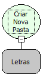

Descrição:

Cria uma nova pasta no servidor.

Parâmetros:

1. Caminho absoluto da pasta.

Retorno:

Verdadeiro, caso toda a estrutura de pastas tenha sido criada. Falso, caso contrário.

Observação:

Caso a pasta definida no primeiro parâmetro exista, a a mesma não será criada.

Nome Real:

ebfCreateFolder

Compatibilidade:

Servidor
