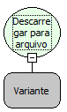

Descrição:

Força a gravação do arquivo em disco, movendo todo o conteúdo que estava na memória para a unidade de armazenamento. Quando a função "adicionar a arquivo" da categoria arquivo é utilizada, por exemplo, a gravação das informações não é feita de forma dinâmica, logo para forçar que o Sistema Operacional grave logo aquelas informações no arquivo, é necessária a utilização dessa função.

Parâmetros:

1. Referência para o arquivo

Retorno:

Não possui.

Exemplo:

Supondo que anteriormente foi armazenado na variável "Arquivo" a referência para determinado arquivo e que foi utilizada a função "Adicionar a arquivo"  para adicionar conteúdos a este arquivo. Ao colocar no parâmetro desta função a variável arquivo, o conteúdo adicionado que está na memória será descarregado para o arquivo.

Observação:

A referência para o arquivo utilizado na função deverá ser para escrita.

Nome Real:

ebfFileFlush

Compatibilidade:

Banco de dados e Servidor
