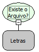

Descrição:

Verifica se existe um arquivo no servidor.

Parâmetros:

1. Caminho absoluto do arquivo

Retorno:

Verdadeiro caso o arquivo exista. Caso contrário, retorna Falso.

Nome Real:

ebfFileExists

Compatibilidade:

Banco de dados e Servidor
