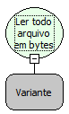

Descrição:

Ler em bytes todo o conteúdo do arquivo passado no parâmetro, mesmo que tenha quebra de linha.

Parâmetros:

1. Variável onde a referência do arquivo foi armazenada. Essa referência é o retorno da função "Abrir arquivo para leitura".

Retorno:

Array de bytes lido. (Variante).

Exemplo:

Assumindo como parâmetro a referência para um arquivo que tem o texto "Maker" , o retorno será [77,97,107,101,114].

Observação:

Antes de utilizar essa função, é necessário utilizar a função "Abrir arquivo para leitura" (Categoria arquivo). Antes de manipular os elementos do array de bytes retornados por esta função utilizando a categoria lista, é necessário utilizar a função "Array para Lista"  da categoria conversão.

Nome Real:

ebfFileReadAllToBytes

Compatibilidade:

Banco de dados e Servidor
