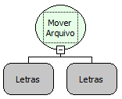

Descrição:

Move o arquivo especificado.

Parâmetros:

1. Caminho absoluto do arquivo original.

2. Caminho absoluto do destino do arquivo.

Retorno:

Verdadeiro caso consiga mover. Caso contrário, retorna Falso.

Nome Real:

ebfFileMove

Compatibilidade:

Banco de dados e Servidor
